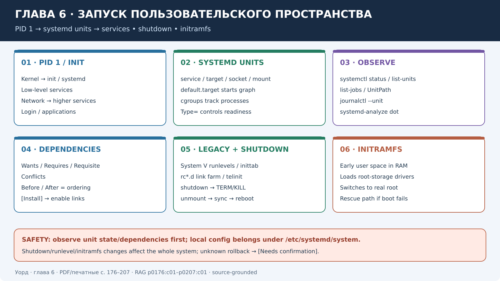
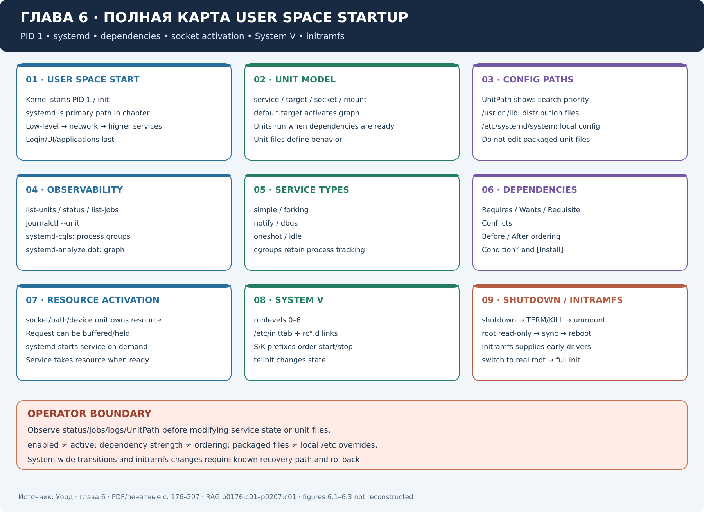

# Глава 6 — Запуск пользовательского пространства

Брайан Уорд — «Внутреннее устройство Linux», 3-е русское издание, 2022.





## Идентификация и readiness

- Book ID: `how-linux-works-brian-ward-3e-ru-2022`; inventory: `0034`.
- Chapter: **6. Запуск пользовательского пространства**; slug: `user-space-startup`.
- Source: `source/book.pdf`; SHA-256 `eee3833ea6ac0fe70268f66076c2ed2bd413b41484bd51d75af7b3ed3ae40ac3`.
- RAG acceptance: **ACCEPTED**, `failed_checks: []`.
- Extraction: `READY_WITH_KNOWN_LIMITATIONS`.
- Source policy: **rag_only**; external web, model-memory completion and direct canonical-PDF reading are not used.

## Chapter boundary

- PDF/printed pages: **176–207** inclusive.
- RAG chunks: **`p0176:c01`–`p0207:c01`**.
- Chunk paths: `rag/chunks/p0101-p0200/p0176-c01.md` … `p0200-c01.md`, then `rag/chunks/p0201-p0300/p0201-c01.md` … `p0207-c01.md`.
- TOC evidence: `p0011:c01`.
- `p0176:c01` begins «6. Запуск пользовательского пространства».
- `p0207:c01` contains §6.9 «Что дальше?» and closes the chapter.
- `p0208:c01` begins chapter 7.
- **Chapter boundary verified: YES.**

## Карта главы

| Раздел | PDF/печатные с. | Содержание |
|---|---:|---|
| Вступление | 176 | Переход kernel → init; порядок запуска user space. |
| 6.1–6.2 | 177–178 | Назначение init; systemd, System V, Upstart; определение используемой init system. |
| 6.3–6.3.4 | 178–186 | systemd units, targets, dependency graph, unit files, variables/specifiers, `systemctl`, jobs. |
| 6.3.5–6.3.6 | 186–191 | cgroups/process tracking, service `Type=`, dependencies `Requires/Wants/Requisite/Conflicts`, ordering, conditions, `[Install]`. |
| 6.3.7–6.3.8 | 191–197 | Socket/path/device activation, resource parallelization, echo-service example, systemd auxiliary components. |
| 6.4–6.5.5 | 197–203 | System V runlevels, `/etc/inittab`, rc scripts/link farm, `run-parts`, `telinit`, compatibility with systemd. |
| 6.6 | 203–205 | Correct shutdown/reboot path, TERM/KILL, unmount, sync, kernel reboot. |
| 6.7 | 205–206 | initramfs: early user space, drivers, real-root handoff, mkinitramfs/dracut. |
| 6.8 | 206–207 | Rescue/live image and single-user/rescue mode. |
| 6.9 | 207 | Что дальше: переход к configuration files and services in chapter 7. |

## Основные идеи

**1. User space starts at PID 1.** Kernel startup hands control to an `init` implementation, which then brings up low-level services, networking, higher-level services and login/application layers. In the chapter's current mainstream path this implementation is systemd (§6 intro–6.2).

**2. systemd models work as units and dependencies, not one long script.** Service, target, socket and mount units form a dependency graph; `default.target` is the high-level entry point. Activation occurs when units are ready rather than strictly serially (§6.3.1–6.3.2).

**3. Configuration ownership matters.** Distribution unit files normally live under `/lib/systemd/system` or `/usr/lib/systemd/system`; local overrides/definitions belong under `/etc/systemd/system`. The chapter explicitly advises against editing distribution-owned unit directories (§6.3.3).

**4. Observation and state change are separated through `systemctl`.** `list-units`, `status`, `list-jobs`, dependency/property views and journal queries are diagnostic. `start/stop/restart/reload`, `daemon-reload`, `enable/disable` change runtime or persistent state (§6.3.4, §6.3.6).

**5. Service readiness and tracking are explicit.** cgroups let systemd associate processes with units. `Type=simple/forking/notify/dbus/oneshot/idle` communicates startup behavior/readiness expectations (§6.3.5).

**6. Dependency strength and ordering are separate concepts.** `Requires`, `Wants`, `Requisite`, `Conflicts` express relationship semantics; `Before` and `After` express order. The chapter emphasizes `Wants` as a resilient default when strict failure propagation is unnecessary (§6.3.6).

**7. Resource activation can parallelize startup.** Socket/path/device units can own or monitor a resource while the service starts, buffering/holding access until the service is ready. The echo.socket/echo@.service example demonstrates socket activation (§6.3.7).

**8. System V remains relevant for compatibility and embedded/old systems.** Runlevels, `/etc/inittab`, rc link farms and `telinit` explain the older sequential model and how systemd can wrap legacy init scripts (§6.4–6.5.5).

**9. Shutdown is an ordered state transition, not a power-cut.** `shutdown` asks init to terminate services, escalates TERM→KILL as needed, unmounts filesystems, remounts root read-only, syncs and finally calls the kernel reboot path (§6.6).

**10. initramfs is early user space.** It solves the dependency problem where drivers/modules needed for the real root filesystem live on storage not yet accessible. Bootloader loads the archive; kernel mounts the temporary RAM filesystem, runs its init, loads what is needed, then switches to the real root and full init (§6.7).

## Главная концептуальная карта

```text
kernel
  ↓
PID 1 / init
  ↓
systemd default.target
  ↓ dependency graph
units: service / target / socket / mount / ...
  ↓
low-level services → networking → higher services → login/apps

Early boot special case:
bootloader → kernel + initramfs → early init → real root FS → normal init
```

Operationally:

```text
identify init system
    ↓
read-only: status / list-units / list-jobs / journal
    ↓
localize unit + dependencies + unit file path
    ↓
change only in /etc/systemd/system
    ↓
daemon-reload / start-restart-enable as required
    ↓
status + jobs + logs
    ↓
keep or rollback
```

This second sequence is an operational synthesis of the chapter, not a universal service-change runbook.

## Артефакты

- [cheatsheet.md](cheatsheet.md) — eight mandatory operational sections.
- [commands.md](commands.md) — source-confirmed systemd/System V/shutdown commands classified by risk.
- [diagram.md](diagram.md) — Mermaid startup graph, dependency semantics, socket activation, shutdown and initramfs.
- [visual-cheatsheet.svg](visual-cheatsheet.svg) — compact visual summary.
- [visual-cheatsheet-detailed.svg](visual-cheatsheet-detailed.svg) — detailed chapter map.
- [summary.md](summary.md) — explicit §6.9 «Что дальше?».
- [source-findings.md](source-findings.md) — source/extraction inconsistencies without silent correction.

## Ограничения

- Figures 6.1–6.3 are not available as independent multimodal RAG objects; diagrams here reconstruct only text-confirmed relationships.
- Actual init implementation, unit paths, service names, dependencies, cgroups, rescue mode and initramfs tooling on a real host are **[Needs confirmation]**.
- The TOC in `p0011:c01` skips subsection **6.3.5**, while the chapter body contains §6.3.5 on PDF 186–188; recorded in `source-findings.md`.
- No source review/control questions are present; `review-questions.md` and `review-answers.md` are omitted.
