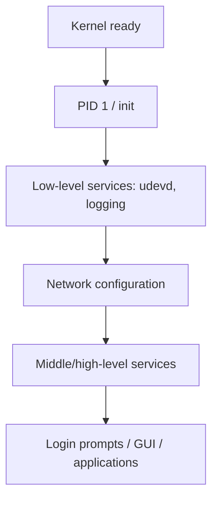
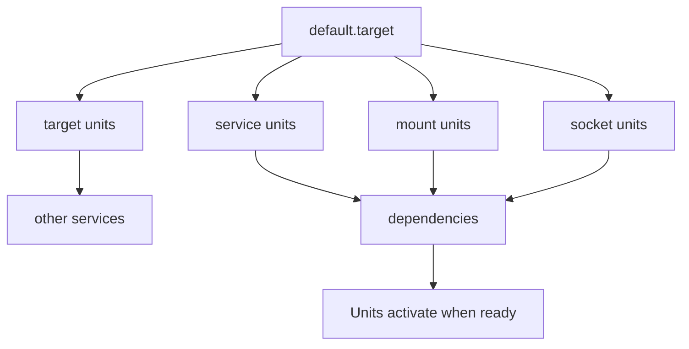
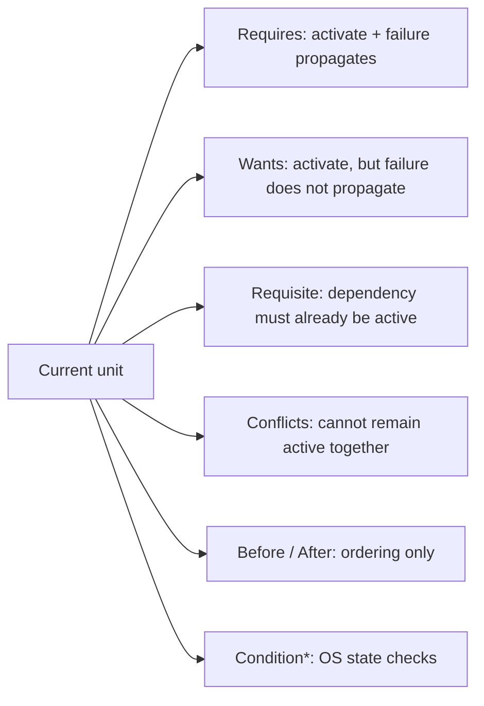
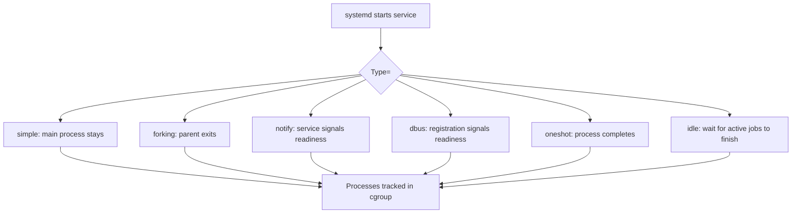
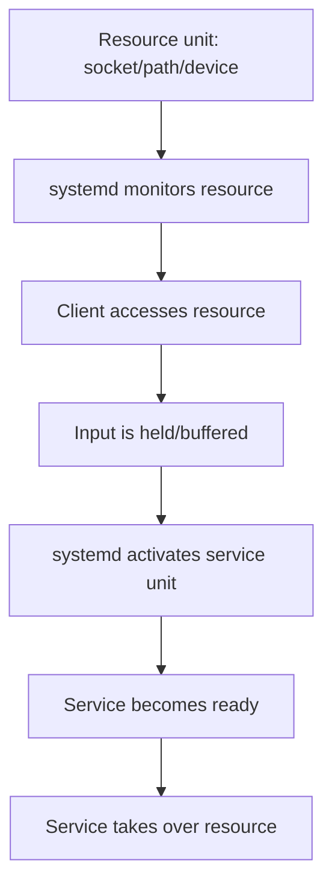
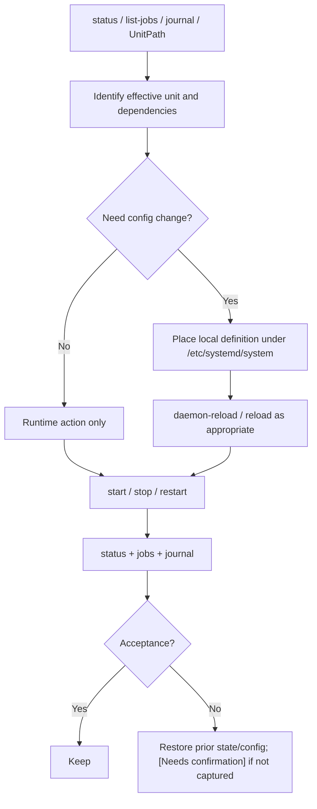
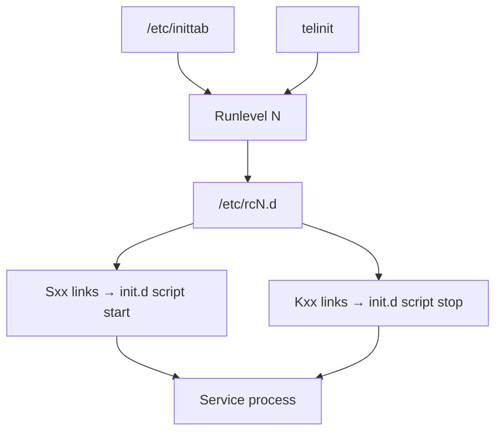
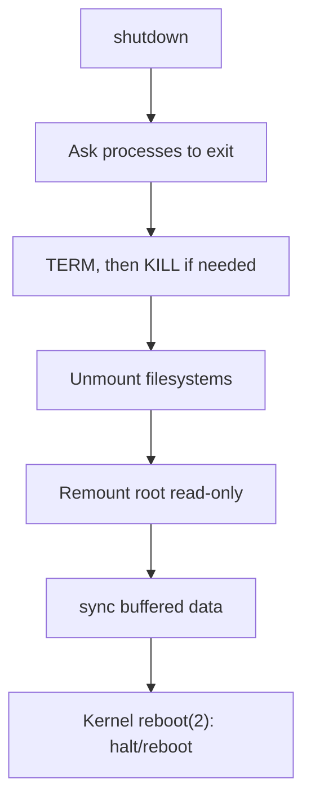
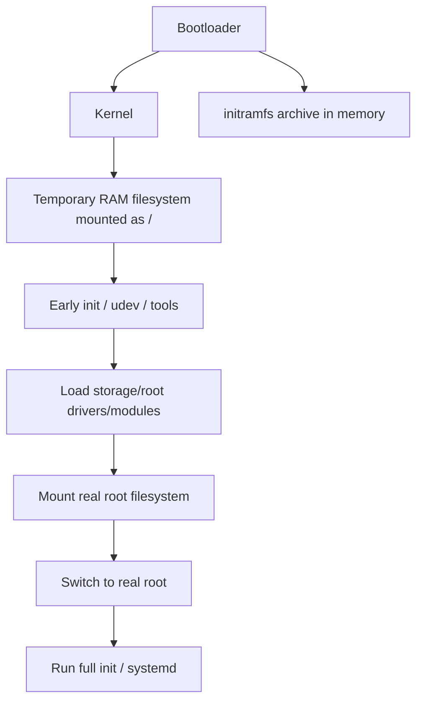

# Mermaid — глава 6 «Запуск пользовательского пространства»

Источник: `p0176:c01`–`p0207:c01`, PDF/печатные страницы 176–207. Диаграммы реконструируют только текстово подтверждённые связи; рис. 6.1–6.3 не копируются.

## 1. Переход kernel → user space

Глава начинает именно с этой последовательности (§6 intro).

## 2. systemd boot graph

Зависимости формируют **граф**, а не простое дерево; systemd не обязана запускать всё строго последовательно (§6.3.1–6.3.2).

## 3. Dependency semantics

Dependency **strength** and **ordering** are separate concepts (§6.3.6).

## 4. Service readiness / tracking

§6.3.5 explains that cgroups give systemd a reliable process hierarchy.

## 5. Socket/resource activation

The echo.socket / echo@.service example shows one concrete socket-activation path (§6.3.7).

## 6. Safe unit-change workflow

This is an operational synthesis of the chapter's rules and commands, not a universal service-management procedure.

## 7. System V init model

System V startup is sequential and link-order driven (§6.4–6.5.4). systemd can wrap legacy scripts for compatibility (§6.5.5).

## 8. Ordered shutdown

§6.6 explicitly warns against power/reset during orderly shutdown.

## 9. initramfs handoff

The purpose is to solve the chicken-and-egg problem where drivers needed for the real root filesystem are themselves stored as files (§6.7).
