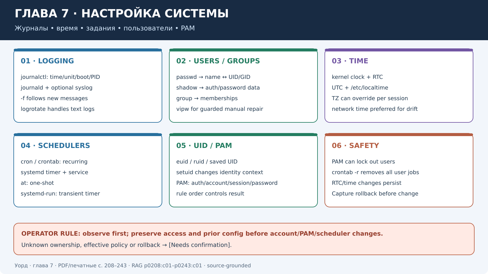
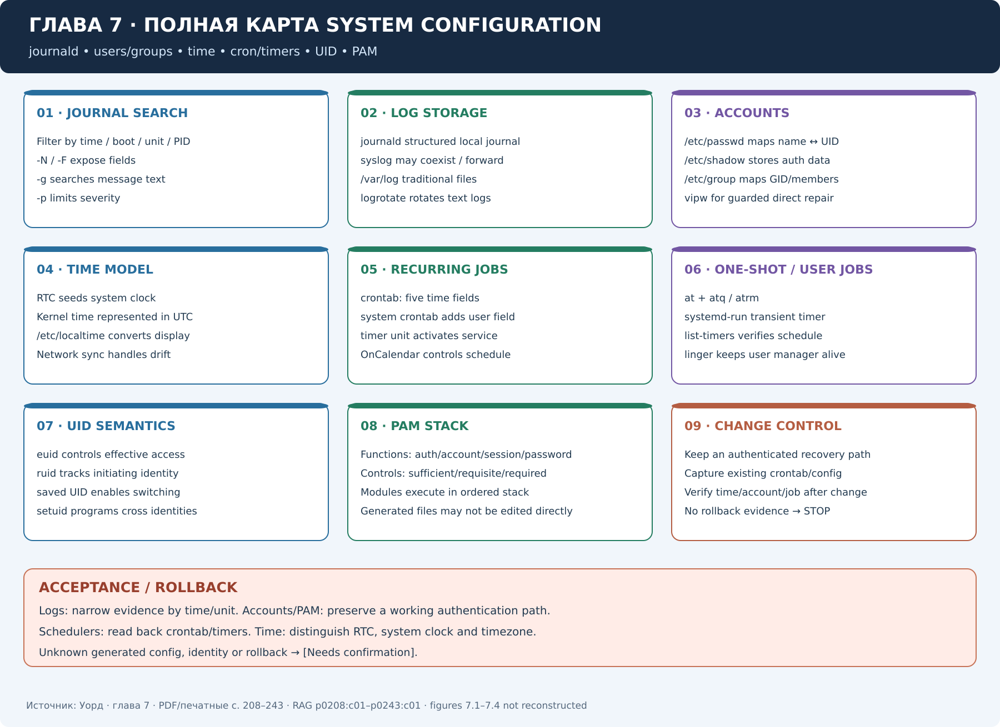

# Глава 7 — Настройка системы: журналирование, системное время, пакетные задачи и пользователи

Брайан Уорд — «Внутреннее устройство Linux», 3-е русское издание, 2022.





## Идентификация и readiness

- Book ID: `how-linux-works-brian-ward-3e-ru-2022`; inventory: `0034`.
- Source: `source/book.pdf`; SHA-256: `eee3833ea6ac0fe70268f66076c2ed2bd413b41484bd51d75af7b3ed3ae40ac3`.
- RAG acceptance: **ACCEPTED**; `failed_checks: []`.
- Extraction status: `READY_WITH_KNOWN_LIMITATIONS`.
- Source policy: **rag_only**; external sources, model-memory completion and direct canonical-PDF reading are not used.
- Chapter: **7. Настройка системы: журналирование, системное время, пакетные задачи и пользователи**.
- Slug: `system-configuration-logging-time-jobs-users`.

## Chapter boundary

- PDF/printed pages: **208–243** inclusive.
- RAG chunks: **`p0208:c01`–`p0243:c01`**.
- TOC evidence: `p0011:c01`–`p0012:c01`.
- `p0208:c01` begins chapter 7.
- `p0243:c01` contains §7.11 «Что дальше?» and closes the chapter.
- `p0244:c01` begins chapter 8 «Процессы и использование ресурсов».
- **Chapter boundary verified: YES.**

## Карта главы

| Раздел | PDF/печатные с. | Содержание |
|---|---:|---|
| Вступление | 208–209 | Конфигурация user space, logging, users, time, periodic jobs. |
| 7.1–7.1.5 | 209–217 | journald/syslog, `journalctl`, filtering, boot logs, severity, rotation, journald retention. |
| 7.2 | 218 | Структура `/etc`, local config vs packaged defaults. |
| 7.3–7.4 | 218–224 | `/etc/passwd`, `/etc/shadow`, groups, account tools, getty/login. |
| 7.5–7.5.2 | 224–226 | System clock, RTC, UTC, timezone, NTP/timesyncd/chronyd. |
| 7.6–7.8 | 226–232 | cron, crontab, systemd timers, `at`, `systemd-run`, user timers/linger. |
| 7.9–7.9.4 | 232–237 | UID switching, ruid/euid/saved UID, identification/authentication/authorization, libc lookup. |
| 7.10–7.10.3 | 237–243 | PAM modules, rule stack, control arguments, config syntax, password modules. |
| 7.11 | 243 | «Что дальше?» — переход к processes/resources in chapter 8. |

## Основные идеи

**1. Logs are the first evidence source.** The chapter explicitly recommends starting troubleshooting with system logs. `journalctl` can filter by PID, time, unit, field, regex, boot and severity; `-f` follows new messages (§7.1.1–7.1.2).

**2. journald and syslog may coexist.** journald is central on systemd systems, while rsyslogd/syslog-ng may also route/store logs. Traditional files under `/var/log` and binary journal storage under `/var/log/journal` are separate mechanisms (§7.1).

**3. Persistent configuration belongs under `/etc`, but ownership matters.** The chapter distinguishes host-specific configurable state from packaged defaults and recommends drop-in/subdirectory approaches where available rather than blindly overwriting distribution-managed files (§7.2).

**4. User names are user-space mappings; the kernel sees numeric IDs.** `/etc/passwd` maps names to UID/GID and account metadata; `/etc/shadow` carries authentication/password-aging data. Direct editing is discouraged; `vipw` is the guarded path when manual repair is unavoidable (§7.3).

**5. Time has multiple layers.** Kernel system time, RTC, UTC representation and timezone conversion are distinct. The source advises network time synchronization rather than manual jumps for drift correction (§7.5).

**6. Repeating and one-shot jobs are separate scheduling models.** cron/crontab handles recurring commands; systemd timers split schedule and service execution; `at` and `systemd-run --on-calendar` cover one-shot scheduling (§7.6–7.8).

**7. Authentication is user-space policy layered over kernel UID mechanics.** Identification, authentication and authorization are different concerns. PAM provides a stack of modules and control rules around functions `auth/account/session/password` (§7.9–7.10).

**8. PAM rule order is executable policy.** `sufficient`, `requisite` and `required` change how failure/success propagates through the stack. Editing PAM without preserving a working authentication path can lock users out (§7.10).

## Main operational map

```text
problem / configuration target
        ↓
read-only evidence
  logs / IDs / current time / crontab / PAM files
        ↓
identify owning subsystem
 journald | users | time | scheduler | PAM
        ↓
make the narrowest supported change
        ↓
verify with the subsystem's own readback
        ↓
keep or rollback
```

This is an operational synthesis of source material, not a vendor-specific production runbook.

## High-risk boundaries

- Do not directly edit `/etc/passwd` or `/etc/shadow` when safer account tools are available; use `vipw` only for justified repair.
- PAM configuration changes can break authentication system-wide; generated PAM files may be overwritten.
- Passwordless/weak-password options such as `nullok` materially affect authentication policy.
- `loginctl enable-linger` changes lifetime semantics of a user's systemd manager.
- Changes to RTC/timezone/schedulers affect future task execution and timestamps.
- Source examples contain literal usernames, dates, ports, UIDs/GIDs and paths that are not valid target-system facts.

## Артефакты

- [cheatsheet.md](cheatsheet.md) — operational workflow and safety boundaries.
- [commands.md](commands.md) — source-confirmed commands/config elements classified by risk.
- [diagram.md](diagram.md) — Mermaid flows for logging, users, schedulers, PAM and UID semantics.
- [visual-cheatsheet.svg](visual-cheatsheet.svg) — compact overview.
- [visual-cheatsheet-detailed.svg](visual-cheatsheet-detailed.svg) — detailed overview.
- [summary.md](summary.md) — explicit §7.11 «Что дальше?».
- [source-findings.md](source-findings.md) — extraction/source anomalies preserved explicitly.

No review/control questions are present in the chapter; `review-questions.md` and `review-answers.md` are omitted.
