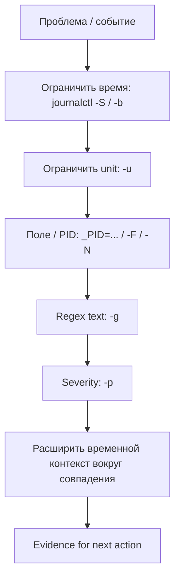
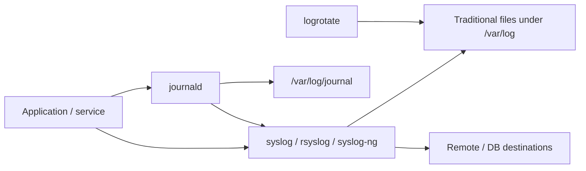
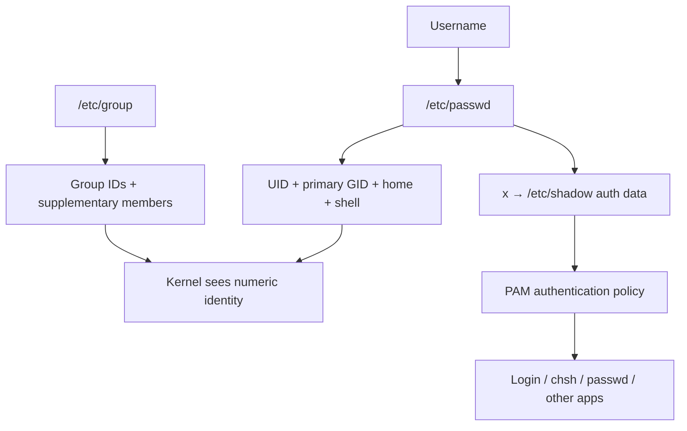
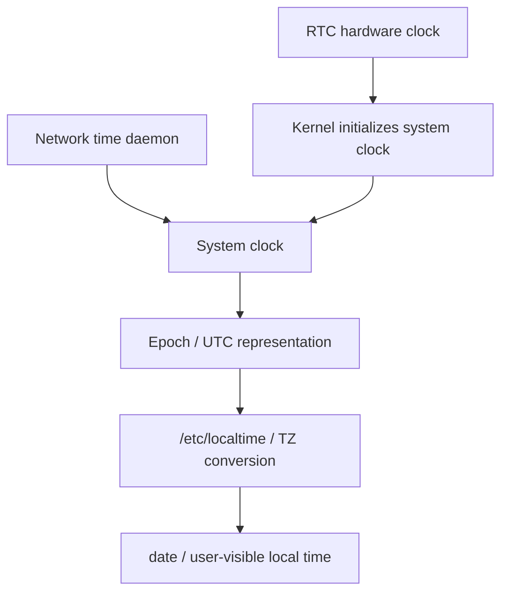
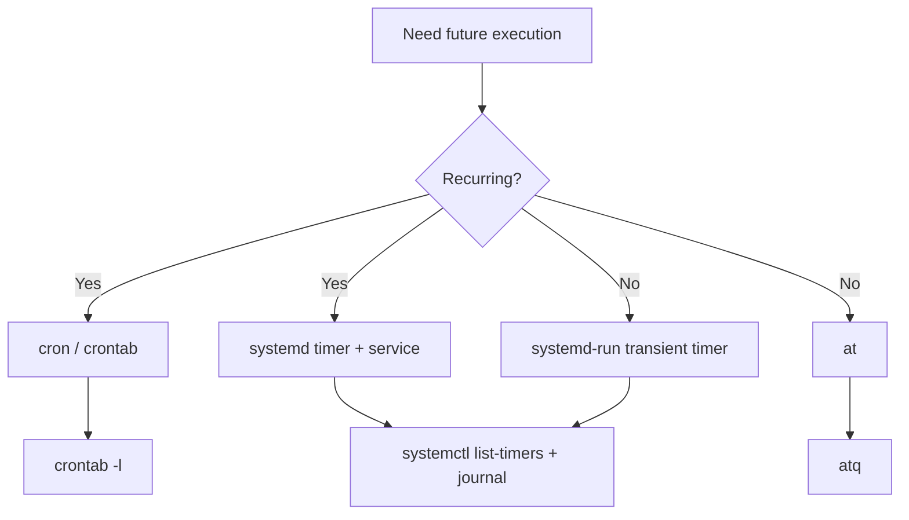
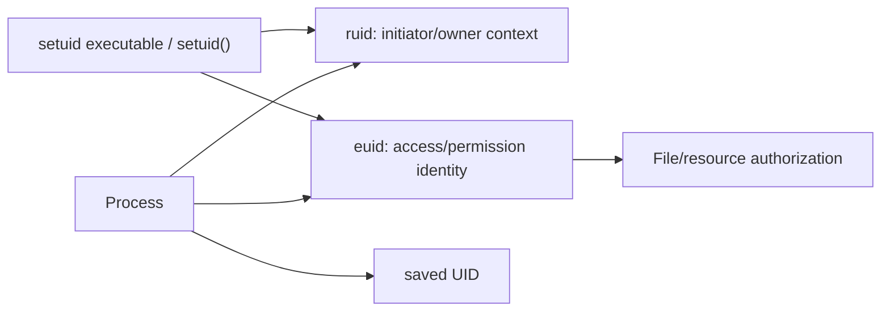
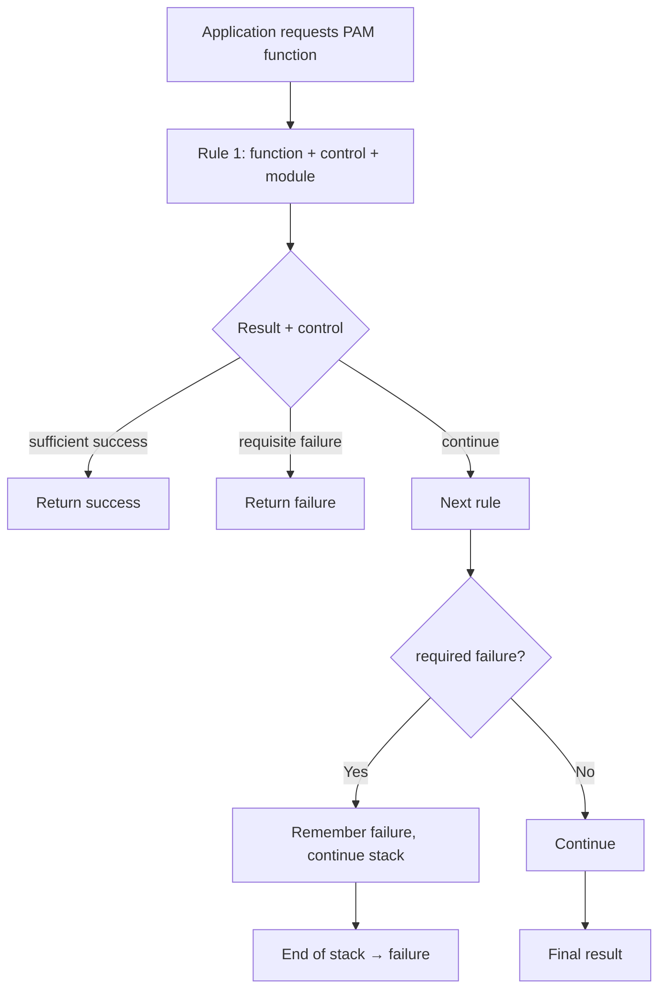
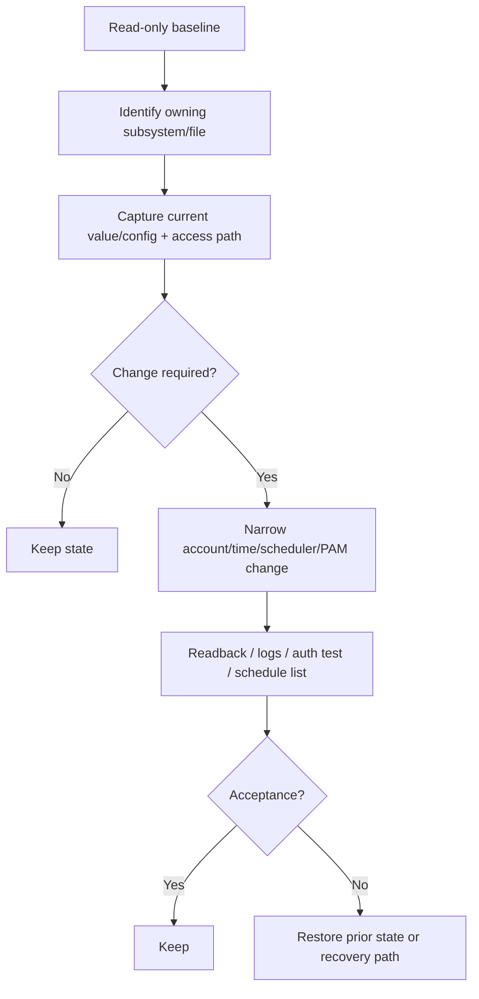

# Mermaid — глава 7 «Настройка системы»

Источник: **RAG `p0208:c01`–`p0243:c01`**, PDF/печатные страницы 208–243. Диаграммы — аналитическое представление текстовых связей главы; оригинальные рисунки 7.1–7.4 не реконструируются.

## 1. Диагностика через journald

Глава прямо рекомендует начинать troubleshooting с журналов и использовать time/unit filters вместо чтения всего потока (§7.1.1–7.1.2).

## 2. Logging stack

journald and syslog may coexist; syslog is historically useful for aggregation, while journald emphasizes structured collection on one host (§7.1.3–7.1.5).

## 3. User/account mapping

Names/password policy live in user space; kernel authorization centers on numeric IDs and setuid transitions (§7.3, §7.9).

## 4. Time layers

Source advises network synchronization for drift instead of abrupt manual correction (§7.5).

## 5. Scheduling choices

cron is simpler/portable; systemd timers add cgroup/process tracking, richer timing/dependencies and journal integration (§7.6–7.8).

## 6. UID semantics

The chapter stresses that names/passwords are user-space concepts; kernel transitions operate on numeric user IDs (§7.9.1–7.9.2).

## 7. PAM stack control flow

The concrete chsh example stacks `pam_rootok.so`, `pam_shells.so`, `pam_unix.so`, then `pam_deny.so` (§7.10.1).

## 8. Safe configuration-change boundary

For PAM/authentication especially, exact generic rollback is not provided by the chapter and must remain **[Needs confirmation]** unless captured before the change.
