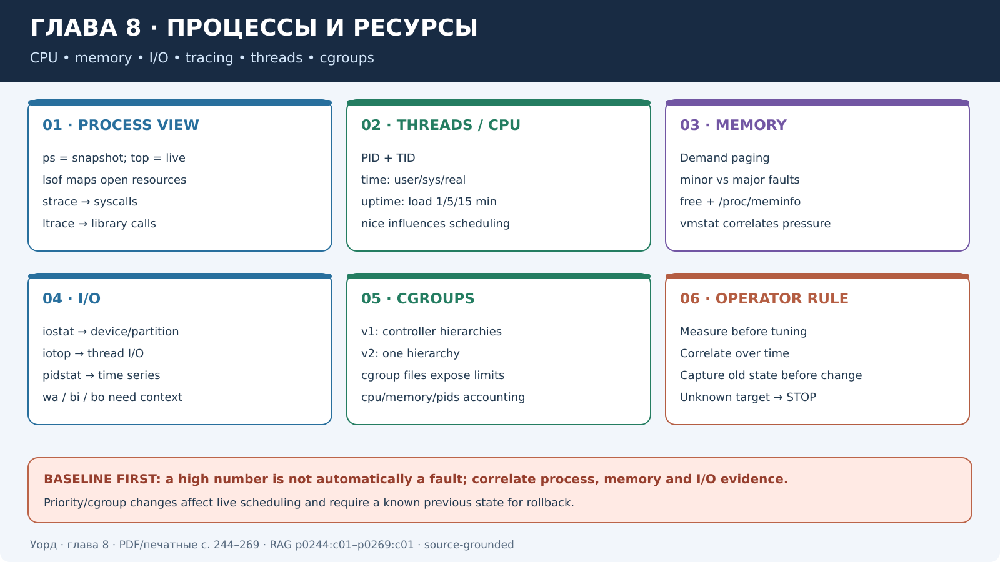
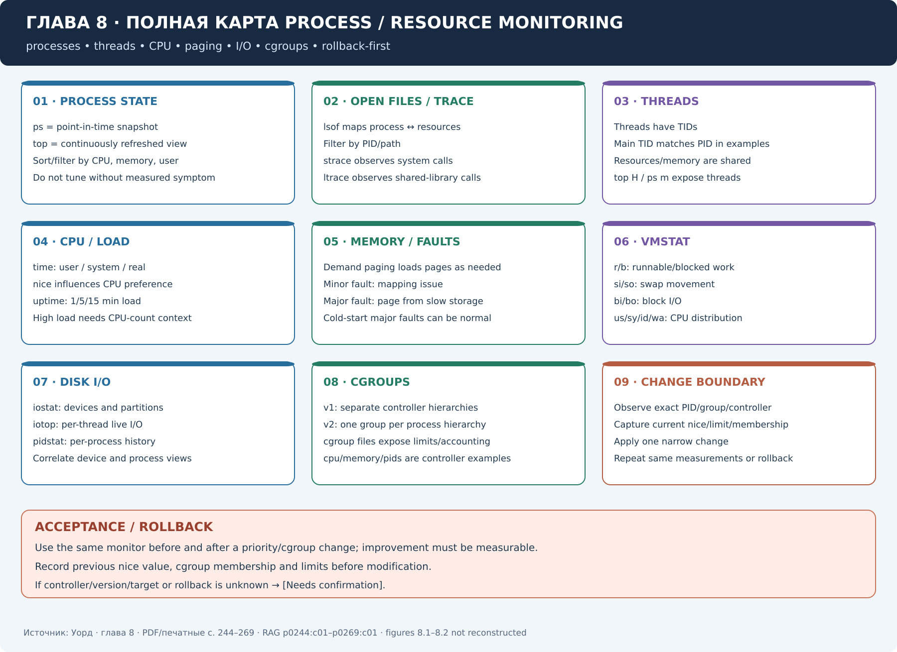

# Глава 8 — Процессы и использование ресурсов

Брайан Уорд — «Внутреннее устройство Linux», 3-е русское издание, 2022.





## Идентификация и readiness

- Book ID: `how-linux-works-brian-ward-3e-ru-2022`; inventory: `0034`.
- Chapter: **8. Процессы и использование ресурсов**; slug: `processes-and-resources`.
- Source: `source/book.pdf`; SHA-256 `eee3833ea6ac0fe70268f66076c2ed2bd413b41484bd51d75af7b3ed3ae40ac3`.
- RAG acceptance: **ACCEPTED**, `failed_checks: []`.
- Extraction: `READY_WITH_KNOWN_LIMITATIONS`.
- Source policy: **rag_only**; external web, model-memory completion and direct canonical-PDF reading are not used.

## Chapter boundary

- PDF/printed pages: **244–269** inclusive.
- RAG chunks: **`p0244:c01`–`p0269:c01`**.
- Chunk path: `rag/chunks/p0201-p0300/p####-c01.md`.
- TOC evidence: `p0012:c01`–`p0013:c01`.
- `p0244:c01` begins chapter 8.
- `p0269:c01` contains §8.7 «Дополнительно» and closes the chapter.
- `p0270:c01` begins chapter 9 «Сеть и ее конфигурация».
- **Chapter boundary verified: YES.**

## Карта главы

| Раздел | PDF/печатные с. | Содержание |
|---|---:|---|
| Вступление, 8.1 | 244–245 | CPU, memory, I/O as contested resources; process observation with `top`. |
| 8.2–8.2.2 | 245–247 | Open files/resources and process correlation with `lsof`. |
| 8.3–8.3.2 | 247–249 | `strace` for system calls, `ltrace` for shared-library calls. |
| 8.4–8.4.2 | 250–251 | Threads, TID, multithreading and thread-aware `ps`/`top`. |
| 8.5.1–8.5.3 | 252–255 | CPU time, process priorities/nice, load average. |
| 8.5.4–8.5.5 | 255–260 | Memory, demand paging, page faults, `free`, `/proc/meminfo`, `vmstat`. |
| 8.5.6–8.5.7 | 260–263 | Disk I/O with `iostat`/`iotop`; per-process history via `pidstat`. |
| 8.6–8.6.4 | 263–268 | cgroups v1/v2, cgroup2 filesystem, controllers, limits and resource accounting. |
| 8.7 | 269 | Further tools: sar, acct, quotas; transition to networking. |

## Основные идеи

**1. Measure before tuning.** The chapter explicitly warns against performance tuning a system that already works well. Its main goal is to understand what monitoring tools measure and how the kernel allocates CPU, memory and I/O.

**2. Process state is temporal.** `ps` gives a snapshot; `top`, `vmstat`, `iostat`, `iotop` and `pidstat` expose change over time.

**3. Files are a strong process-observation boundary.** `lsof` maps processes to open regular files, directories, sockets, libraries, pipes and other resources.

**4. Trace tools answer “what did the program try to do?”** `strace` records system calls and their results; `ltrace` observes shared-library calls rather than kernel system calls.

**5. Threads share process resources but are scheduled individually.** A multithreaded process has TIDs, shared memory/resources and potentially concurrent CPU execution.

**6. CPU time and load average are different metrics.** `time` separates user/system/real time. Load average estimates runnable work over 1/5/15-minute windows and must be interpreted with CPU count, memory and I/O.

**7. Memory pressure is visible through paging behavior, not just free RAM.** Demand paging, page faults, cache/buffer usage, swap activity and blocked processes form the chapter's useful memory model.

**8. I/O needs both device and process views.** `iostat` summarizes devices/partitions, `iotop` shows active per-thread I/O, and `pidstat` tracks process behavior over intervals.

**9. cgroups aggregate control and accounting.** Processes live in a hierarchy, controllers govern resource behavior, and cgroup interface files expose usage and limits. The chapter explains both v1 and v2, then focuses on v2.

## Главный принцип

```text
symptom: slow / busy / blocked process
        ↓
identify scope
 process | threads | whole system | device | cgroup
        ↓
observe the relevant resource
 CPU | memory/page faults | disk I/O | open files/syscalls
        ↓
correlate over time
        ↓
only then consider priority / cgroup changes
        ↓
remeasure
```

This is an operational synthesis of the chapter, not a generic performance-tuning recipe.

## Операционные границы

- Priority and cgroup changes affect live resource scheduling/allocation and should follow observation.
- Recursive file scans and tracing/monitoring can generate nontrivial work/output even when they are observational.
- cgroup v1 and v2 semantics differ; actual controller files and hierarchy must be read from the host.
- Source examples use specific PIDs, devices, cgroup paths and counters that are not target-system facts.

## Артефакты

- [cheatsheet.md](cheatsheet.md) — operational resource-monitoring flow.
- [commands.md](commands.md) — source-confirmed tools classified by operational effect.
- [diagram.md](diagram.md) — process/resource, paging, I/O and cgroup flows.
- [visual-cheatsheet.svg](visual-cheatsheet.svg) — compact visual summary.
- [visual-cheatsheet-detailed.svg](visual-cheatsheet-detailed.svg) — detailed visual map.
- [source-findings.md](source-findings.md) — source/extraction anomalies without silent correction.

## Conditional artifacts

- No explicit chapter-end summary/resume heading is present; §8.7 is «Дополнительно», so `summary.md` is omitted.
- No review/control questions or exercises are present; `review-questions.md` and `review-answers.md` are omitted.
