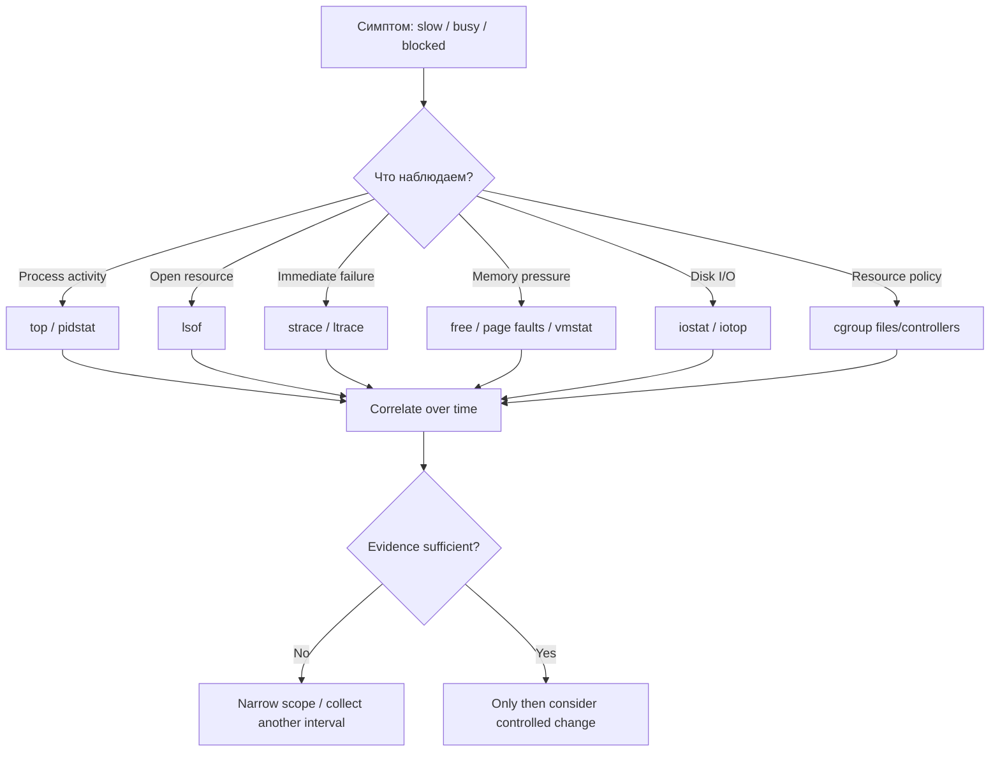
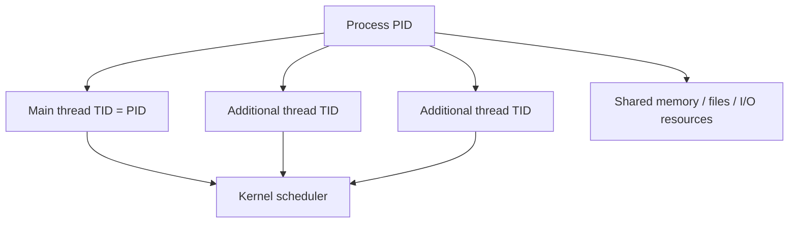
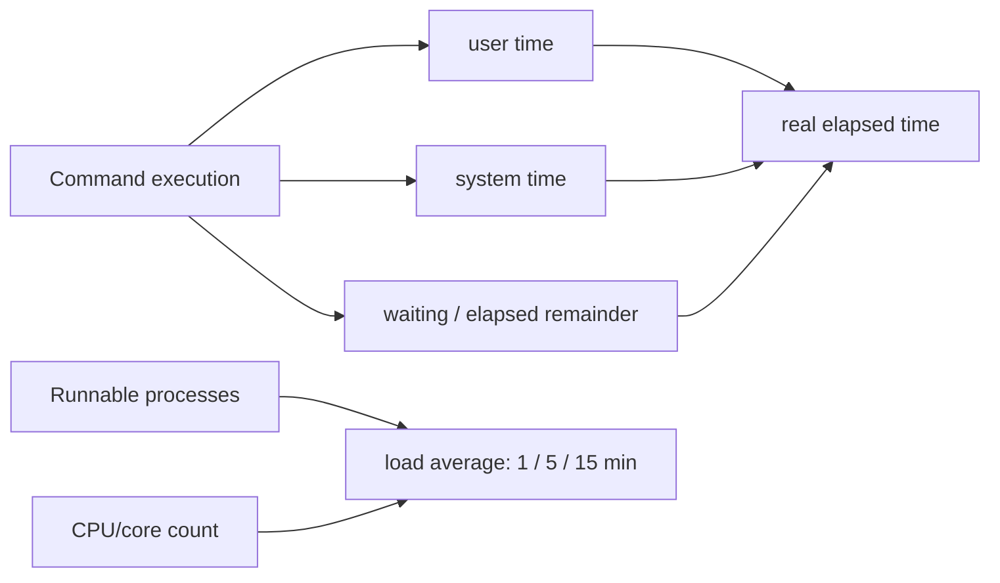
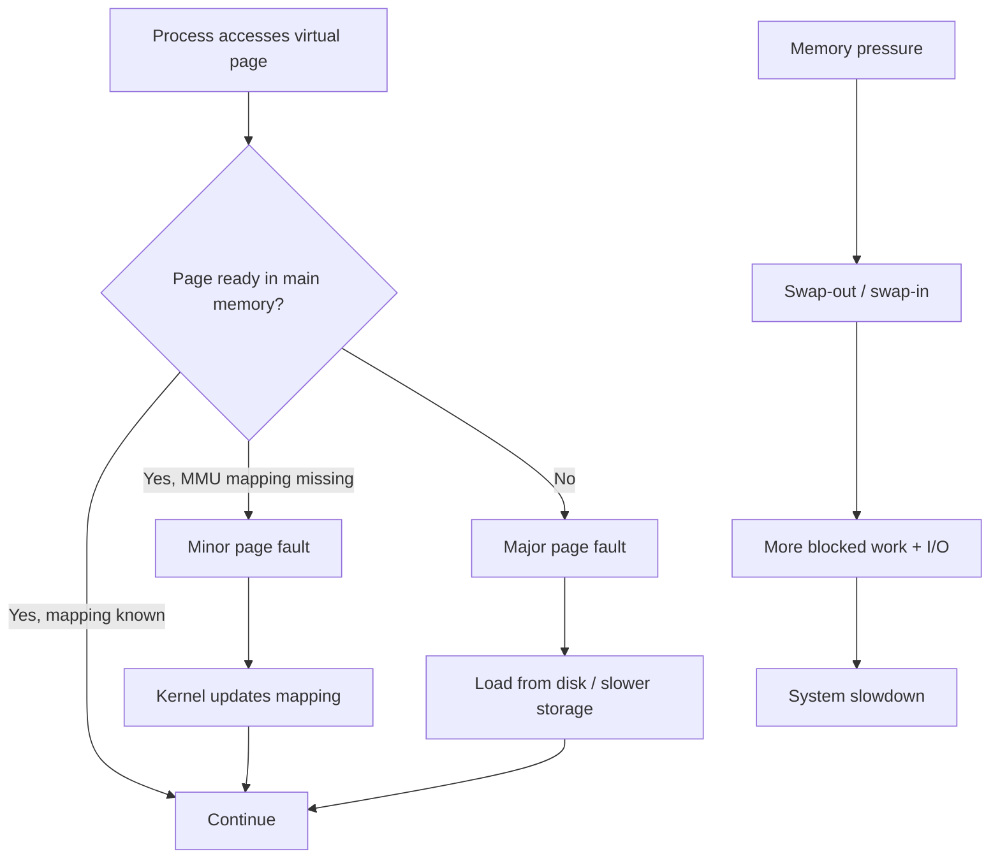
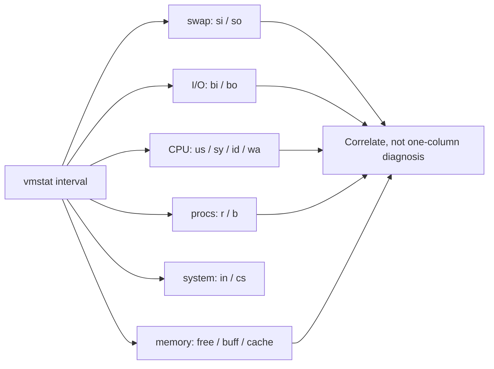
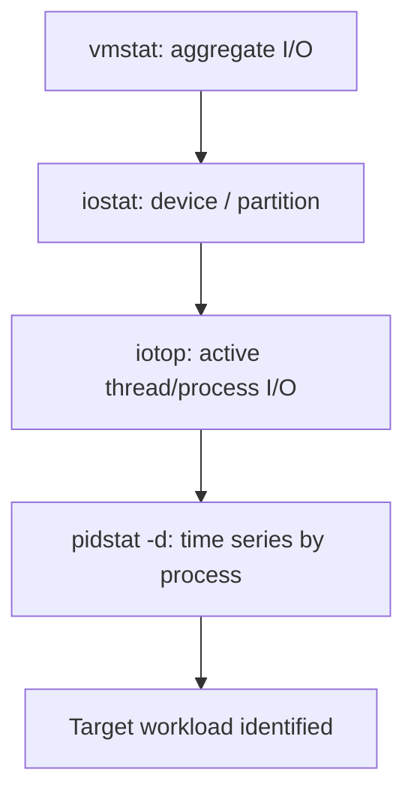
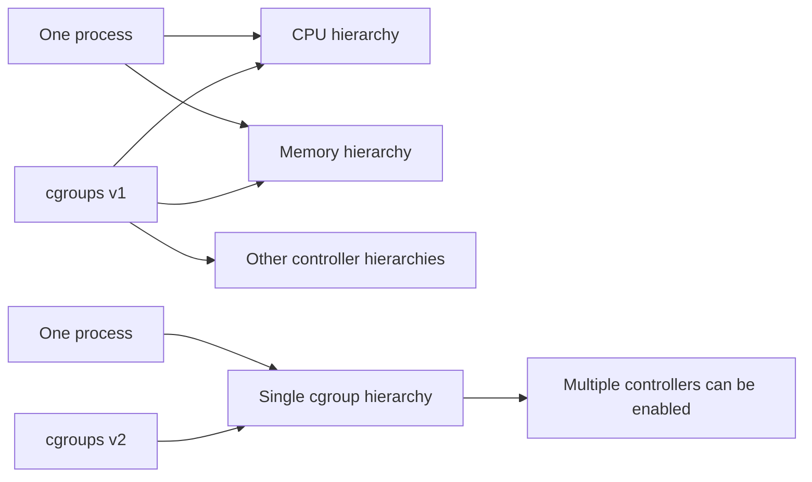
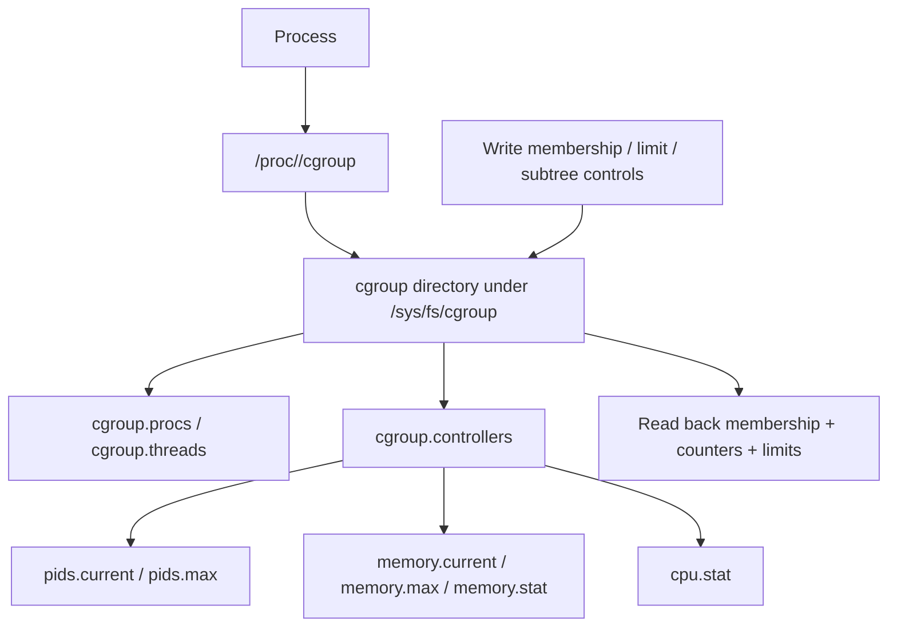
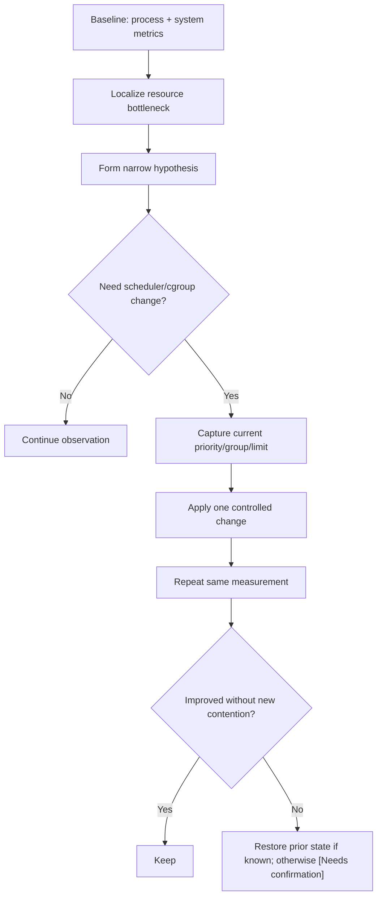

# Mermaid — глава 8 «Процессы и использование ресурсов»

Источник: **RAG `p0244:c01`–`p0269:c01`**, PDF/печатные страницы 244–269. Диаграммы синтезированы из текста главы; исходные рисунки 8.1–8.2 не реконструируются.

## 1. Диагностический выбор инструмента

Глава прямо отговаривает от настройки производительности без измеренного bottleneck.

## 2. Process / thread model

Потоки внутри процесса разделяют ресурсы, но kernel schedules threads as runnable entities (§8.4).

## 3. CPU time and load

`time` и load average измеряют разные аспекты работы; high load сам по себе не доказывает проблему (§8.5.1–8.5.3).

## 4. Demand paging and memory pressure

The source treats some major faults as normal cold-start behavior and warns against diagnosing from free-memory number alone.

## 5. vmstat correlation

The chapter uses `vmstat` to correlate memory pressure, blocked processes, swap and disk activity (§8.5.5).

## 6. I/O localization

Device totals and partition totals need not sum exactly because the whole disk can be accessed directly (§8.5.6).

## 7. cgroup v1 vs v2

The chapter then focuses on v2 because v1 is being phased out (§8.6.1).

## 8. cgroup v2 control flow

Writes to cgroup interface files are live state changes; exact controller names/paths must be confirmed from the target host.

## 9. Monitoring-before-tuning boundary

This final flow is an operational synthesis of the chapter's “measure before tuning” guidance.
