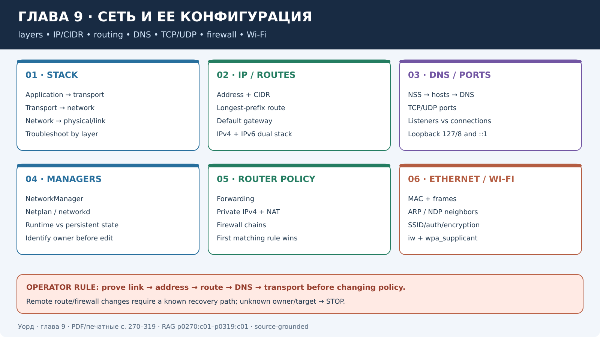
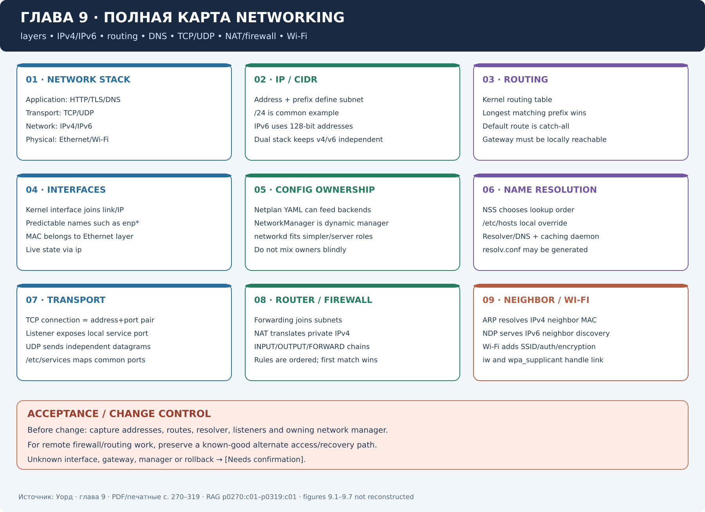

# Глава 9 — Сеть и ее конфигурация

Брайан Уорд — «Внутреннее устройство Linux», 3-е русское издание, 2022.





## Идентификация и readiness

- Book ID: `how-linux-works-brian-ward-3e-ru-2022`; inventory: `0034`.
- Chapter: **9. Сеть и ее конфигурация**; slug: `networking-and-configuration`.
- Source: `source/book.pdf`; SHA-256 `eee3833ea6ac0fe70268f66076c2ed2bd413b41484bd51d75af7b3ed3ae40ac3`.
- RAG acceptance: **ACCEPTED**, `failed_checks: []`.
- Extraction: `READY_WITH_KNOWN_LIMITATIONS`.
- Source policy: **rag_only**; external web, model-memory completion and direct canonical-PDF reading are not used.

## Chapter boundary

- PDF/printed pages: **270–319** inclusive.
- RAG chunks: **`p0270:c01`–`p0319:c01`**.
- Chunk paths: `rag/chunks/p0201-p0300/p0270-c01.md` … `p0300-c01.md`, then `rag/chunks/p0301-p0400/p0301-c01.md` … `p0319-c01.md`.
- TOC evidence: `p0013:c01`–`p0015:c01`.
- `p0270:c01` begins chapter 9.
- `p0319:c01` contains §9.28 «Выводы» and closes the chapter.
- `p0320:c01` begins chapter 10.
- **Chapter boundary verified: YES.**

## Карта главы

| Раздел | PDF/печатные с. | Содержание |
|---|---:|---|
| 9.1–9.3 | 271–273 | LAN/WAN, packets, four-layer network stack. |
| 9.4–9.7.2 | 273–281 | IPv4/IPv6, subnet/CIDR, routing table, default gateway, dual stack. |
| 9.8–9.11.2 | 281–286 | ICMP/DNS basics, Ethernet/MAC, kernel interfaces, manual IP/routes. |
| 9.12–9.14.3 | 287–292 | Boot-time configuration, Netplan, NetworkManager/systemd-networkd, unmanaged interfaces/dispatchers. |
| 9.15–9.17.2 | 292–301 | Name resolution, hosts/resolv/nsswitch, localhost, TCP/UDP, ports/listeners. |
| 9.18–9.20 | 301–304 | DHCP and IPv6 stateless autoconfiguration. |
| 9.21–9.24 | 304–309 | Linux routing, private IPv4, NAT, Linux-based routers/OpenWRT. |
| 9.25–9.25.3 | 309–314 | Firewall chains/tables/rules and default-deny strategy. |
| 9.26–9.27.2 | 315–319 | ARP/NDP, neighbor cache, Wi-Fi, iw, wpa_supplicant. |
| 9.28 | 319 | Chapter conclusions. |

## Основные идеи

**1. Troubleshoot by layer.** The chapter uses a four-layer model: application → transport → network → physical. Data descends the stack on the sender and ascends it on the receiver.

**2. IP addressing and routing are separate.** An interface can have an address/subnet, but reachability beyond directly connected networks depends on the kernel routing table. The kernel chooses the longest matching destination prefix; the default route is the catch-all.

**3. IPv4 and IPv6 can coexist independently.** Dual-stack hosts have separate addressing and routing. IPv6 adds link-local addresses, global addresses and router advertisements.

**4. Network configuration has runtime and persistent layers.** Live kernel state and persistent configuration may be owned by different tools. Netplan, NetworkManager, systemd-networkd and distro-specific files can overlap.

**5. Name resolution is a chain.** Application lookup → NSS rules → local hosts and/or DNS → nameserver/caching resolver. With systemd-resolved, `/etc/resolv.conf` may be generated rather than authoritative.

**6. TCP and UDP solve different transport problems.** TCP provides connection-oriented reliable streams; UDP provides individual datagrams without TCP-style retransmission/ordering.

**7. Routing/NAT/firewall are live kernel policy.** Forwarding, NAT and firewall rule order can affect every host behind a router. In ordered firewall chains, first match wins.

**8. Ethernet needs address resolution.** IP packets ride inside Ethernet frames addressed by MAC. ARP maps IPv4 neighbors; the chapter explains NDP for IPv6.

**9. Wireless adds physical-layer identity/authentication.** IP remains the same, while SSID, authentication, encryption, access points and tools such as `iw`/`wpa_supplicant` add link-layer complexity.

## Главная операционная карта

```text
symptom
  ↓
physical/link? → interface / MAC / Wi-Fi association
  ↓
network? → address + CIDR + route + gateway
  ↓
name resolution? → NSS → hosts → resolver/DNS
  ↓
transport? → TCP/UDP port + listener/connection
  ↓
policy? → forwarding / NAT / firewall
  ↓
verify from the same layer after each change
```

This is an operational synthesis of the chapter, not a distribution-specific runbook.

## High-risk boundaries

- Live address/route changes can cut off remote access.
- Forwarding changes can turn a host into a router.
- NAT/firewall changes alter packet handling and must not be applied blindly.
- Changing firewall default policy before allow rules can isolate a remote host immediately.
- NetworkManager/Netplan/systemd-networkd/distro-specific files may overlap; effective ownership must be identified first.
- Source examples use concrete interfaces/addresses that are not target-system facts.

## Артефакты

- [cheatsheet.md](cheatsheet.md) — layered troubleshooting/change workflow.
- [commands.md](commands.md) — source-confirmed networking commands and mutation boundaries.
- [diagram.md](diagram.md) — stack/routing/DNS/TCP/firewall/neighbor flows.
- [visual-cheatsheet.svg](visual-cheatsheet.svg) — compact visual summary.
- [visual-cheatsheet-detailed.svg](visual-cheatsheet-detailed.svg) — detailed chapter map.
- [summary.md](summary.md) — explicit §9.28 «Выводы».
- [source-findings.md](source-findings.md) — source inconsistencies/extraction caveats without silent correction.

No review/control questions or exercises are present; review artifacts are omitted.
