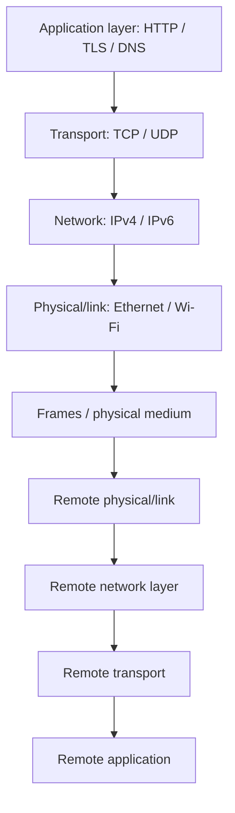
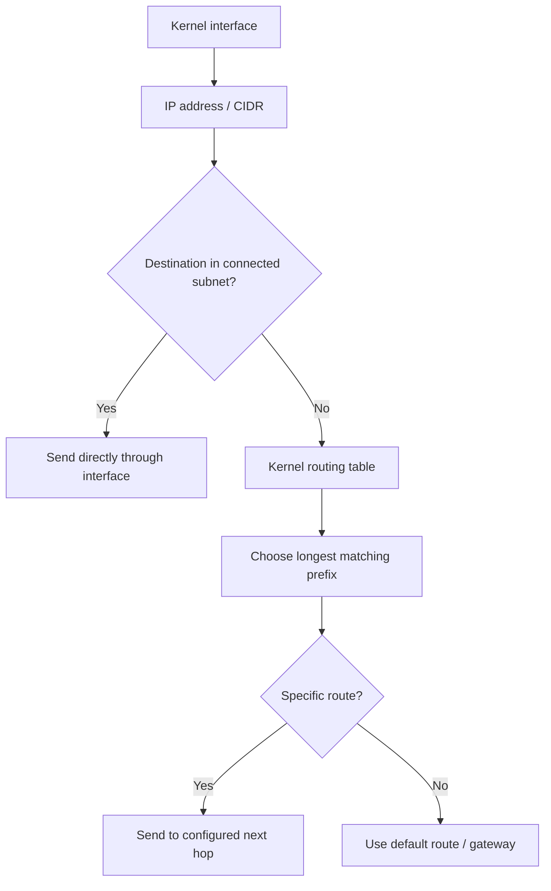
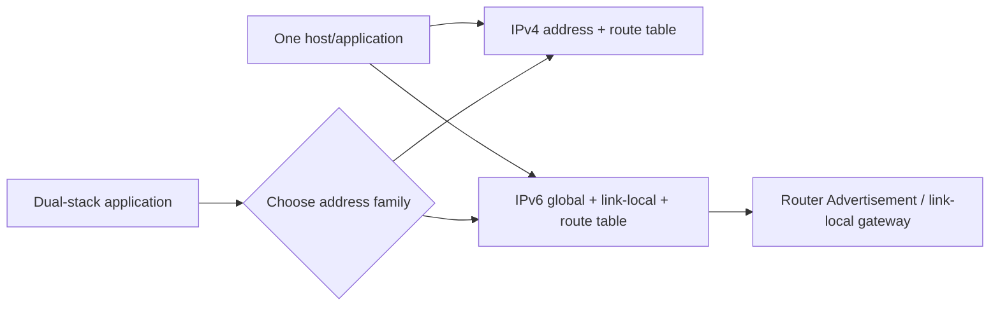
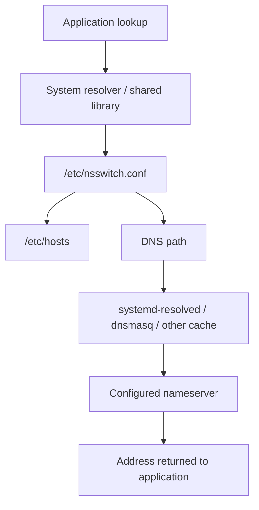
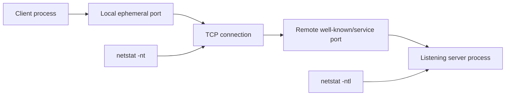
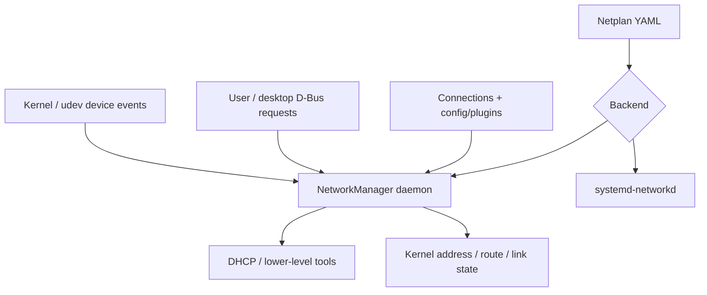
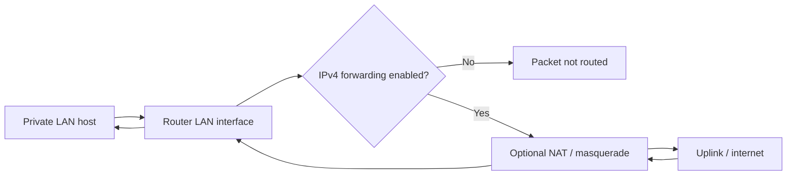
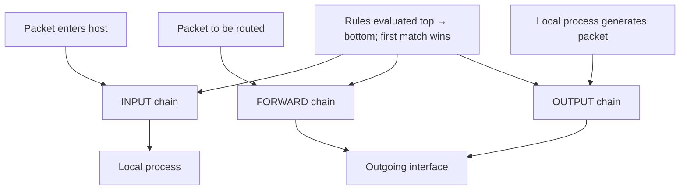
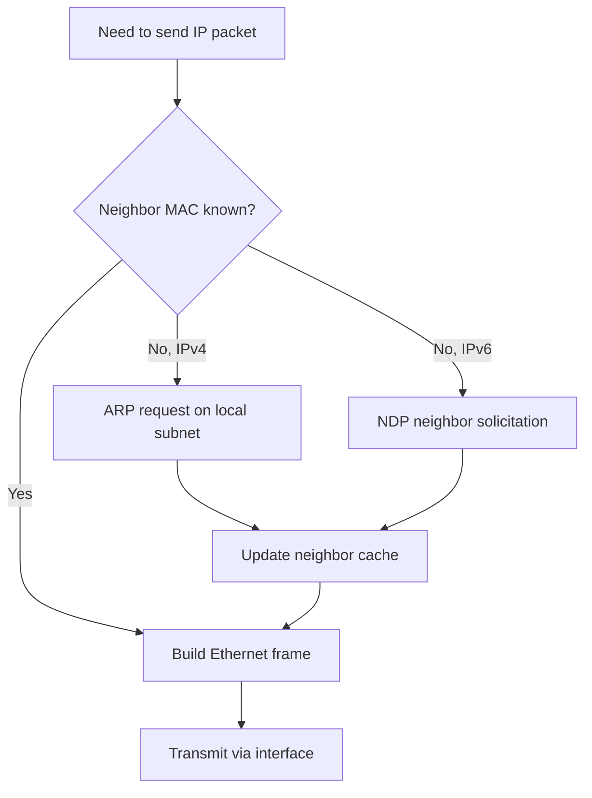
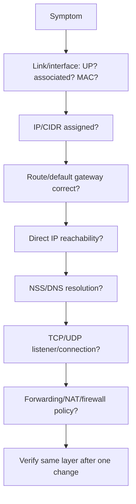

# Mermaid — глава 9 «Сеть и ее конфигурация»

Источник: **RAG `p0270:c01`–`p0319:c01`**, PDF/печатные страницы 270–319. Диаграммы синтезированы из текста главы; исходные рисунки 9.1–9.7 не реконструируются.

## 1. Четырёхуровневый сетевой стек

Глава сознательно использует четырёхуровневую модель, а не OSI-7 (§9.3).

## 2. Address + subnet + route

Address assignment and route selection are distinct; the default route is the least-specific catch-all (§9.4–9.6).

## 3. IPv4 / IPv6 dual stack

The source treats IPv4 and IPv6 as independent network-layer protocols that may coexist (§9.7.2).

## 4. Name-resolution chain

With systemd-resolved, `/etc/resolv.conf` may point to an automatically generated file (§9.15).

## 5. TCP ports and listener role

Port pairs identify one TCP connection; listener state is a separate observation (§9.17.1).

## 6. NetworkManager ownership model

Before persistent changes, identify which manager/backend actually owns the interface (§9.12–9.14).

## 7. Linux router / NAT path

Forwarding and NAT are separate mechanisms. Private IPv4 requires translation to communicate with the public internet in the chapter's example (§9.21–9.23).

## 8. Firewall chain model

Default chain policy applies only when no rule matches (§9.25.1–9.25.3).

## 9. Ethernet neighbor resolution

For destinations outside the local subnet, the host resolves the router's MAC rather than the final remote host (§9.26).

## 10. Layered troubleshooting workflow

This is an operational synthesis of chapter concepts, not a distro-specific troubleshooting script.
