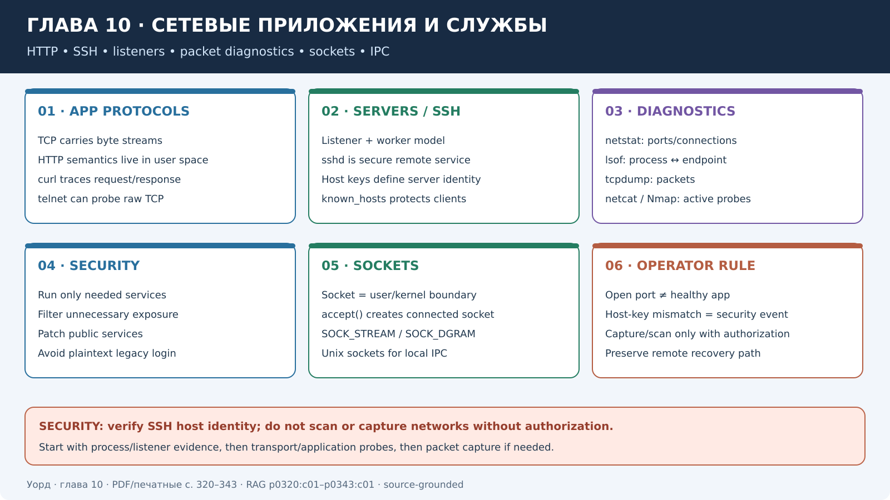
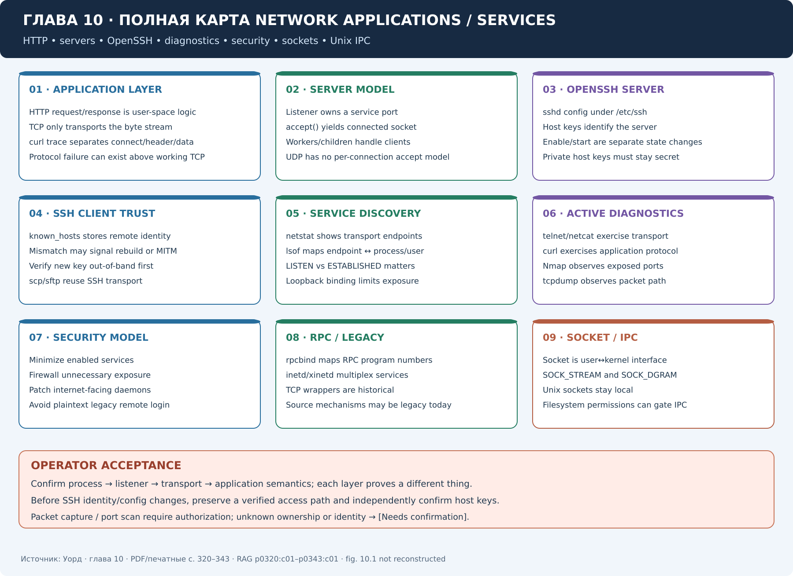

# Глава 10 — Сетевые приложения и службы

Брайан Уорд — «Внутреннее устройство Linux», 3-е русское издание, 2022.





## Идентификация и readiness

- Book ID: `how-linux-works-brian-ward-3e-ru-2022`; inventory: `0034`.
- Chapter: **10. Сетевые приложения и службы**; slug: `network-applications-and-services`.
- Source: `source/book.pdf`; SHA-256 `eee3833ea6ac0fe70268f66076c2ed2bd413b41484bd51d75af7b3ed3ae40ac3`.
- RAG acceptance: **ACCEPTED**, `failed_checks: []`.
- Extraction: `READY_WITH_KNOWN_LIMITATIONS`.
- Source policy: **rag_only**; external web, model-memory completion and direct canonical-PDF reading are not used.

## Chapter boundary

- PDF/printed pages: **320–343** inclusive.
- RAG chunks: **`p0320:c01`–`p0343:c01`**.
- Chunk path: `rag/chunks/p0301-p0400/p####-c01.md`.
- TOC evidence: `p0015:c01`.
- `p0320:c01` begins chapter 10.
- `p0343:c01` contains §10.10 «Доменные сокеты Unix» and closes the chapter.
- `p0344:c01` begins chapter 11.
- **Chapter boundary verified: YES.**

## Карта главы

| Раздел | PDF/печатные с. | Содержание |
|---|---:|---|
| 10.1–10.2 | 320–323 | TCP service basics; raw HTTP via telnet; application-layer tracing with curl. |
| 10.3–10.3.4 | 323–330 | Network server process model; SSH/OpenSSH; sshd config/host keys; fail2ban; SSH client/scp/sftp. |
| 10.4 | 330–331 | inetd/xinetd and historical TCP wrappers. |
| 10.5–10.5.4 | 331–337 | Diagnostics: netstat, lsof, tcpdump, netcat, Nmap. |
| 10.6 | 337 | RPC/rpcbind and `rpcinfo`. |
| 10.7–10.7.2 | 338–340 | Network-security principles, common attack classes, unsafe legacy services and resources. |
| 10.8 | 341 | «Что дальше?» — transition from service administration to socket internals. |
| 10.9 | 341–342 | Network sockets as kernel/user-space boundary; listener + accepted connection model. |
| 10.10 | 342–343 | Unix domain sockets for local IPC; filesystem permissions and `lsof -U`. |

## Основные идеи

**1. Application protocols are interpreted in user space.** HTTP headers and body travel through the same lower-layer byte stream; the application decides where headers end and payload begins (§10.1–10.2).

**2. Servers map ports to processes.** A server may listen directly or through a super-server/socket activation mechanism. Common TCP servers often have one listening process plus workers/children; UDP services do not need a per-connection fork model (§10.3).

**3. SSH is the chapter's primary secure-service example.** OpenSSH separates client `ssh` and server `sshd`, uses host keys, supports encrypted sessions and remote execution/file transfer, and treats host-key mismatch as a security-significant event (§10.3.1–10.3.4).

**4. Service configuration and host identity are separate concerns.** `sshd_config` controls server behavior, while host-key files identify the server. Private host keys are security-sensitive and must not be exposed (§10.3.2).

**5. Diagnostics should map application symptoms downward.** `netstat`/lsof identify ports and owning processes; `tcpdump` observes packets; netcat exercises TCP/UDP endpoints; Nmap discovers exposed ports from a network viewpoint (§10.5).

**6. Exposure is part of service state.** A daemon can be running but inaccessible because it is bound only to loopback, filtered by firewall, or hidden behind a different address family. Conversely, an unintended listener is a security finding.

**7. Minimal service exposure is the security baseline.** The chapter recommends running as few services as possible, filtering unnecessary traffic, keeping public services updated, using supported releases, limiting local accounts and avoiding untrusted binaries (§10.7).

**8. Sockets bridge processes and the kernel.** Network sockets provide the API boundary for TCP/UDP. A typical stream server has a listening socket and creates a separate connected socket via `accept()`, often handing it to a child/worker process (§10.9).

**9. Unix domain sockets provide local IPC without the IP stack.** They may be filesystem-backed or unnamed, can use filesystem permissions for access control and usually avoid network-stack overhead (§10.10).

## Главная операционная карта

```text
service symptom
  ↓
is the process running?
  ↓
is the expected port/socket listening?
  ↓
is it bound to the intended address family/interface?
  ↓
can a client establish the transport connection?
  ↓
does the application protocol exchange succeed?
  ↓
if not: inspect packets / logs / host-key / policy
```

This is an operational synthesis of the chapter, not a vendor-specific service runbook.

## High-risk boundaries

- Starting/enabling `sshd` exposes a remote-access service and changes attack surface.
- Host-key generation/replacement changes server identity; client warnings must not be bypassed without independent verification.
- Deleting/replacing entries in `known_hosts` weakens protection if the remote host identity has not been confirmed.
- `tcpdump` can expose sensitive traffic and should only be used on networks/hosts you are authorized to inspect.
- Nmap/port scanning should not be used against networks without permission.
- Netcat listener/server modes can expose an unintended port or data path.
- fail2ban changes firewall state based on observed authentication failures.
- Source examples use historical tools/configurations and concrete ports/hosts that are not live-host facts.

## Артефакты

- [cheatsheet.md](cheatsheet.md) — service troubleshooting and security boundaries.
- [commands.md](commands.md) — source-confirmed SSH/diagnostic/socket commands classified by effect.
- [diagram.md](diagram.md) — application-protocol, server, SSH, diagnostics and socket flows.
- [visual-cheatsheet.svg](visual-cheatsheet.svg) — compact visual summary.
- [visual-cheatsheet-detailed.svg](visual-cheatsheet-detailed.svg) — detailed chapter map.
- [summary.md](summary.md) — explicit §10.8 «Что дальше?» transition section.
- [source-findings.md](source-findings.md) — source/extraction inconsistencies without silent correction.

No review/control questions or exercises are present; review artifacts are omitted.
