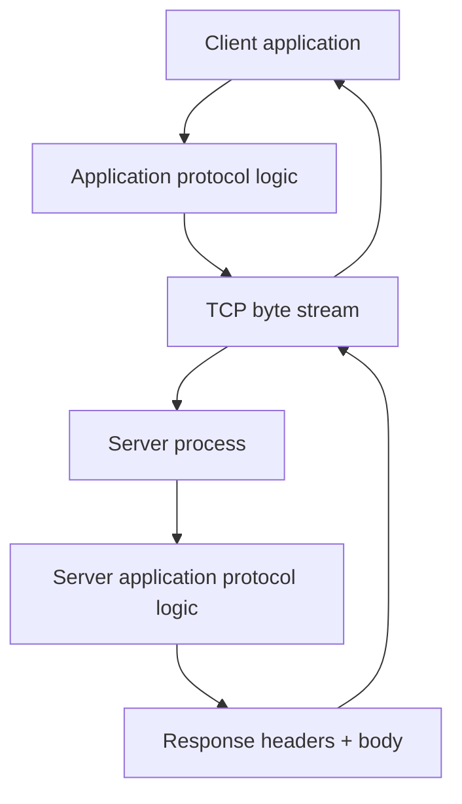
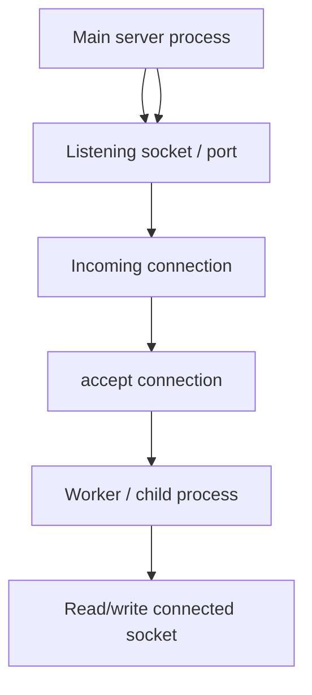
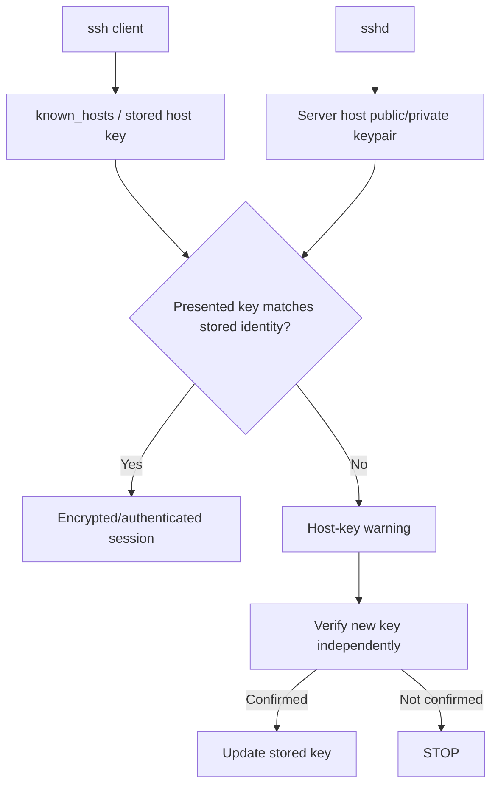
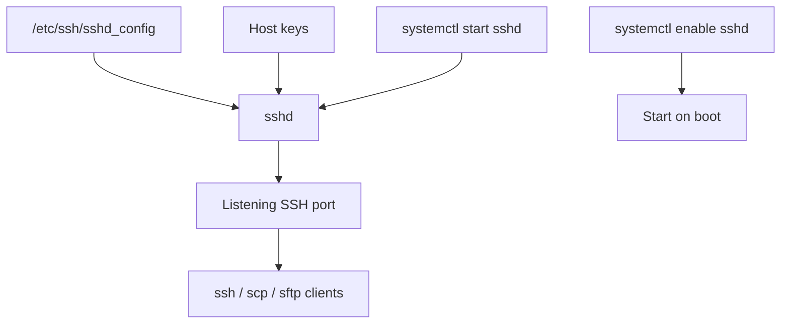
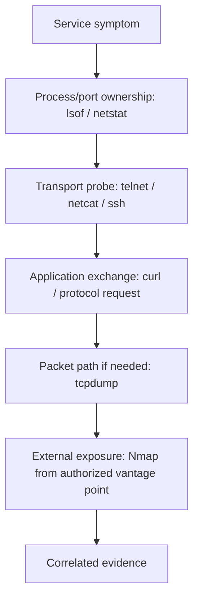
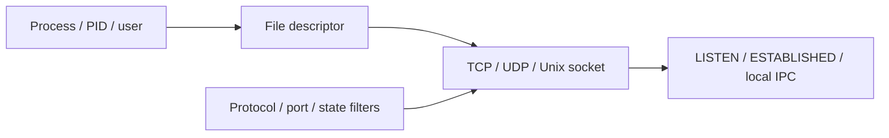
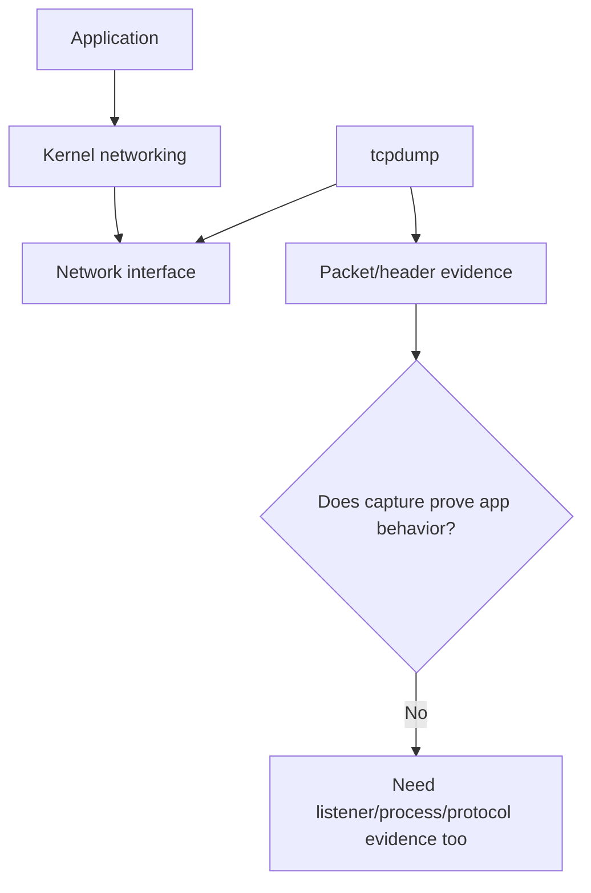
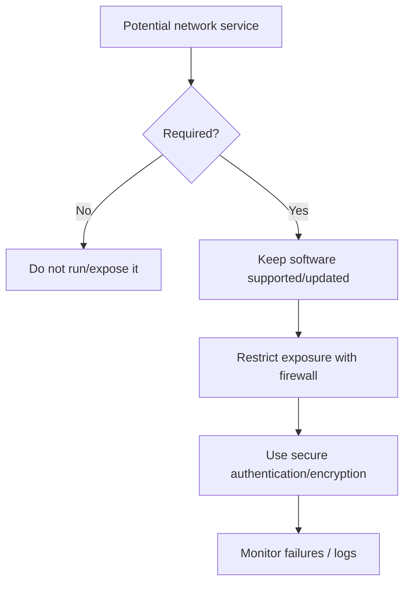
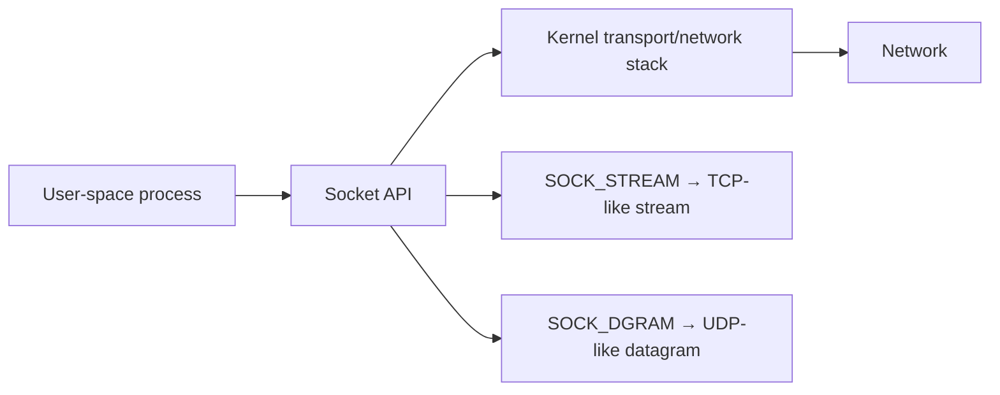
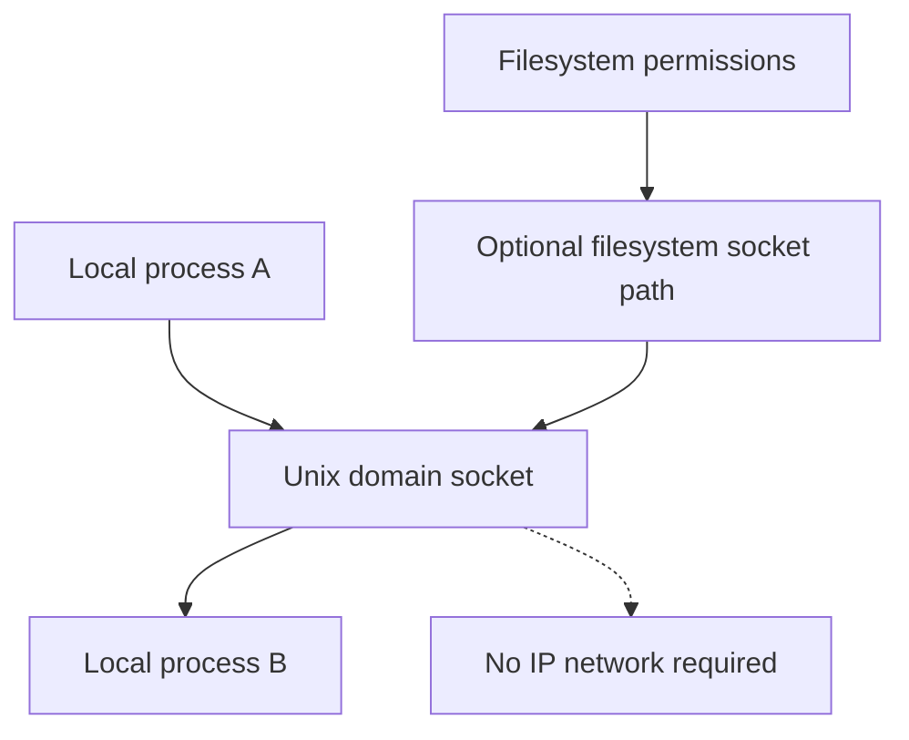

# Mermaid — глава 10 «Сетевые приложения и службы»

Источник: **RAG `p0320:c01`–`p0343:c01`**, PDF/печатные страницы 320–343. Диаграммы синтезированы из текста главы; исходный рис. 10.1 не реконструируется.

## 1. Application protocol over TCP

HTTP header/body distinction is interpreted by user-space applications; lower layers carry bytes without knowing those semantic boundaries (§10.1–10.2).

## 2. Typical network-server process model

The chapter notes that some high-performance servers pre-create workers; UDP services do not need a per-connection fork model (§10.3).

## 3. SSH trust boundary

A host-key mismatch is security-significant; the source explicitly mentions possible interception (§10.3.4).

## 4. SSH service lifecycle

Configuration and host identity are separate inputs to the server (§10.3.2–10.3.4).

## 5. Diagnostic ladder

Each tool answers a different layer/question; an open port does not prove application health.

## 6. lsof correlation

The chapter uses lsof to connect application processes with network or Unix-domain endpoints (§10.5.1, §10.10).

## 7. Packet capture versus application state

tcpdump sees packet traffic, not full application intent/health. Packet payload may also be sensitive (§10.5.2).

## 8. Exposure/security model

This condenses the chapter's security guidance: minimize services, filter unnecessary traffic, maintain exposed software and avoid plaintext legacy remote-login services (§10.7).

## 9. Network socket boundary

Sockets form the interface between user space and the kernel's networking machinery (§10.9).

## 10. Unix domain socket IPC

Unix-domain sockets can be filesystem-backed or unnamed and are used for local IPC (§10.10).
