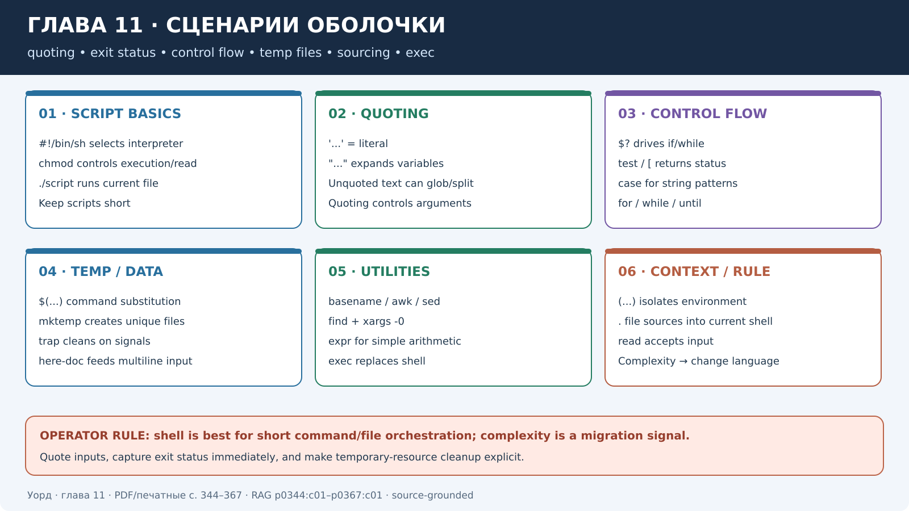
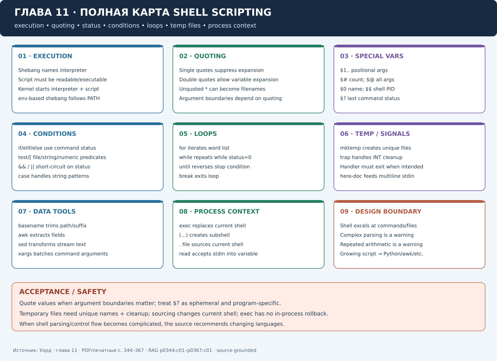

# Глава 11 — Сценарии оболочки

Брайан Уорд — «Внутреннее устройство Linux», 3-е русское издание, 2022.





## Идентификация и readiness

- Book ID: `how-linux-works-brian-ward-3e-ru-2022`; inventory: `0034`.
- Chapter: **11. Сценарии оболочки**; slug: `shell-scripts`.
- Source: `source/book.pdf`; SHA-256 `eee3833ea6ac0fe70268f66076c2ed2bd413b41484bd51d75af7b3ed3ae40ac3`.
- RAG acceptance: **ACCEPTED**, `failed_checks: []`.
- Extraction: `READY_WITH_KNOWN_LIMITATIONS`.
- Source policy: **rag_only**; external web, model-memory completion and direct canonical-PDF reading are not used.

## Chapter boundary

- PDF/printed pages: **344–367** inclusive.
- RAG chunks: **`p0344:c01`–`p0367:c01`**.
- Chunk path: `rag/chunks/p0301-p0400/p####-c01.md`.
- TOC evidence: `p0015:c01`–`p0016:c01`.
- `p0344:c01` begins chapter 11.
- `p0367:c01` contains §11.14 «Когда не стоит использовать сценарии оболочки» and closes the chapter.
- `p0368:c01` begins chapter 12.
- **Chapter boundary verified: YES.**

## Карта главы

| Раздел | PDF/печатные с. | Содержание |
|---|---:|---|
| 11.1–11.1.1 | 344–346 | Shebang, executable/read permissions, launching scripts, limits of shell scripting. |
| 11.2–11.2.4 | 346–348 | Literals, single/double quotes, escaping embedded quotes. |
| 11.3–11.4 | 349–352 | Positional/special variables, `shift`, `$@`, `$0`, `$$`, `$?`, exit codes. |
| 11.5–11.5.6 | 352–358 | `if`, `test`/`[`, `elif`, `&&`/`||`, file/string/numeric tests, `case`. |
| 11.6 | 358–359 | `for`, `while`, `until`, `break`. |
| 11.7–11.9 | 359–362 | Command substitution, temporary files, `mktemp`, `trap`, here-documents. |
| 11.10–11.10.6 | 362–365 | `basename`, `awk`, `sed`, `xargs`, `expr`, `exec`. |
| 11.11–11.13 | 366–367 | Subshells, sourcing, `read`. |
| 11.14 | 367 | When shell scripts are the wrong tool. |

## Основные идеи

**1. A shell script is executable command orchestration.** A Bourne-style script is a file of shell commands, normally beginning with a shebang such as `#!/bin/sh`. The kernel ultimately starts the interpreter named by the shebang (§11.1).

**2. Shell is strongest at composing commands and files.** The chapter repeatedly warns that complicated string processing, arithmetic, database access or large control structures are better handled by Python, Perl, awk or compiled languages (§11.1.1, §11.14).

**3. Quoting is part of correctness, not style.** Before running a command, the shell expands variables, globs and substitutions. Single quotes suppress expansion; double quotes preserve variable expansion while protecting wildcard characters. Incorrect quoting can change both argument count and meaning (§11.2).

**4. Exit status is the control-flow currency.** `$?` stores the last command's return code; zero normally means success, but tools such as `grep` and `diff` can use nonzero values for ordinary conditions. `if`, `while`, `&&` and `||` are all driven by command return status (§11.4–11.6).

**5. `test` / `[` is a command model.** File, string and numeric predicates produce exit codes that drive shell control flow. The chapter emphasizes that spacing and quoting matter because `[` behaves as a command interface (§11.5).

**6. Temporary resources need cleanup.** `mktemp` avoids filename collisions; `trap` can remove temporary files when signals interrupt the script. The source explicitly notes that the trap handler must `exit` or execution continues (§11.8).

**7. Command substitution is useful but easy to overuse.** `$(...)` feeds command output back into the shell. The chapter recommends globbing instead of `$(ls)` and `xargs`/`find -exec` for large file sets (§11.7, §11.10.4).

**8. Data-shaping utilities matter, but complexity is a signal.** `basename`, `awk`, `sed`, `xargs` and `expr` can simplify pipelines, yet repeated complex text/arithmetic work is a sign to move to a more suitable language (§11.10).

**9. Subshells isolate temporary environment changes.** Commands grouped in `(...)` run in a child shell; environment or working-directory changes disappear when it exits (§11.11).

**10. Sourcing is not the same as executing.** `. config.sh` runs commands in the current shell environment, allowing variable/function definitions to persist; executing another script creates a separate shell context (§11.12).

## Главная операционная карта

```text
task
 ↓
can it be expressed as short composition of existing commands/files?
 ↓ yes
define inputs → quote expansions → check return codes
 ↓
use narrow control flow
 ↓
manage temp files/signals
 ↓
verify output + exit status
 ↓
if parsing/control complexity keeps growing → move to Python/awk/etc.
```

This is an operational synthesis of the chapter, not a universal shell-style guide.

## High-risk boundaries

- `chmod +rx script` changes execution/readability; source notes mode 700 if others should not read/execute it.
- `exec` is irreversible for the current shell process: the shell is replaced by the new program.
- `xargs` with newline-separated filenames can be unsafe when names contain spaces/newlines; the chapter prefers `find -print0 | xargs -0`.
- Temporary files under `/tmp` need unique names and signal cleanup.
- Unquoted variable/filename expansion can change argument boundaries or trigger globbing.
- Sourcing a file executes its commands in the current shell environment; treat source-file ownership/content as a trust boundary.
- The chapter's example scripts are pedagogical; current production shell/linting policies remain **[Needs confirmation]**.

## Артефакты

- [cheatsheet.md](cheatsheet.md) — operational scripting workflow and safety checks.
- [commands.md](commands.md) — source-confirmed shell constructs/utilities classified by effect.
- [diagram.md](diagram.md) — quoting, exit-code, temp-file and execution-context flows.
- [visual-cheatsheet.svg](visual-cheatsheet.svg) — compact visual summary.
- [visual-cheatsheet-detailed.svg](visual-cheatsheet-detailed.svg) — detailed chapter map.
- [source-findings.md](source-findings.md) — source/example inconsistencies without silent correction.

## Conditional artifacts

- No explicit chapter-end summary/resume section is present; §11.14 is a concluding guidance section, not a labeled summary. `summary.md` is omitted.
- No review/control questions or exercises are present; `review-questions.md` and `review-answers.md` are omitted.
