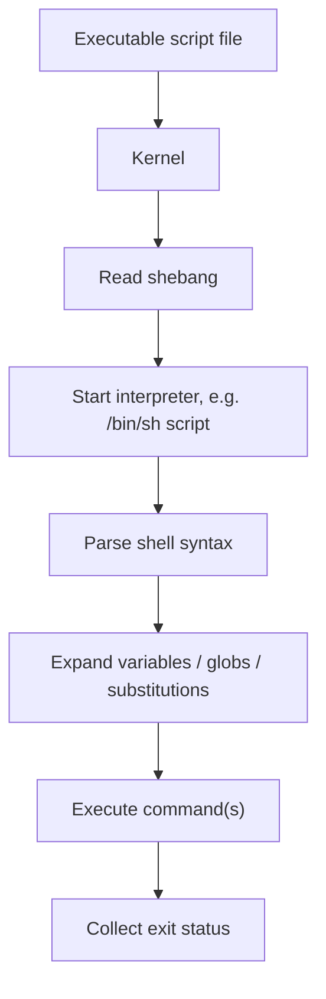
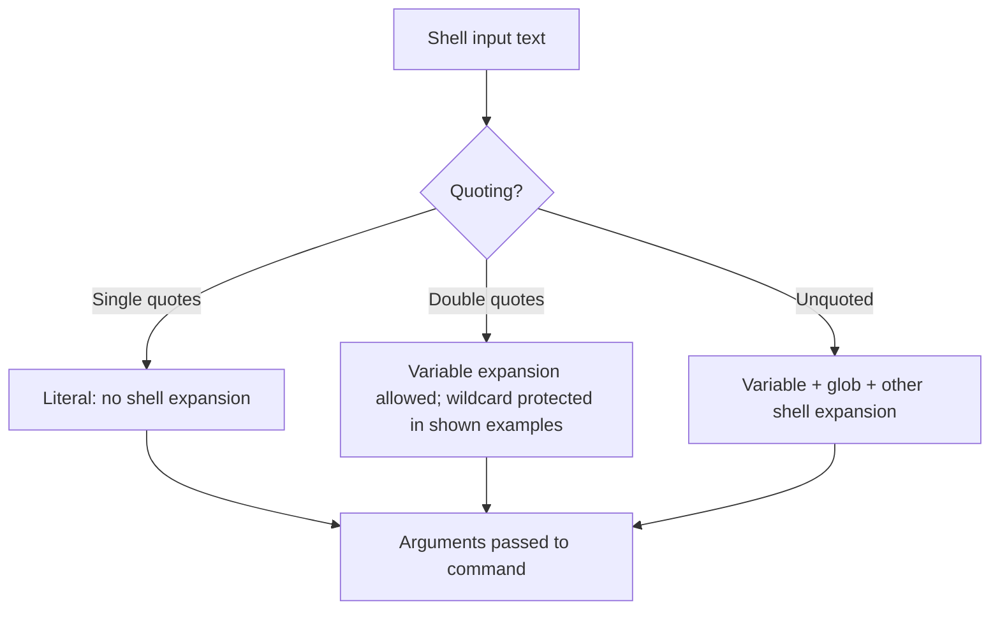
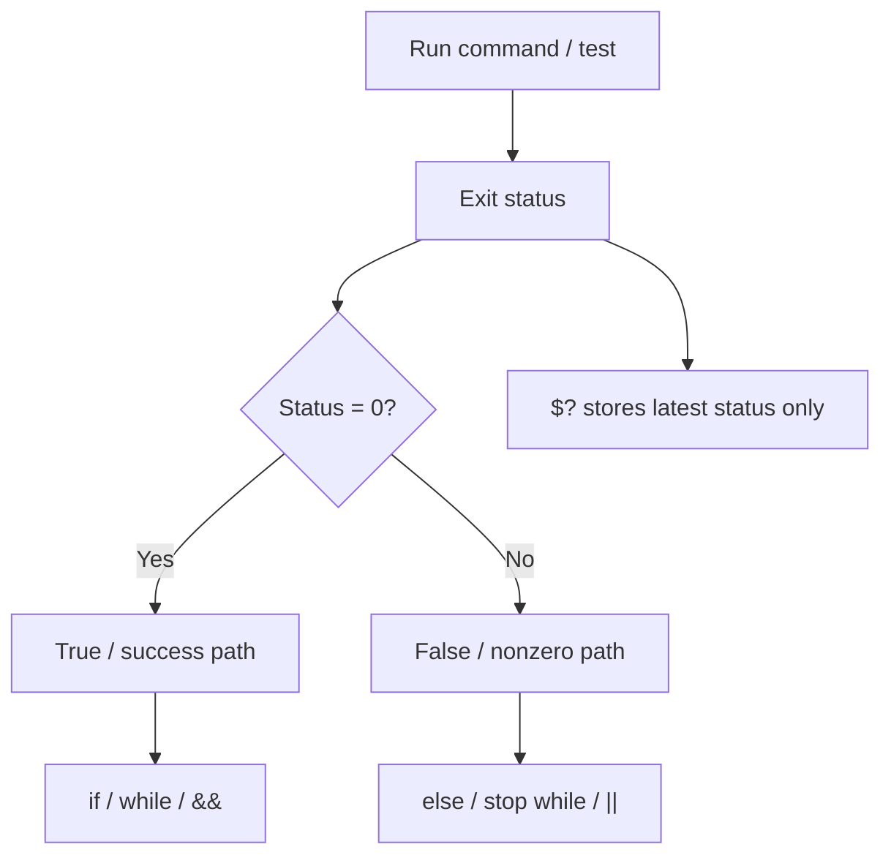
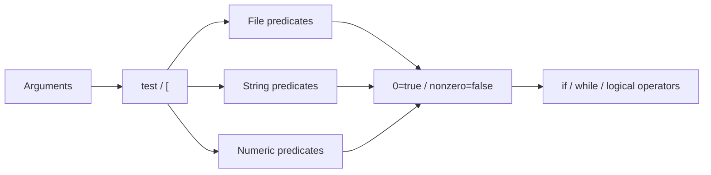
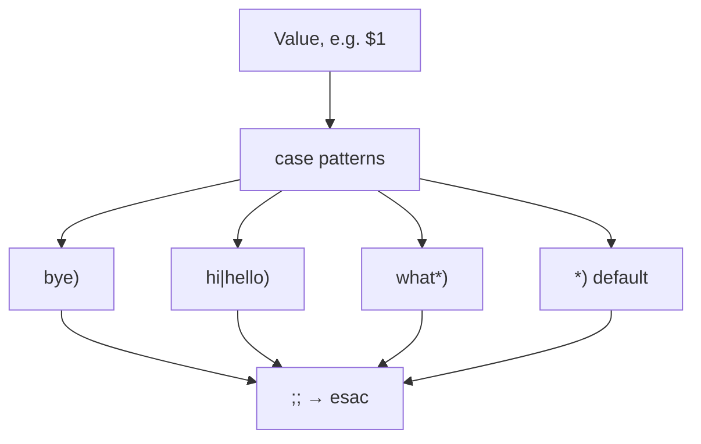
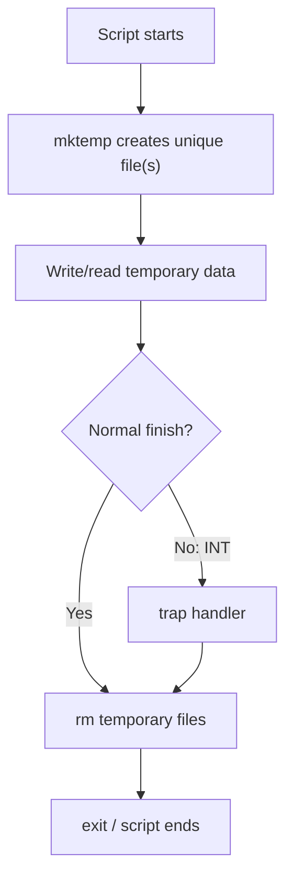
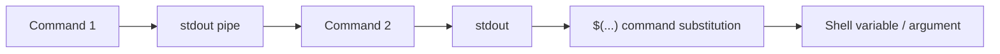
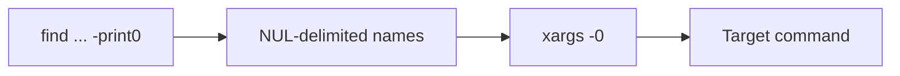
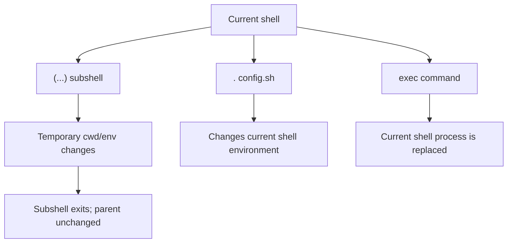
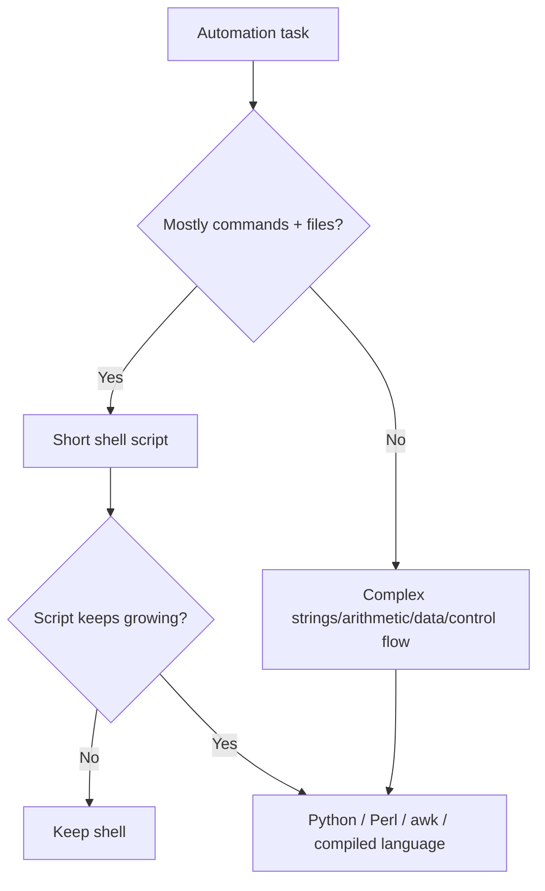

# Mermaid — глава 11 «Сценарии оболочки»

Источник: **RAG `p0344:c01`–`p0367:c01`**, PDF/печатные страницы 344–367. Диаграммы — аналитическое представление текста главы.

## 1. Script execution path

The chapter treats a shell script as a file of commands executed by the interpreter named in the shebang (§11.1).

## 2. Quoting / expansion boundary

The main failure mode described in §11.2 is the shell changing text before the target command sees it.

## 3. Exit status drives control flow

The chapter explicitly warns that tools such as `grep` and `diff` can assign application-specific meaning to nonzero statuses (§11.4).

## 4. test / [ model

§11.5 emphasizes that `[` behaves like a command interface, so spaces and argument boundaries matter.

## 5. case vs if/elif

The chapter recommends `case` for many string-matching branches (§11.5.6).

## 6. Temporary-file lifecycle

Without signal cleanup, interrupted scripts can leave stale files under `/tmp` (§11.8).

## 7. Command substitution and pipelines

The chapter warns against overusing command substitution for filename enumeration (§11.7).

## 8. Filename-safe batch processing

This flow is source-recommended when filenames may contain spaces/newlines (§11.10.4).

## 9. Process/environment contexts

Subshells isolate changes; sourcing imports them; `exec` replaces the process (§11.10.6–11.12).

## 10. Tool-choice boundary

This is the chapter's recurring design guidance: shell is a composition tool, not a universal programming language.
