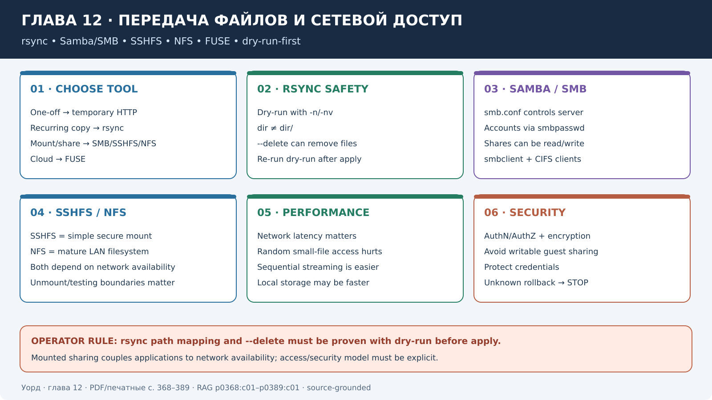
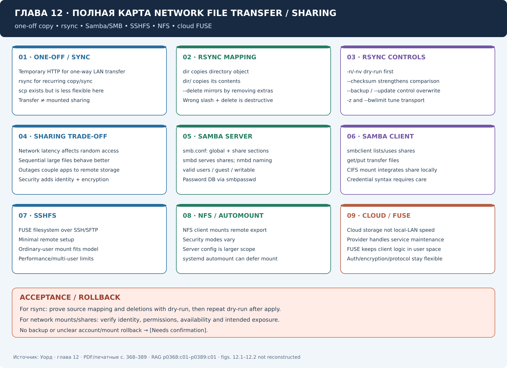

# Глава 12 — Передача файлов по сети и доступ к ним

Брайан Уорд — «Внутреннее устройство Linux», 3-е русское издание, 2022.





## Идентификация и readiness

- Book ID: `how-linux-works-brian-ward-3e-ru-2022`; inventory: `0034`.
- Chapter: **12. Передача файлов по сети и доступ к ним**; slug: `network-file-transfer-and-access`.
- Source: `source/book.pdf`; SHA-256 `eee3833ea6ac0fe70268f66076c2ed2bd413b41484bd51d75af7b3ed3ae40ac3`.
- RAG acceptance: **ACCEPTED**, `failed_checks: []`.
- Extraction: `READY_WITH_KNOWN_LIMITATIONS`.
- Source policy: **rag_only**; external web, model-memory completion and direct canonical-PDF reading are not used.

## Chapter boundary

- PDF/printed pages: **368–389** inclusive.
- RAG chunks: **`p0368:c01`–`p0389:c01`**.
- Chunk path: `rag/chunks/p0301-p0400/p####-c01.md`.
- TOC evidence: `p0016:c01`–`p0017:c01`.
- `p0368:c01` begins chapter 12.
- `p0389:c01` closes §12.8 «Состояние совместного доступа к файлам в сети».
- `p0390:c01` begins chapter 13.
- **Chapter boundary verified: YES.**

## Карта главы

| Раздел | PDF/печатные с. | Содержание |
|---|---:|---|
| Вступление, 12.1 | 368–369 | Выбор способа file distribution/sharing; one-way temporary HTTP serving. |
| 12.2–12.2.9 | 370–376 | `rsync`: SSH transport, archive mode, dry-run, delete, trailing slash, exclude/include, checksums, backup/update, compression, bandwidth limit, pull mode. |
| 12.3–12.3.2 | 376–378 | File-sharing trade-offs: latency/performance and security requirements. |
| 12.4–12.4.9 | 378–386 | Samba server/client basics, SMB shares, access control, passwords, logs, CIFS mount. |
| 12.5 | 386 | SSHFS/FUSE for small-scale Linux-to-Linux sharing. |
| 12.6 | 387 | NFS client basics, security options, automount/systemd automount; server scope note. |
| 12.7 | 388 | Cloud storage via FUSE; maintenance/backup trade-offs. |
| 12.8 | 388–389 | Why network file sharing remains fragmented; performance/security/flexibility limits. |

## Основные идеи

**1. Choose transfer vs sharing deliberately.** One-off distribution, recurring synchronization, mounted remote access and multi-user shared storage are different problems. The opening table maps them to different mechanisms rather than proposing one universal tool.

**2. `rsync` is the chapter's primary synchronization tool.** It supports local or SSH-backed remote copying, archive mode, dry-run/verbose inspection, exact-mirror deletion, include/exclude rules, checksums, backups, update semantics, compression and bandwidth limiting.

**3. Dry-run is the safety boundary before destructive synchronization.** The source repeatedly recommends `-n`/`-nv`, especially with `--delete`, so the operator can see what would be copied or removed before applying the transfer.

**4. A trailing slash changes rsync semantics.** `dir` copies the directory itself; `dir/` copies only its contents. Combining a mistaken trailing slash with `--delete` can remove unrelated destination files.

**5. Network file sharing trades convenience for latency, failure coupling and security complexity.** Sequential large-file streaming behaves differently from random access to many small files; network latency and temporary storage unavailability can dominate performance.

**6. File-sharing security needs both identity and confidentiality.** The chapter separates authentication/authorization from encryption and warns that easy-to-configure sharing modes are often the least secure.

**7. Samba is a compatibility stack, not just a filesystem mount.** It includes server configuration, access control, separate password handling, file/printer shares and client tooling for SMB environments.

**8. SSHFS optimizes for simplicity and secure reachability.** It relies on SSH/SFTP and FUSE, requires little server-specific setup, but pays in performance and multi-user flexibility.

**9. NFS is mature but security/version/topology dependent.** The chapter limits itself to client mounting and notes that stronger authentication/encryption, NFS server configuration and automounting introduce additional complexity.

**10. FUSE shifts network-filesystem logic into user space.** This is presented as useful for cloud storage because authentication, encryption and protocol processing no longer need to live in kernel client code.

## Главная операционная карта

```text
need
 ↓
one-off distribution? → temporary HTTP / direct copy
recurring copy?       → rsync
small secure mount?   → SSHFS
Windows/SMB share?    → Samba/CIFS
trusted LAN storage?  → NFS
cloud-backed mount?   → FUSE client
 ↓
for any persistent/destructive action:
baseline → dry-run/readback → apply → verify → rollback/restore
```

This is an operational synthesis of the chapter, not a deployment recommendation for every environment.

## High-risk boundaries

- `rsync --delete` can delete destination files; inspect a dry-run first.
- Source and destination path/trailing-slash semantics must be verified before synchronization.
- Samba account/password operations change access state; `unix password sync = yes` may also affect the normal Linux password.
- Guest/writable SMB shares broaden access and should not be combined casually.
- CIFS/NFS/SSHFS mounts change filesystem availability and may couple applications to network reachability.
- Temporary HTTP serving exposes the current directory to the network described by the source; do not use on an untrusted/public network.
- Source examples contain historical commands/protocol assumptions that are preserved as edition context, not silently modernized.

## Артефакты

- [cheatsheet.md](cheatsheet.md) — transfer/sharing decision tree, dry-run discipline and rollback.
- [commands.md](commands.md) — source-confirmed rsync/Samba/SSHFS/NFS commands classified by effect.
- [diagram.md](diagram.md) — rsync safety, sharing trade-offs, Samba/SSHFS/NFS/FUSE flows.
- [visual-cheatsheet.svg](visual-cheatsheet.svg) — compact visual summary.
- [visual-cheatsheet-detailed.svg](visual-cheatsheet-detailed.svg) — detailed chapter map.
- [source-findings.md](source-findings.md) — source wording/edition/extraction issues without silent correction.

## Conditional artifacts

- No explicit chapter-end `Выводы`/`Резюме`/`Что дальше?` section is present; §12.8 is a thematic concluding discussion, so `summary.md` is omitted.
- No review/control questions or exercises are present; `review-questions.md` and `review-answers.md` are omitted.
