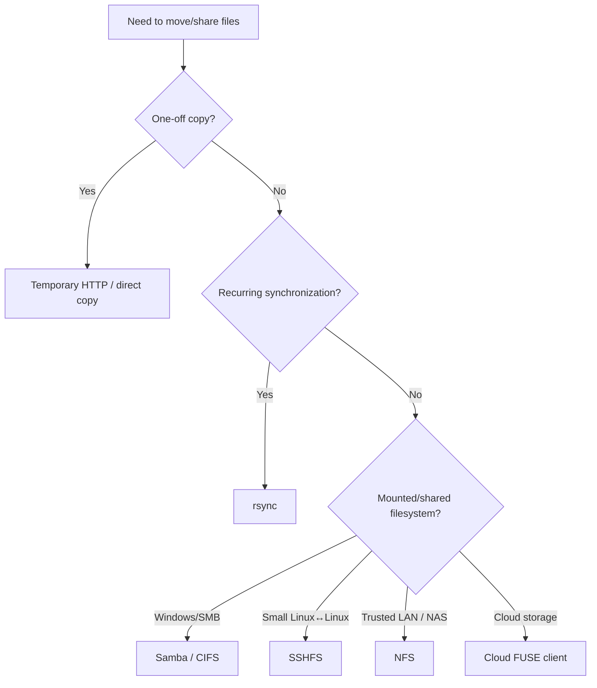
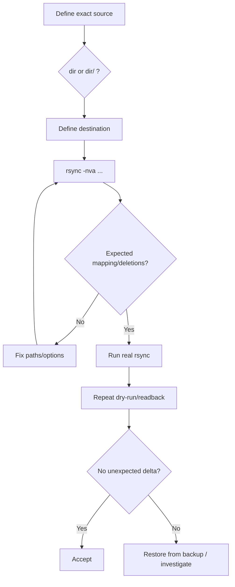
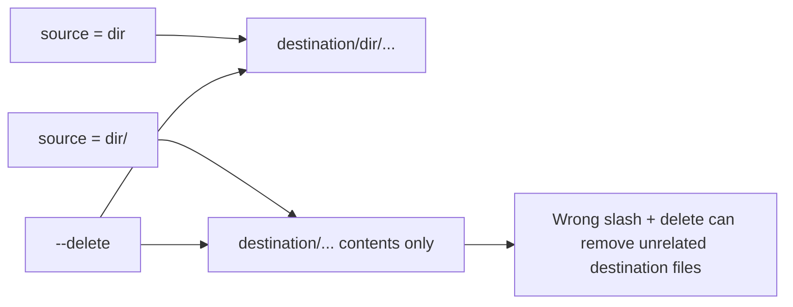
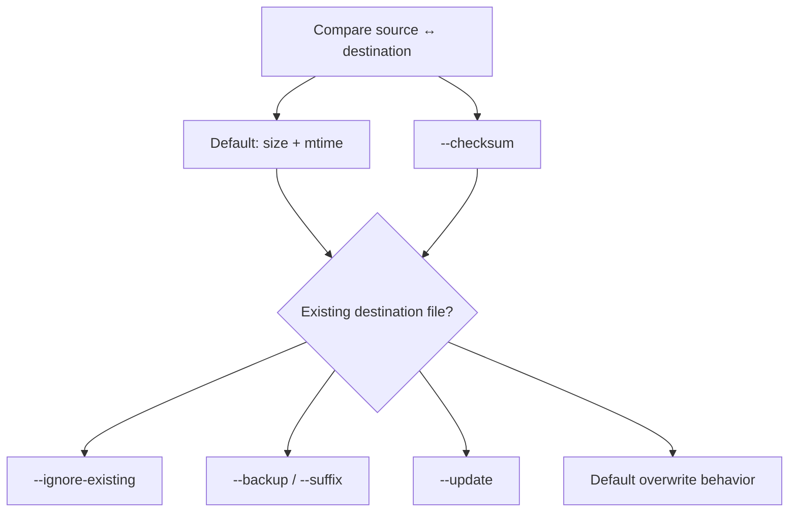
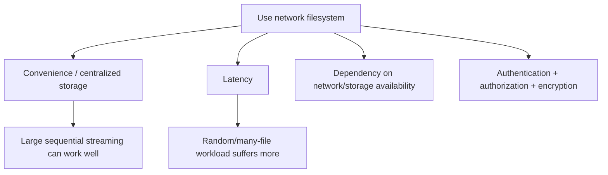
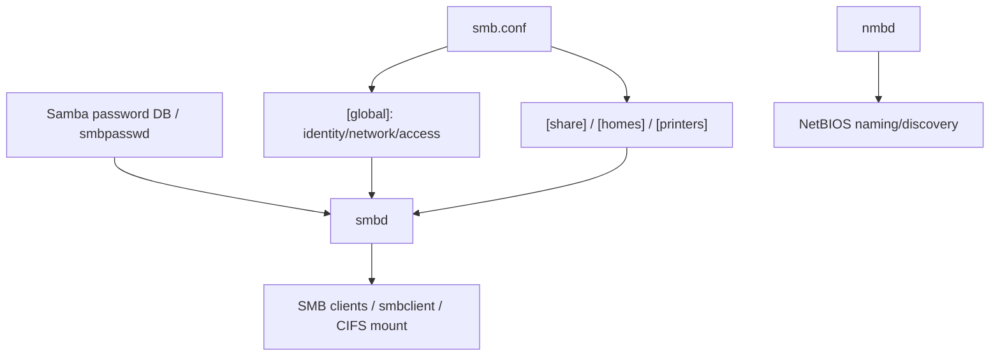
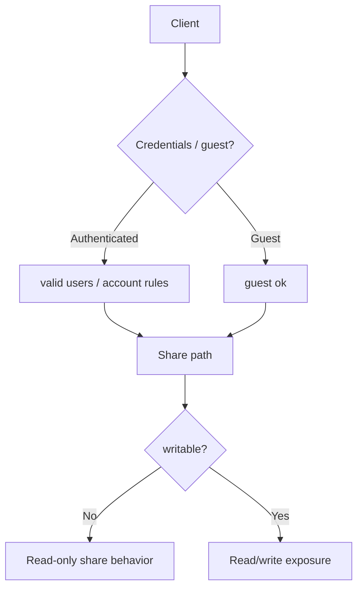
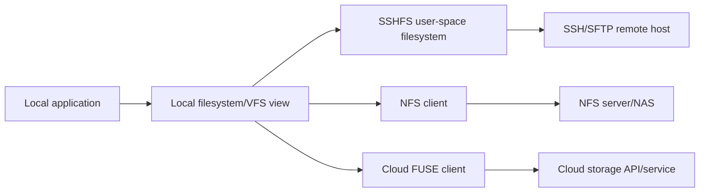
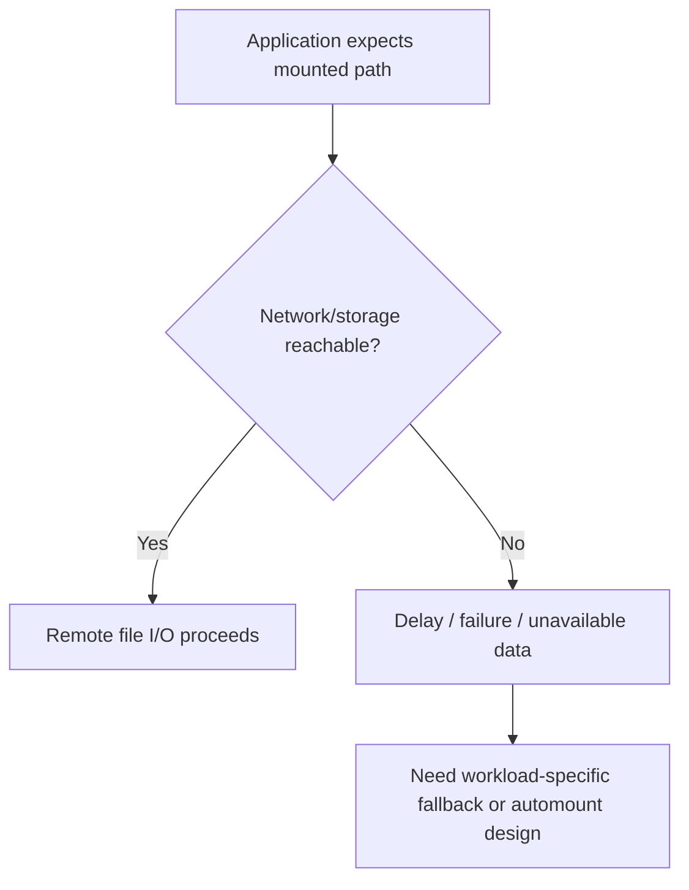
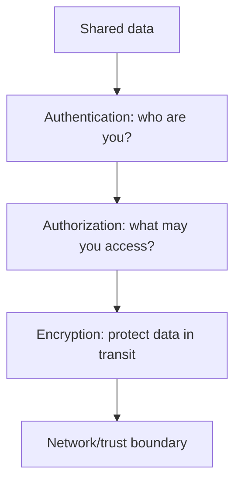

# Mermaid — глава 12 «Передача файлов по сети и доступ к ним»

Источник: **RAG `p0368:c01`–`p0389:c01`**, PDF/печатные страницы 368–389. Диаграммы синтезированы только из текстово подтверждённых связей главы; исходные рис. 12.1–12.2 не реконструируются.

## 1. Выбор механизма

The chapter's opening table explicitly treats these as different classes of problem.

## 2. rsync safety workflow

The dry-run/readback boundary is source-grounded; the generic rollback box is an operational synthesis because the chapter does not provide transactional restore semantics.

## 3. Trailing-slash semantics

This is the chapter's central rsync path-mapping warning (§12.2.3).

## 4. rsync comparison / overwrite choices

The source presents these options as ways to control confidence and overwrite behavior (§12.2.5).

## 5. Network-file-sharing trade-off

§12.3 distinguishes predictable sequential streaming from random access to many files.

## 6. Samba server model

The chapter separates server config, account database, service daemons and client access (§12.4).

## 7. Samba access boundary

The source explicitly warns against writable guest sharing.

## 8. SSHFS / NFS / cloud FUSE placement

The chapter emphasizes that SSHFS/cloud adapters are user-space/FUSE mechanisms, while NFS has historically included kernel client code.

## 9. Failure-coupling view

The exact failure behavior is environment-specific; the chapter's point is that unavailable network storage can degrade the whole system experience.

## 10. Security model

§12.3.2 explicitly separates identity/access control from encryption.
