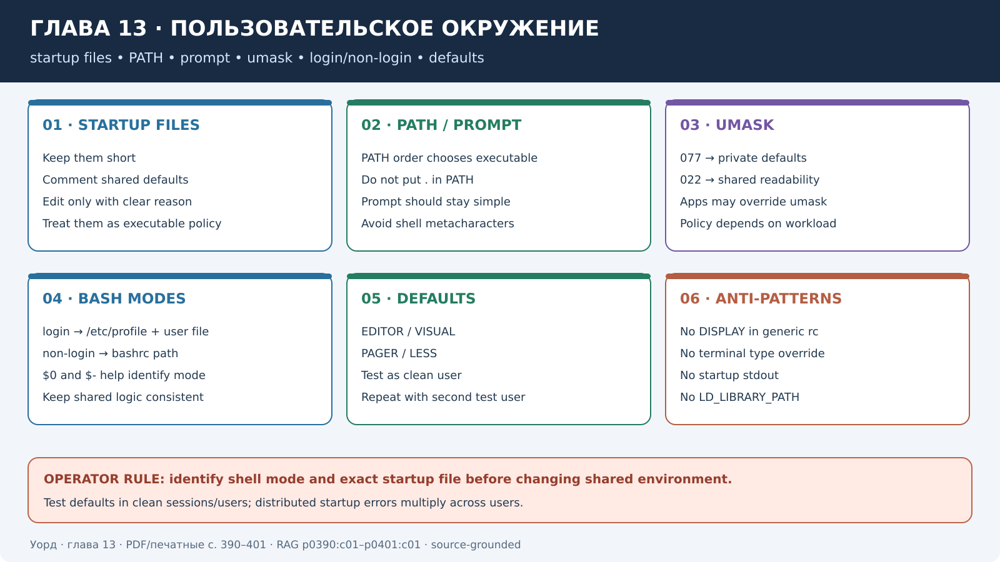
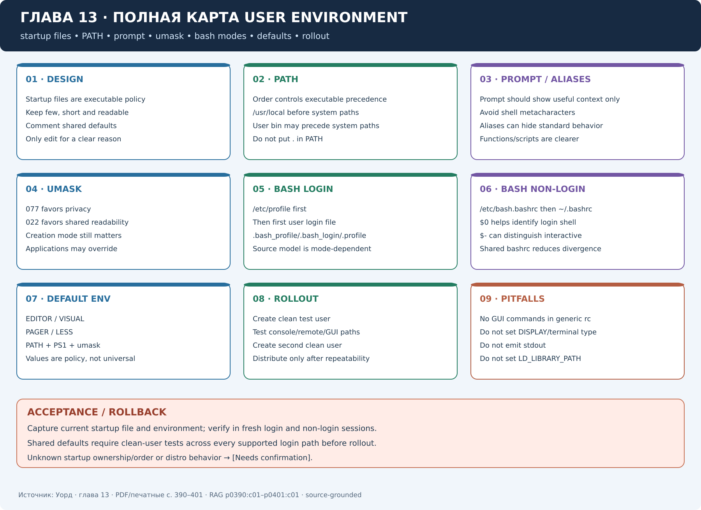

# Глава 13 — Пользовательское окружение

Брайан Уорд — «Внутреннее устройство Linux», 3-е русское издание, 2022.





## Идентификация и readiness

- Book ID: `how-linux-works-brian-ward-3e-ru-2022`; inventory: `0034`.
- Chapter: **13. Пользовательское окружение**; slug: `user-environment`.
- Source: `source/book.pdf`; SHA-256 `eee3833ea6ac0fe70268f66076c2ed2bd413b41484bd51d75af7b3ed3ae40ac3`.
- RAG acceptance: **ACCEPTED**, `failed_checks: []`.
- Extraction: `READY_WITH_KNOWN_LIMITATIONS`.
- Source policy: **rag_only**; external web, model-memory completion and direct canonical-PDF reading are not used.

## Chapter boundary

- PDF/printed pages: **390–401** inclusive.
- RAG chunks: **`p0390:c01`–`p0401:c01`**.
- Chunk paths: `rag/chunks/p0301-p0400/p0390-c01.md` … `p0400-c01.md`, then `rag/chunks/p0401-p0500/p0401-c01.md`.
- TOC evidence: `p0017:c01`–`p0018:c01`.
- `p0390:c01` begins chapter 13.
- `p0401:c01` contains §13.7 «Далее о файлах запуска» and closes the chapter.
- `p0402:c01` begins chapter 14.
- **Chapter boundary verified: YES.**

## Карта главы

| Раздел | PDF/печатные с. | Содержание |
|---|---:|---|
| Вступление, 13.1–13.2 | 390–391 | Startup files, simplicity/readability, when not to modify them. |
| 13.3.1–13.3.5 | 392–395 | PATH, MANPATH, prompt, aliases, `umask`. |
| 13.4.1 | 395–398 | Bash startup ordering: login vs non-login; `.bashrc`, `.bash_profile`, `/etc/profile`, `/etc/bash.bashrc`. |
| 13.4.2 | 398–399 | tcsh/csh startup files and example environment. |
| 13.5–13.5.3 | 399–400 | Testing defaults, shell/editor/pager recommendations. |
| 13.6 | 400–401 | Startup-file pitfalls: GUI commands, DISPLAY, terminal type, stdout, LD_LIBRARY_PATH. |
| 13.7 | 401 | Graphical startup files are out of scope; keep startup logic simple. |

## Основные идеи

**1. Startup files are shared operational policy.** A mistake in a personal file affects one user; a mistake distributed to ten users creates ten repair points. The chapter therefore prioritizes simplicity and readability (§13.1).

**2. Modify startup files only for a clear reason.** The source names prompt changes, critical software adjustments and repairing broken startup files as justified cases; otherwise existing distribution interactions under `/etc` may be disturbed (§13.2).

**3. PATH is both usability and security policy.** The source recommends system/local binary directories in deliberate order, discourages adding every application directory, and strongly warns against putting `.` in PATH because command behavior would depend on the current directory and could be exploited (§13.3.1).

**4. Do not override system MANPATH casually.** The chapter says modern systems can derive manual-page paths from system configuration such as `/etc/manpath.config`, so setting `MANPATH` may replace useful defaults (§13.3.2).

**5. Prompts should communicate context without becoming executable-looking clutter.** User/host/cwd can be useful; shell metacharacters such as `>` can cause accidental redirection when pasted (§13.3.3).

**6. Aliases hide behavior.** The source discourages using aliases to silently alter standard commands because they are non-obvious, awkward with arguments and not inherited by child/noninteractive shells. Functions or separate scripts are presented as clearer alternatives (§13.3.4).

**7. `umask` establishes default access boundaries.** The source contrasts `077` for privacy with `022` for environments where read access by other users/services is needed. The correct default depends on workload and multi-user policy (§13.3.5).

**8. Bash startup behavior depends on shell mode.** Login shells read `/etc/profile` and then the first matching user login file; interactive non-login shells read bashrc files. The source recommends minimizing divergence and shows `.bash_profile` sourcing `.bashrc` (§13.4.1).

**9. Default-environment changes should be tested as a new user.** The chapter proposes creating a clean test account, exercising console/remote/GUI/manual-page paths, then validating the same files with a second test account before distribution (§13.5).

**10. Startup files should not create hidden environmental side effects.** GUI commands, `DISPLAY`, terminal type, stdout-producing commands and `LD_LIBRARY_PATH` are specifically listed as things to avoid in shell startup files (§13.6).

## Главная операционная карта

```text
need to change startup environment
        ↓
is the change actually necessary?
        ↓
identify shell + login/non-login mode
        ↓
identify exact file(s) read in that mode
        ↓
capture current file / environment
        ↓
apply one minimal, commented change
        ↓
test as clean user in every relevant login path
        ↓
distribute only after repeatable verification
```

This is an operational synthesis of the chapter, not a distribution-specific shell policy.

## High-risk boundaries

- PATH ordering can change which executable is run; adding `.` creates a security/consistency risk.
- `umask` changes permissions of newly created files/directories and can affect service/user collaboration.
- Sourcing `.bashrc` from login files executes all contained commands in login context too.
- Startup files are code: distribution to many users amplifies errors.
- Setting `DISPLAY`, terminal type or `LD_LIBRARY_PATH` globally can break sessions or alter program loading.
- Commands that print to stdout in startup files can interfere with remote/noninteractive workflows.
- The chapter's bash/tcsh recommendations are edition/source context; actual distro startup-file ownership and defaults remain **[Needs confirmation]**.

## Артефакты

- [cheatsheet.md](cheatsheet.md) — startup-file change workflow, risks and acceptance checks.
- [commands.md](commands.md) — source-confirmed shell/environment constructs and startup paths.
- [diagram.md](diagram.md) — bash startup order, PATH, umask and rollout flows.
- [visual-cheatsheet.svg](visual-cheatsheet.svg) — compact visual summary.
- [visual-cheatsheet-detailed.svg](visual-cheatsheet-detailed.svg) — detailed chapter map.
- [source-findings.md](source-findings.md) — source/applicability limitations without silent correction.

## Conditional artifacts

- No explicit chapter-end `Выводы`/`Резюме`/`Что дальше?` section is present; §13.7 is a forward-looking scope note, so `summary.md` is omitted.
- No review/control questions or exercises are present; `review-questions.md` and `review-answers.md` are omitted.
