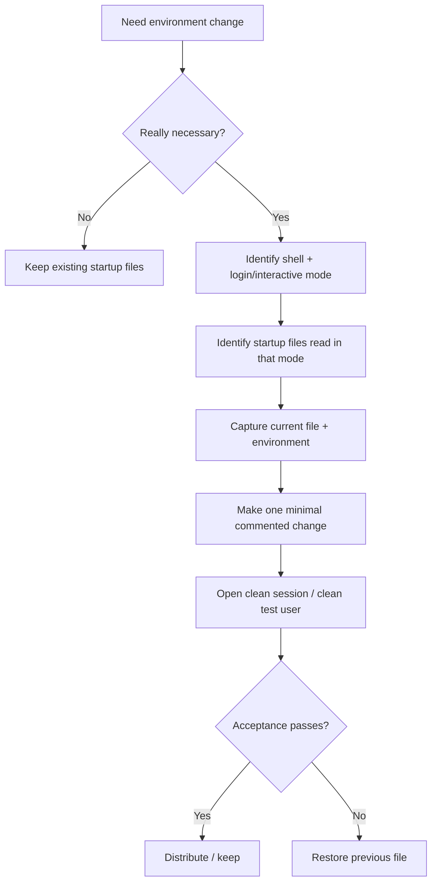
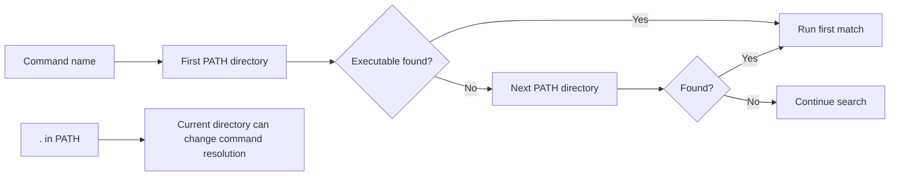
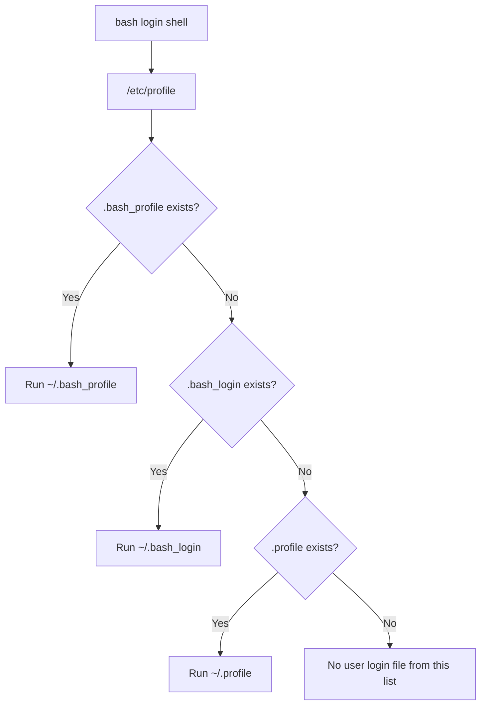
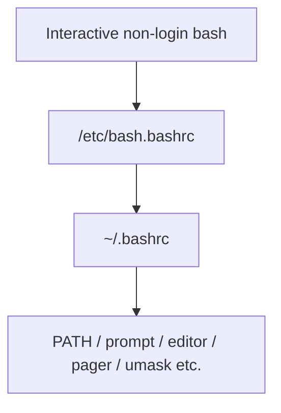
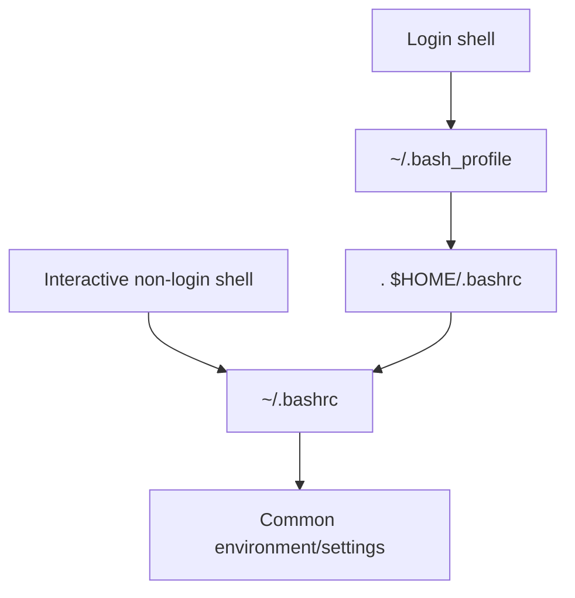
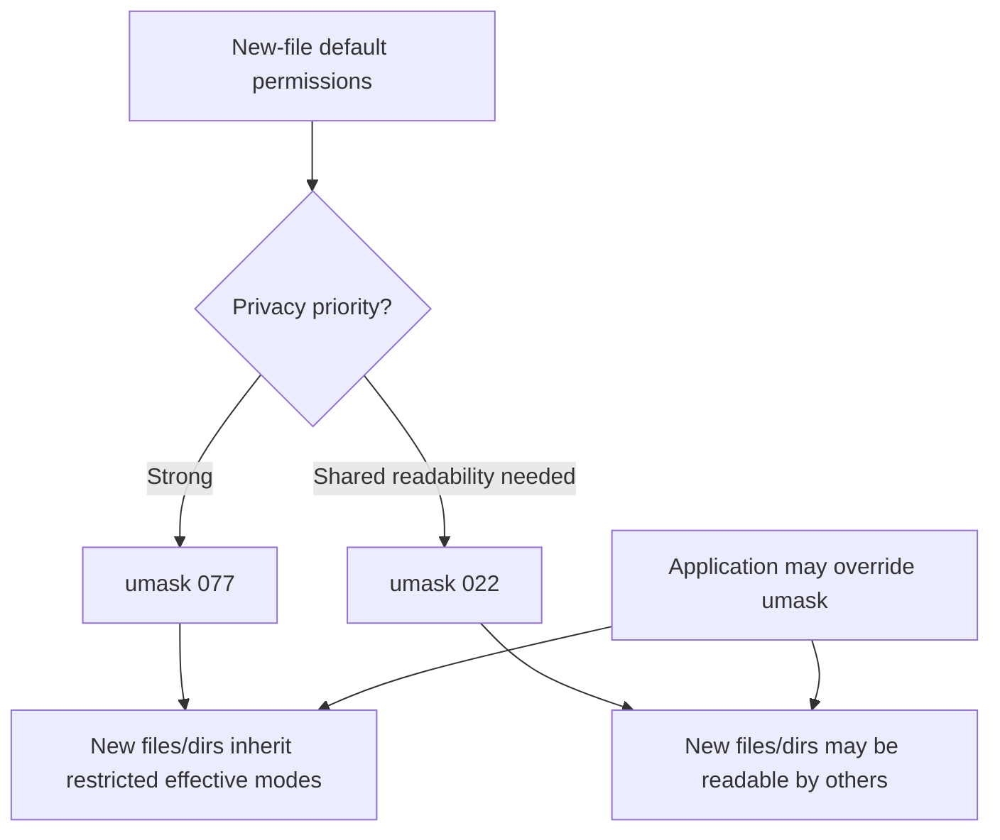
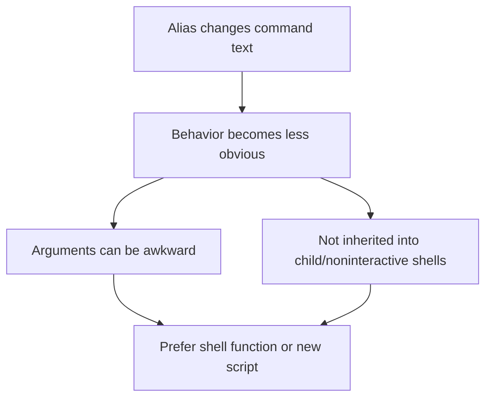
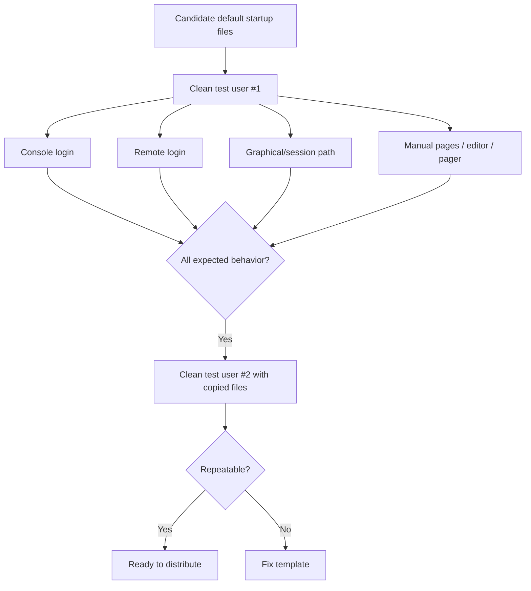
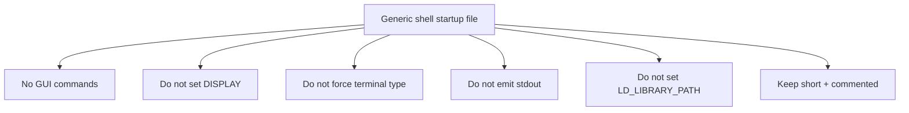

# Mermaid — глава 13 «Пользовательское окружение»

Источник: **RAG `p0390:c01`–`p0401:c01`**, PDF/печатные страницы 390–401. Диаграммы — аналитическое представление текстовых связей главы.

## 1. Startup-file change workflow

This operational flow synthesizes §§13.1–13.2 and §13.5.

## 2. PATH lookup model

The source treats PATH order as executable-precedence policy and discourages `.` (§13.3.1).

## 3. Bash login startup path

The source explicitly says only the first matching user login file is run (§13.4.1).

## 4. Bash interactive non-login path

This is the chapter's source model for terminal shells (§13.4.1).

## 5. Shared bashrc strategy

The source presents sourcing `.bashrc` from `.bash_profile` as a clearer alternative to symlinking the two files.

## 6. umask policy decision

The chapter frames 077 and 022 as trade-offs, not universal constants (§13.3.5).

## 7. Alias risk model

This represents the source's reasons for discouraging aliases that redefine standard commands (§13.3.4).

## 8. Clean-user rollout validation

The chapter explicitly recommends the two-test-user sequence (§13.5).

## 9. Startup-file anti-pattern boundary

These are explicit §13.6 guidance items.
