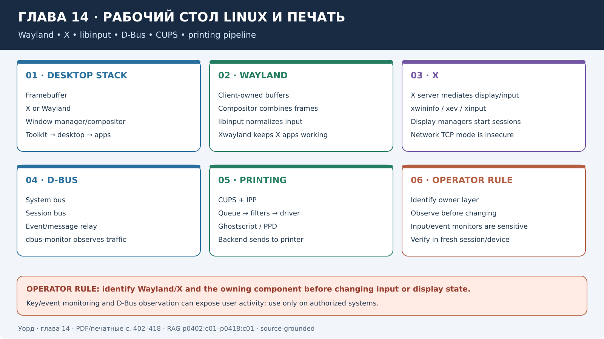
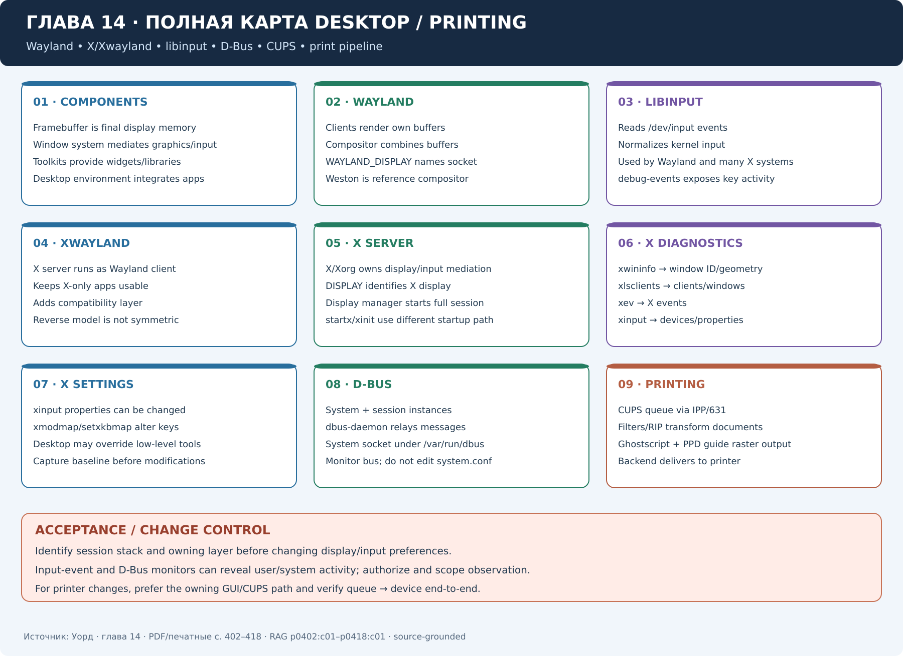

# Глава 14 — Краткий обзор рабочего стола Linux. Вывод на печать

Брайан Уорд — «Внутреннее устройство Linux», 3-е русское издание, 2022.





## Идентификация и readiness

- Book ID: `how-linux-works-brian-ward-3e-ru-2022`; inventory: `0034`.
- Chapter: **14. Краткий обзор рабочего стола Linux. Вывод на печать**; slug: `linux-desktop-and-printing`.
- Source: `source/book.pdf`; SHA-256 `eee3833ea6ac0fe70268f66076c2ed2bd413b41484bd51d75af7b3ed3ae40ac3`.
- RAG acceptance: **ACCEPTED**, `failed_checks: []`.
- Extraction: `READY_WITH_KNOWN_LIMITATIONS`.
- Source policy: **rag_only**; external web, model-memory completion and direct canonical-PDF reading are not used.

## Chapter boundary

- PDF/printed pages: **402–418** inclusive.
- RAG chunks: **`p0402:c01`–`p0418:c01`**.
- Chunk path: `rag/chunks/p0401-p0500/p####-c01.md`.
- TOC evidence: `p0018:c01`–`p0019:c01`.
- `p0402:c01` begins chapter 14.
- `p0418:c01` contains §14.7 «Дополнительно об окружениях рабочего стола» and closes the chapter.
- `p0419:c01` begins chapter 15.
- **Chapter boundary verified: YES.**

## Карта главы

| Раздел | PDF/печатные с. | Содержание |
|---|---:|---|
| Вступление, 14.1 | 402–405 | Desktop components: framebuffer, X, Wayland, window managers, toolkits, desktop environments, applications. |
| 14.2–14.3.3 | 406–409 | Detecting Wayland/X, Wayland compositor, libinput, Xwayland compatibility. |
| 14.4–14.4.5 | 409–415 | X server, display managers, network transparency, X inspection/events/input configuration. |
| 14.5–14.5.2 | 415–417 | D-Bus architecture, system/session buses, message monitoring. |
| 14.6–14.6.2 | 417–418 | Printing pipeline, CUPS, IPP, RIP/Ghostscript/PPD. |
| 14.7 | 418 | Desktop-environment scope and transition to developer tools. |

## Основные идеи

**1. Linux desktop architecture is component-based, not one deep stack.** The chapter describes framebuffer, display/window system, compositor/window manager, toolkit, desktop environment and applications as cooperating components with relatively distinct roles (§14.1).

**2. X and Wayland solve the same desktop problem with different centralization models.** X uses an X server as a central mediator for display/input, while Wayland shifts rendering buffers to clients and compositing/input coordination to a compositor (§14.1.2–14.1.4).

**3. Wayland is a protocol, not a single desktop server package.** Clients communicate with a compositor via the Wayland protocol/library; Weston is presented as a reference compositor rather than a normal end-user desktop (§14.3).

**4. A Wayland session still may contain X compatibility.** Xwayland lets X applications run as clients inside Wayland; the reverse is not symmetric. Running a compositor inside X is possible but can confuse dual-capable applications (§14.3.3).

**5. Input handling crosses kernel and user-space boundaries.** `libinput` reads kernel input devices and normalizes events for compositors/X; X additionally exposes its own input abstraction and device properties (§14.3.2, §14.4.5).

**6. X remains highly inspectable.** `xwininfo`, `xlsclients`, `xev`, `xinput` and related tools expose window IDs, clients, events, devices and properties. This makes the desktop observable but also means low-level configuration can conflict with desktop-environment settings (§14.4.3–14.4.5).

**7. D-Bus is a general IPC/message bus, not just a desktop mechanism.** The chapter distinguishes a system bus from an optional session bus and shows how daemons/applications subscribe to and relay system/desktop events (§14.5).

**8. Printing is a pipeline.** Application output goes to a print server/queue, may be filtered/rasterized and converted by drivers, then is sent through a backend to the printer. CUPS/IPP are the central server/protocol pieces in the chapter (§14.6).

**9. Desktop configuration should usually be left to the owning layer.** The source repeatedly shows overlapping configuration paths—desktop settings, X input tools, compositor behavior, CUPS GUI—and warns that low-level tools may be overridden or create confusing results.

## Главная операционная карта

```text
desktop symptom
   ↓
which display stack?
Wayland | X | Xwayland
   ↓
which component owns it?
compositor / X server / desktop environment / D-Bus / CUPS
   ↓
observe with narrow diagnostic tool
   ↓
change only the owning layer
   ↓
verify in fresh session / target device
```

This is an operational synthesis of the chapter, not a desktop-environment-specific runbook.

## High-risk boundaries

- `libinput debug-events --show-keycodes` reveals key events/keycodes and should not be used where sensitive input may be captured.
- `xinput --set-prop`, `--set-button-map`, `xmodmap`, `setxkbmap` change live input behavior and may be overridden by desktop settings.
- Starting nested Wayland compositors inside X can alter how dual-capable applications choose their backend and confuse the session.
- X network listening is described as historically unencrypted/insecure; the source says distributions commonly disable it.
- `dbus-monitor` may expose message metadata/content from the selected bus.
- CUPS administration via web UI is called unsafe by default in the source; GUI distribution tools are preferred for printer changes.
- Printing submits data to a queue/device and is state-changing even when used diagnostically.

## Артефакты

- [cheatsheet.md](cheatsheet.md) — display-stack/D-Bus/printing troubleshooting and change boundaries.
- [commands.md](commands.md) — source-confirmed Wayland/X/D-Bus/CUPS commands classified by effect.
- [diagram.md](diagram.md) — compositor, X, D-Bus and printing flows.
- [visual-cheatsheet.svg](visual-cheatsheet.svg) — compact visual summary.
- [visual-cheatsheet-detailed.svg](visual-cheatsheet-detailed.svg) — detailed chapter map.
- [source-findings.md](source-findings.md) — source wording/applicability limitations without silent correction.

## Conditional artifacts

- No explicit chapter-end `Выводы`/`Резюме`/`Что дальше?` section is present; §14.7 is a concluding scope/transition section, so `summary.md` is omitted.
- No review/control questions or exercises are present; `review-questions.md` and `review-answers.md` are omitted.
