# Mermaid — глава 14 «Краткий обзор рабочего стола Linux. Вывод на печать»

Источник: **RAG `p0402:c01`–`p0418:c01`**, PDF/печатные страницы 402–418. Диаграммы синтезированы из текстово подтверждённых связей главы.

## 1. Desktop components

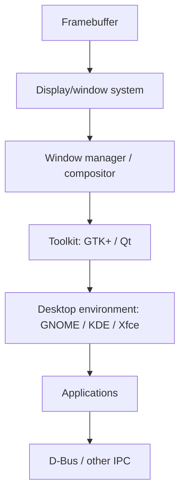

The chapter treats the Linux desktop as cooperating components rather than a strict deep hierarchy (§14.1).

## 2. X rendering model

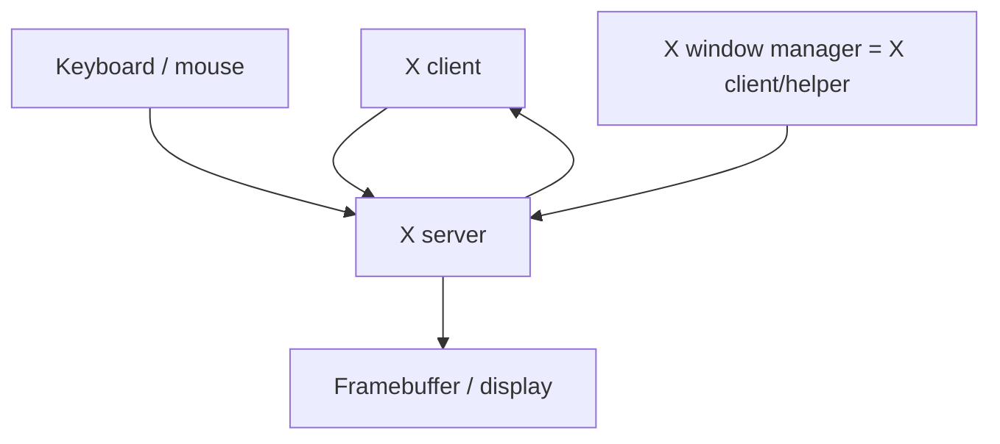

The X server centrally mediates rendering and input; the window manager is itself a client that assists with placement/decorations (§14.1.2, §14.1.4).

## 3. Wayland rendering model

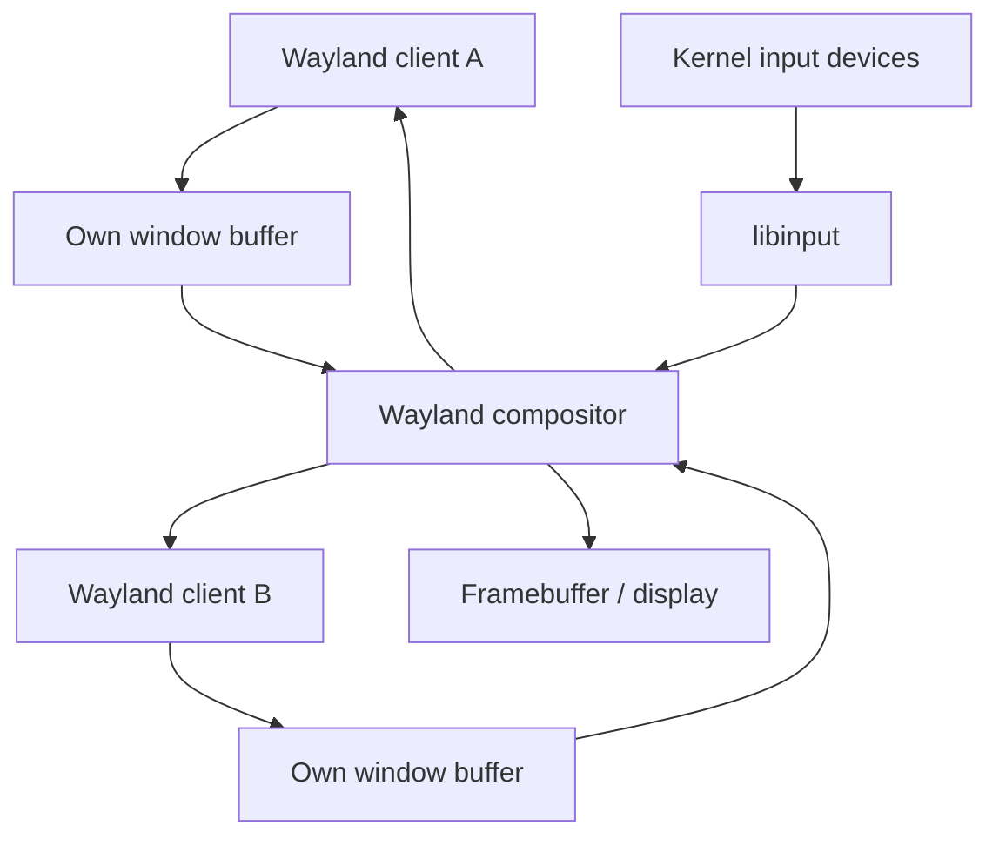

Wayland clients render their own buffers; the compositor combines them and routes input (§14.1.3–14.3.2).

## 4. Xwayland compatibility

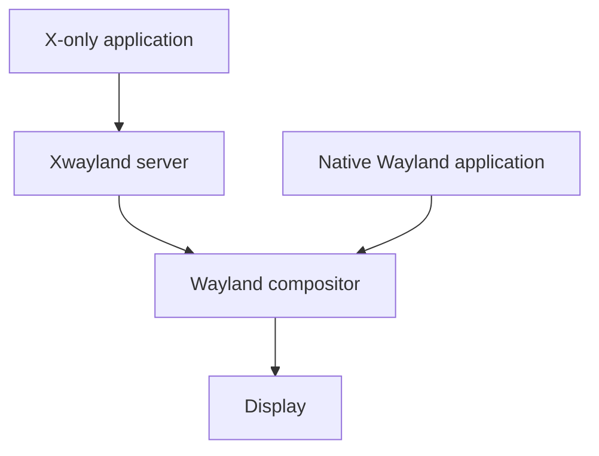

Xwayland is an X server running as a Wayland client; the source says the reverse model is not equivalent (§14.3.3).

## 5. Wayland compositor discovery

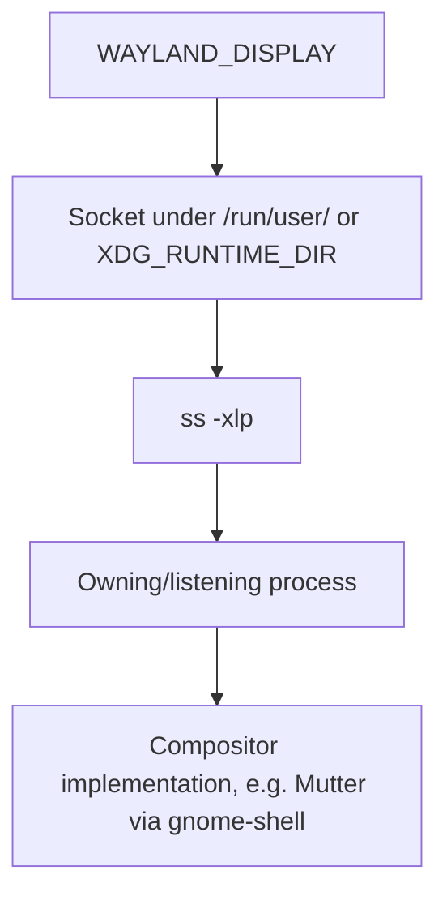

The source uses socket ownership as a practical way to infer the compositor process (§14.3.1).

## 6. X diagnostic ladder

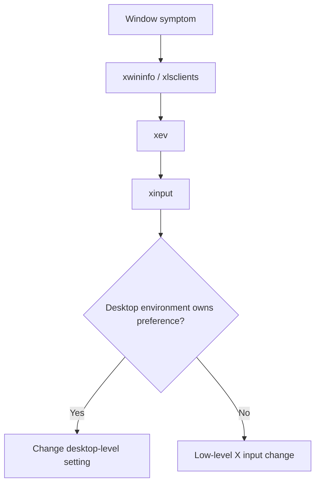

The chapter warns that multiple X configuration paths can overlap and be overridden (§14.4.3–14.4.5).

## 7. Input path

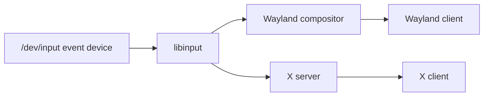

libinput is described as a kernel-event collection/normalization layer used by Wayland and many X systems (§14.3.2).

## 8. D-Bus event relay

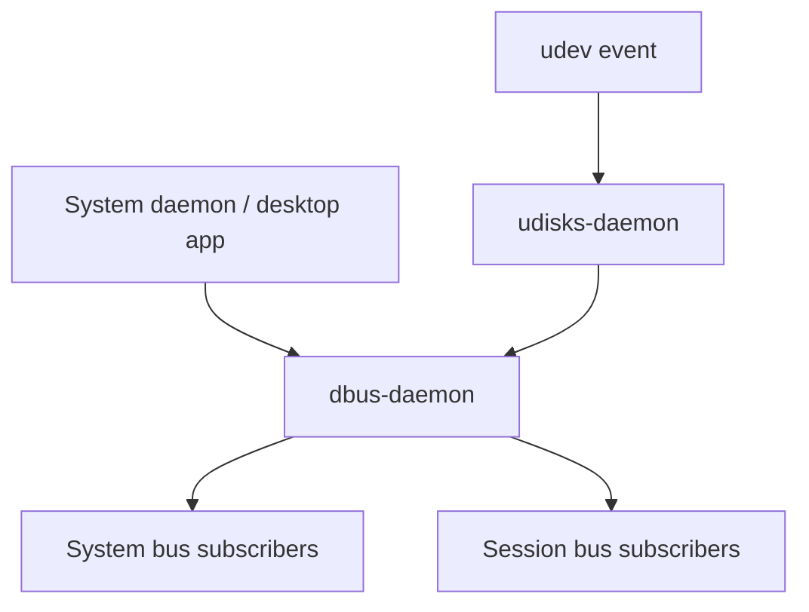

The source example shows udisks-daemon relaying device events through D-Bus to interested applications (§14.5).

## 9. D-Bus instance split

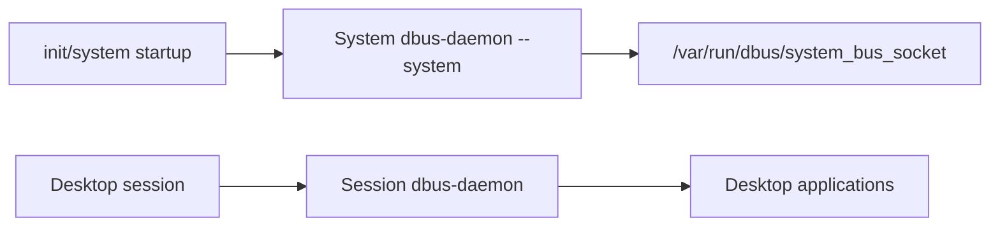

The chapter separates the system bus from the optional per-session desktop bus (§14.5.1).

## 10. Printing pipeline

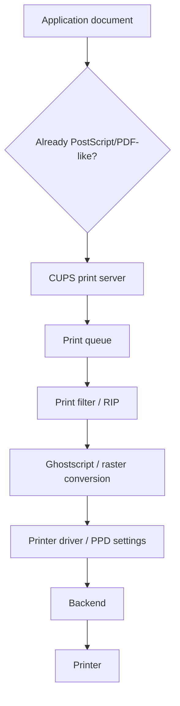

The chapter describes printing as a staged conversion/queue/backend pipeline (§14.6).

## 11. Desktop troubleshooting workflow

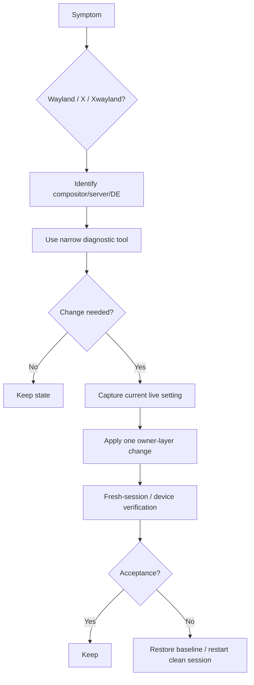

This is an operational synthesis of the chapter rather than a desktop-specific deployment procedure.
