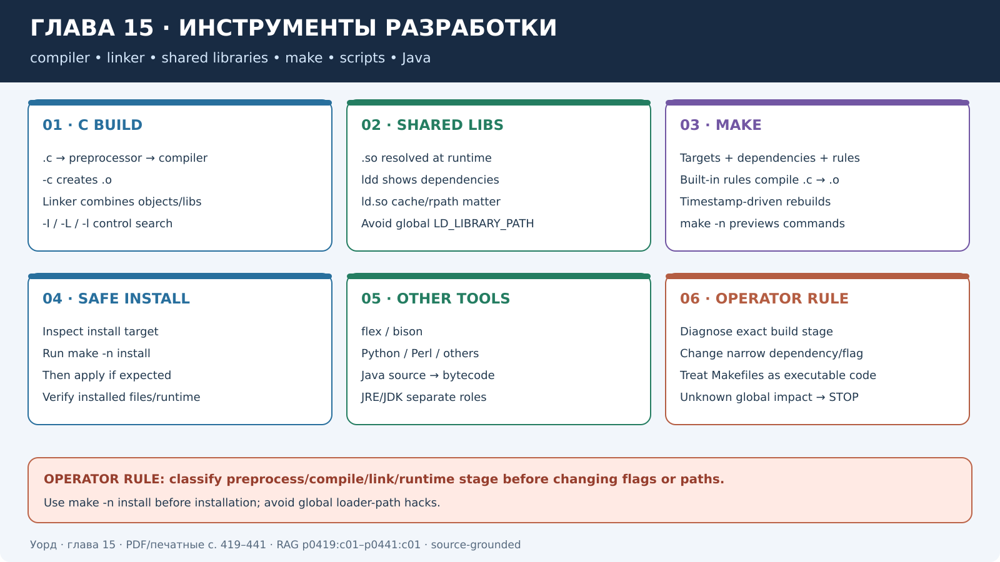
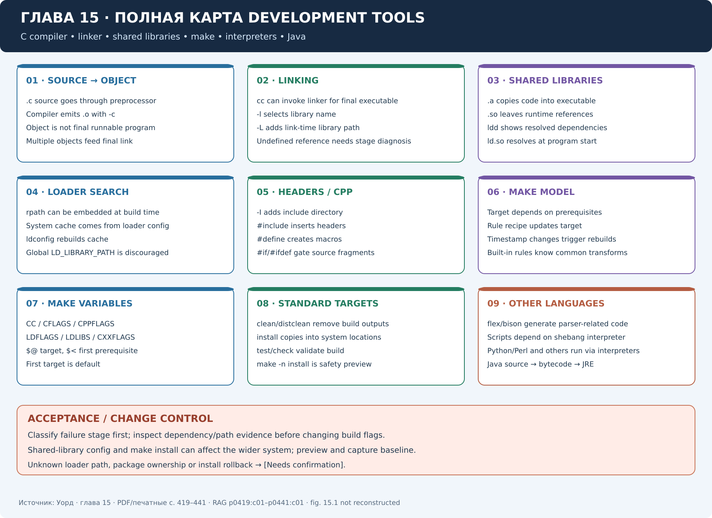

# Глава 15 — Инструменты разработки

Брайан Уорд — «Внутреннее устройство Linux», 3-е русское издание, 2022.





## Идентификация и readiness

- Book ID: `how-linux-works-brian-ward-3e-ru-2022`; inventory: `0034`.
- Chapter: **15. Инструменты разработки**; slug: `development-tools`.
- Source: `source/book.pdf`; SHA-256 `eee3833ea6ac0fe70268f66076c2ed2bd413b41484bd51d75af7b3ed3ae40ac3`.
- RAG acceptance: **ACCEPTED**, `failed_checks: []`.
- Extraction: `READY_WITH_KNOWN_LIMITATIONS`.
- Source policy: **rag_only**; external web, model-memory completion and direct canonical-PDF reading are not used.

## Chapter boundary

- PDF/printed pages: **419–441** inclusive.
- RAG chunks: **`p0419:c01`–`p0441:c01`**.
- Chunk path: `rag/chunks/p0401-p0500/p####-c01.md`.
- TOC evidence: `p0019:c01`.
- `p0419:c01` begins chapter 15.
- `p0441:c01` contains §15.6 «А что дальше? Компиляция пакетов» and closes the chapter.
- `p0442:c01` begins chapter 16.
- **Chapter boundary verified: YES.**

## Карта главы

| Раздел | PDF/печатные с. | Содержание |
|---|---:|---|
| 15.1–15.1.2 | 419–423 | C compiler basics, object files, linker, static libraries, `-l`/`-L`. |
| 15.1.3 | 423–428 | Shared libraries, `ldd`, `ld.so`, `ldconfig`, rpath, `LD_LIBRARY_PATH`, failure modes. |
| 15.1.4 | 428–430 | Header/include search, `-I`, preprocessor, macros and conditional directives. |
| 15.2–15.2.8 | 430–437 | `make`, Makefile dependencies, built-in rules, variables/macros, dry-run, standard targets, organization. |
| 15.3 | 437 | Lex/flex and Yacc/bison. |
| 15.4–15.4.3 | 437–440 | Script languages, shebang/interpreter path, Python, Perl and others. |
| 15.5 | 440–441 | Java bytecode/JRE/JDK, `java`, `javac`, JAR. |
| 15.6 | 441 | Transition to package compilation; Go/Rust/LLVM context. |

## Основные идеи

**1. Build output is staged.** C source is compiled to object files, then linked into executables. For nontrivial programs, managing object files and dependencies manually quickly becomes impractical (§15.1–15.2).

**2. Linker failures are dependency evidence.** An `undefined reference` can mean either a missing library or a missing project object file. The chapter treats symbol names, `-l`, `-L` and tools such as `nm` as ways to localize the missing dependency (§15.1.2).

**3. Shared libraries are the chapter's most important systems topic.** Static libraries copy code into an executable; shared libraries leave runtime references resolved by the dynamic loader. This saves disk/memory and enables library updates without rebuilding every executable, but increases runtime dependency complexity (§15.1.3).

**4. Runtime library search is policy.** The dynamic loader uses embedded runtime search paths and the system library cache; the chapter strongly discourages indiscriminate edits to `/etc/ld.so.conf` and global `LD_LIBRARY_PATH` because of conflicts/performance risks (§15.1.3).

**5. Prefer build-time rpath over global runtime hacks.** For nonstandard library locations, the source recommends embedding rpath during linking and presents `LD_LIBRARY_PATH` only as a constrained workaround, ideally inside a wrapper script (§15.1.3).

**6. Header discovery is a separate dependency problem.** Missing headers fail before linking. `-I` changes include search; quoted includes usually mean a project-local header. The C preprocessor resolves includes/macros/conditional compilation before the compiler sees the resulting source (§15.1.4).

**7. `make` is dependency-driven orchestration.** Targets depend on prerequisites; rules describe how to update targets. `make` compares timestamps and performs only the minimum rebuild needed to restore consistency (§15.2).

**8. Dry-run matters before installation.** The source specifically recommends `make -n install` before `make install`, because install targets copy files into system-selected locations and can be dangerous (§15.2.7).

**9. Build variables separate concerns.** `CC`, `CFLAGS`, `CPPFLAGS`, `LDFLAGS`, `LDLIBS` and automatic variables let a Makefile express compiler/linker inputs without hardcoding every command (§15.2.5–15.2.6).

**10. Development tooling extends beyond C.** Lex/flex, Yacc/bison, scripting languages and Java use different execution/build models, but the operational task is the same: identify interpreter/compiler/runtime, dependencies and generated artifacts (§15.3–15.5).

## Главная операционная карта

```text
build/runtime symptom
   ↓
which stage?
preprocess → compile → link → runtime loader
   ↓
inspect exact error / dependency
   ↓
change narrow flag/path/dependency
   ↓
dry-run build/install where supported
   ↓
rebuild minimum target
   ↓
verify executable dependencies + runtime behavior
```

This is an operational synthesis of the chapter, not a universal build-system runbook.

## High-risk boundaries

- `ldconfig -v` rebuilds the system shared-library cache after library/config changes.
- Editing `/etc/ld.so.conf` or spreading `LD_LIBRARY_PATH` globally can destabilize unrelated programs; the source explicitly discourages both patterns.
- `patchelf` modifies existing binaries; the source names it but provides no concrete safe workflow.
- `make clean`/other cleanup targets remove build outputs.
- `make install` copies files into installation locations; always inspect `make -n install` first.
- Makefiles are executable build logic: an unfamiliar target can run arbitrary shell commands from the project.
- Compiler/linker commands create or overwrite build artifacts in the working tree.
- Script shebang paths and Java/Python interpreter locations are edition/source context; target availability remains **[Needs confirmation]**.

## Артефакты

- [cheatsheet.md](cheatsheet.md) — build-stage diagnosis, shared-library safety and install guardrails.
- [commands.md](commands.md) — source-confirmed compiler/linker/make/runtime commands classified by effect.
- [diagram.md](diagram.md) — compile/link/load, Makefile dependency and language-runtime flows.
- [visual-cheatsheet.svg](visual-cheatsheet.svg) — compact visual summary.
- [visual-cheatsheet-detailed.svg](visual-cheatsheet-detailed.svg) — detailed chapter map.
- [summary.md](summary.md) — explicit §15.6 «А что дальше? Компиляция пакетов».
- [source-findings.md](source-findings.md) — source inconsistencies/applicability limits without silent correction.

No review/control questions or exercises are present; review artifacts are omitted.
