# Mermaid — глава 15 «Инструменты разработки»

Источник: **RAG `p0419:c01`–`p0441:c01`**, PDF/печатные страницы 419–441. Диаграммы синтезированы из текстово подтверждённых связей главы; исходный рис. 15.1 не реконструируется.

## 1. C build pipeline

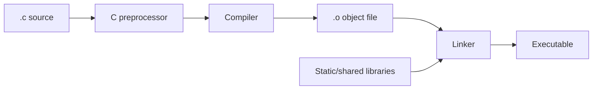

The chapter separates preprocessing, compilation to object files, and final linking (§15.1, §15.1.4).

## 2. Missing dependency by stage

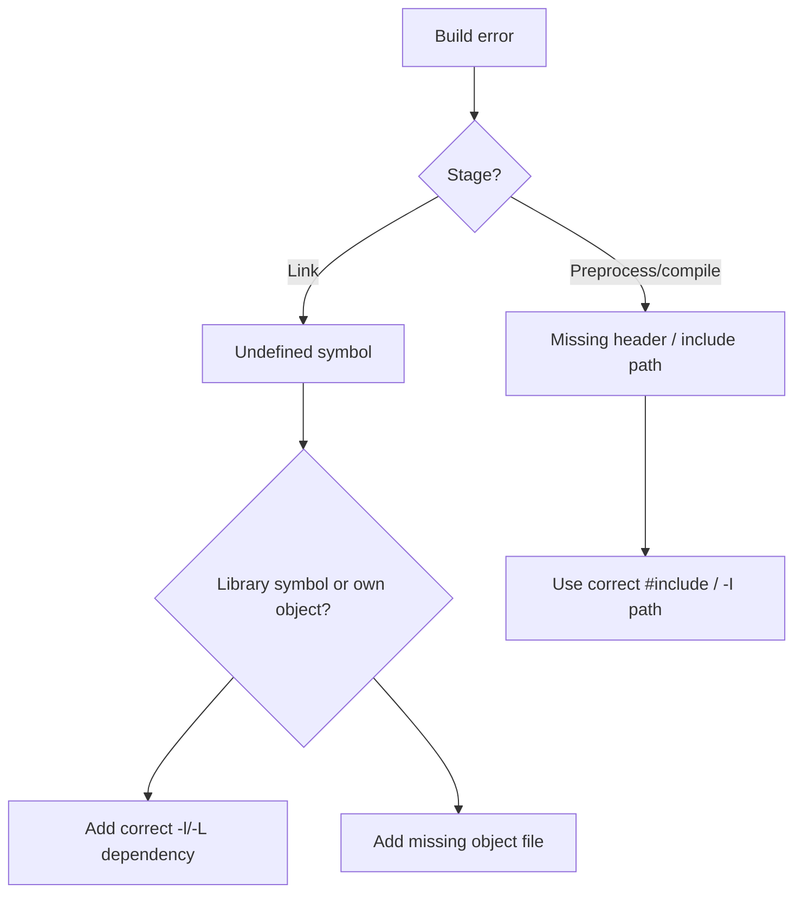

The source explicitly says an undefined reference is not always a missing library; it can be an omitted object file (§15.1.2).

## 3. Static vs shared library

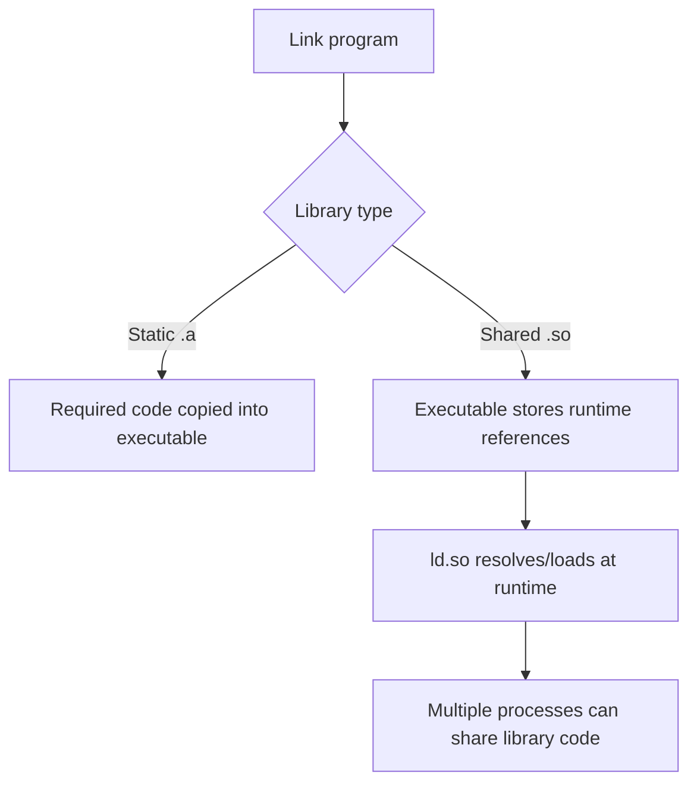

This is the chapter's central shared-library model (§15.1.3).

## 4. Runtime shared-library search

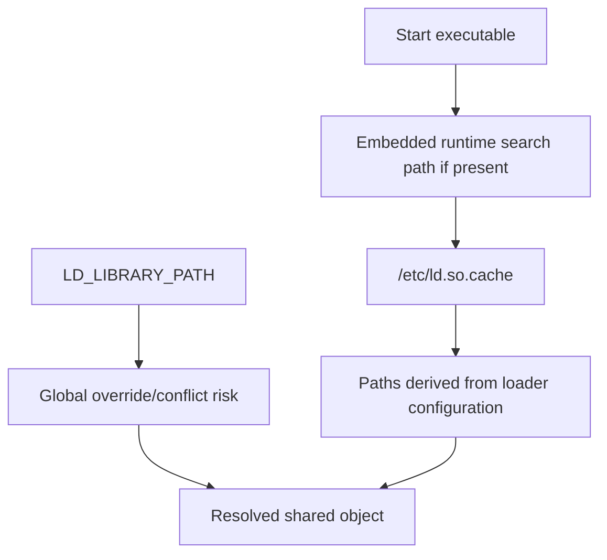

The source strongly discourages global `LD_LIBRARY_PATH` and arbitrary additions to `/etc/ld.so.conf` (§15.1.3).

## 5. Narrow nonstandard-library strategy

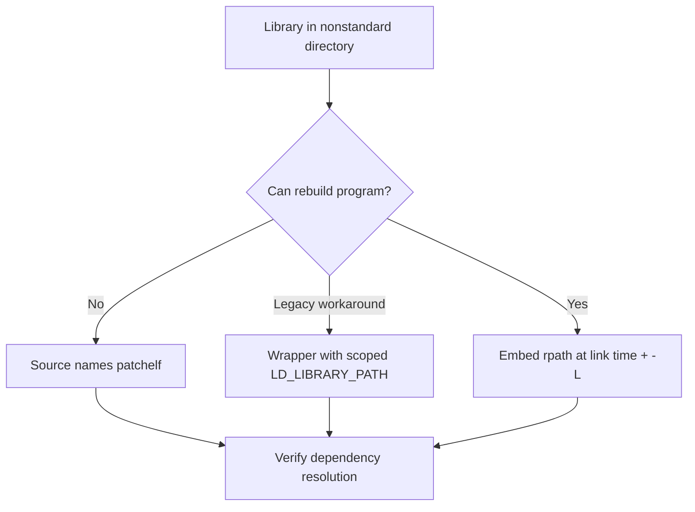

The wrapper approach is presented as a constrained exception, not a global policy.

## 6. Make dependency graph

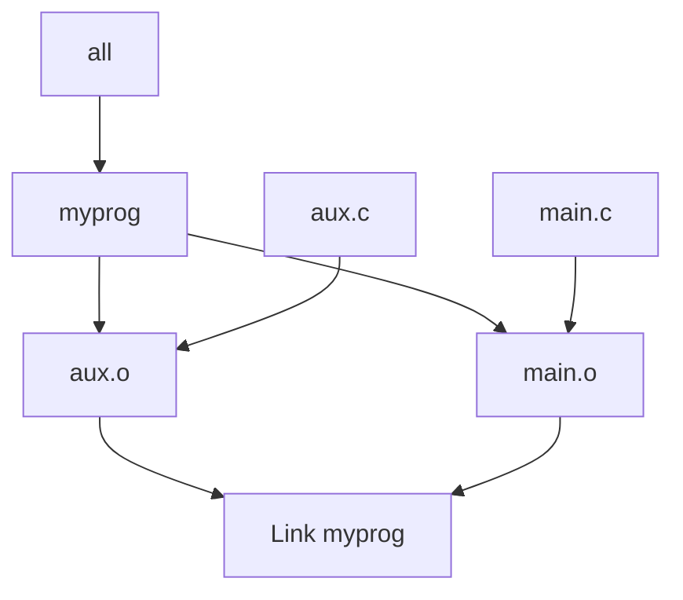

This reconstructs the text-confirmed dependencies behind fig. 15.1; original figure geometry is unavailable.

## 7. Make rebuild decision

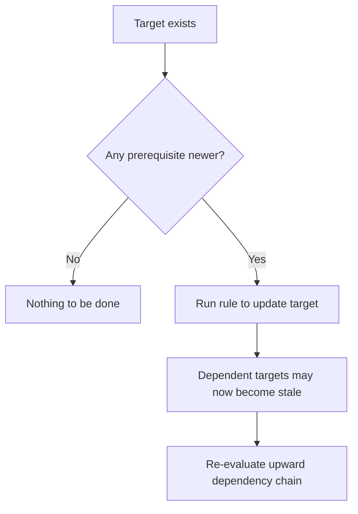

The source uses `touch aux.c` to demonstrate the cascading rebuild (§15.2.4).

## 8. Safe install workflow

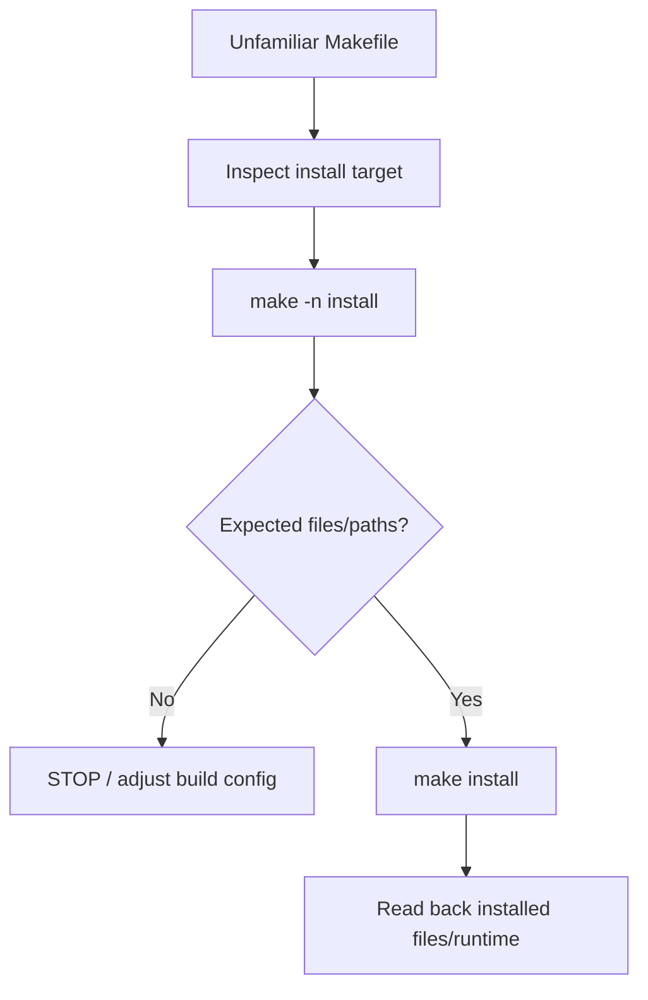

The dry-run-before-install rule is explicit in §15.2.7.

## 9. Shebang execution model

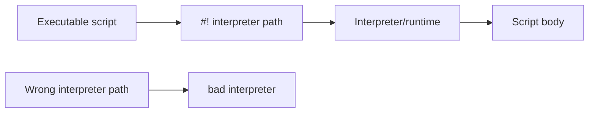

The chapter highlights interpreter-path correctness as a common script failure (§15.4).

## 10. Java model

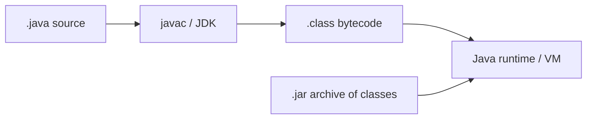

The source distinguishes Java source compilation from bytecode execution (§15.5).

## 11. Tool-choice / chapter transition

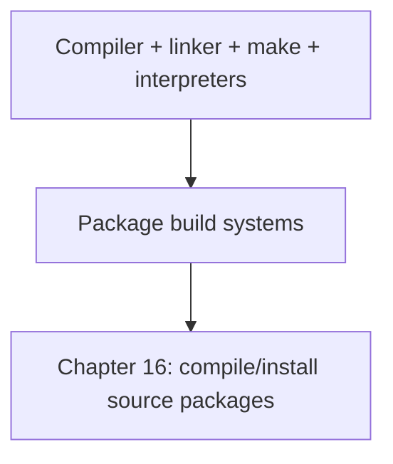

§15.6 explicitly transitions from individual development tools to package compilation.
