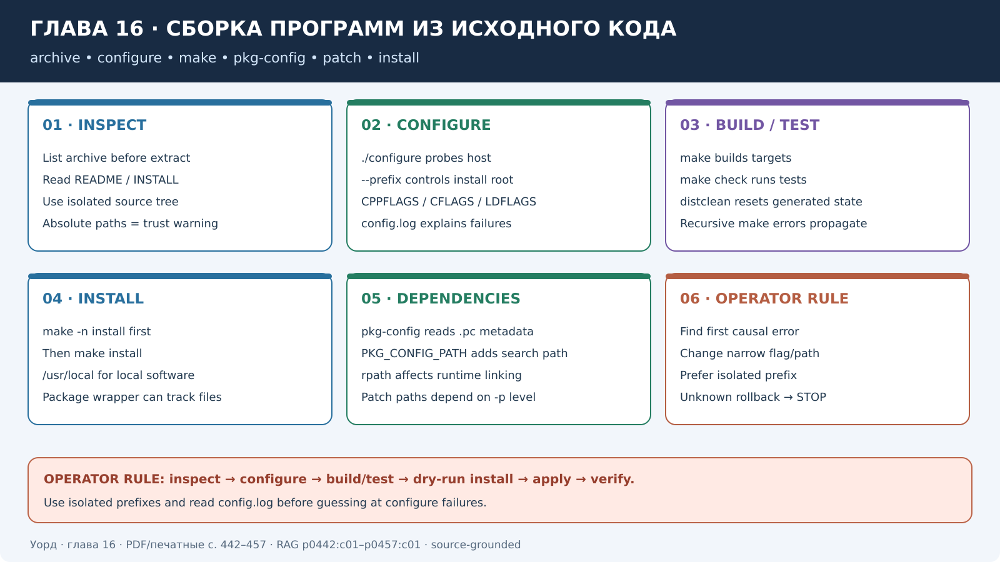
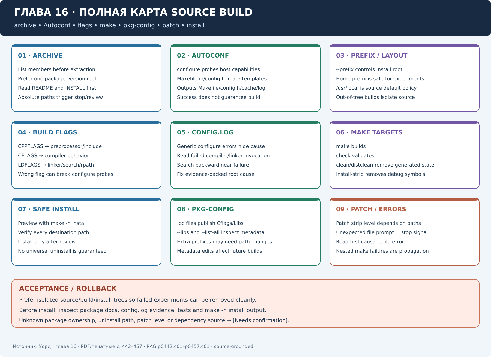

# Глава 16 — Компиляция программ из исходного кода на языке C

Брайан Уорд — «Внутреннее устройство Linux», 3-е русское издание, 2022.





## Идентификация и readiness

- Book ID: `how-linux-works-brian-ward-3e-ru-2022`; inventory: `0034`.
- Chapter: **16. Компиляция программ из исходного кода на языке C**; slug: `building-c-programs-from-source`.
- Source: `source/book.pdf`; SHA-256 `eee3833ea6ac0fe70268f66076c2ed2bd413b41484bd51d75af7b3ed3ae40ac3`.
- RAG acceptance: **ACCEPTED**, `failed_checks: []`.
- Extraction: `READY_WITH_KNOWN_LIMITATIONS`.
- Source policy: **rag_only**; external web, model-memory completion and direct canonical-PDF reading are not used.

## Chapter boundary

- PDF/printed pages: **442–457** inclusive.
- RAG chunks: **`p0442:c01`–`p0457:c01`**.
- Chunk path: `rag/chunks/p0401-p0500/p####-c01.md`.
- TOC evidence: `p0019:c01`–`p0020:c01`.
- `p0442:c01` begins chapter 16.
- `p0457:c01` contains §16.7 «Что дальше?» and closes the chapter.
- `p0458:c01` begins chapter 17.
- **Chapter boundary verified: YES.**

## Карта главы

| Раздел | PDF/печатные с. | Содержание |
|---|---:|---|
| Вступление, 16.1 | 442–443 | Why build from source; build-system stages; when manual installs make sense. |
| 16.2 | 443–445 | Inspecting/extracting source archives; README/INSTALL; Makefile/configure/CMakeLists/source/object files. |
| 16.3–16.3.4 | 445–449 | GNU Autoconf, `./configure`, prefix/options, out-of-tree builds, CPPFLAGS/CFLAGS/LDFLAGS/rpath. |
| 16.3.5–16.3.7 | 449–452 | Autoconf targets, `config.log`, `pkg-config`, `.pc` files, `PKG_CONFIG_PATH`. |
| 16.4–16.4.1 | 452–453 | Manual-install trade-offs, distribution packages, `/usr/local`. |
| 16.5 | 453–454 | Applying patches; working-directory/path-strip semantics with `patch -p0/-p1`. |
| 16.6–16.6.1 | 454–456 | Build/install troubleshooting: make recursion, headers, compiler/tool availability, source compatibility. |
| 16.7 | 457 | Next steps: other build systems, kernel builds, distro source packages, deeper development. |

## Основные идеи

**1. Building from source is a controlled exception, not the default maintenance path.** The source gives valid reasons—configuration control, install location, version control, learning—but also emphasizes that distribution packages simplify security updates and lifecycle management (§16 intro, §16.4).

**2. The source-build workflow is staged:** inspect/extract → configure → build → test → preview install → install. Each stage has different failure modes and rollback boundaries (§16.1–16.4).

**3. Inspect archives before extraction.** The chapter explicitly recommends `tar tvf`/ `tar ztvf` first, especially to detect archives that do not create a containing directory or contain absolute paths (§16.2).

**4. README/INSTALL are first-class inputs.** Before changing flags or editing Makefiles, read package-provided instructions because they may define nonstandard options, supported platforms and required dependencies (§16.2, §16.6).

**5. Autoconf separates discovery from build execution.** `./configure` probes the host and generates Makefiles/configuration headers; successful configuration does not guarantee successful compilation (§16.3).

**6. Install prefix is the main isolation mechanism.** The source demonstrates `--prefix=$HOME/mycoreutils` to keep a build independent from the system and later recommends `/usr/local` for locally installed software (§16.3.1, §16.4.1).

**7. Dry-run before installation is mandatory operational discipline.** The chapter explicitly calls for `make -n install` before `make install`, especially when evaluating unfamiliar installation paths (§16.3.1, §16.4).

**8. Build variables should be applied to the correct stage.** `CPPFLAGS` for preprocessor/include flags, `CFLAGS` for compiler flags, `LDFLAGS` for linker/search/rpath flags. A missing character can make `configure` report generic compiler failure; `config.log` is then the evidence source (§16.3.4, §16.3.6).

**9. `pkg-config` externalizes dependency metadata.** It reads `.pc` files to provide library/include flags. Nonstandard prefixes may require links/copies or `PKG_CONFIG_PATH`, which the chapter calls inefficient system-wide (§16.3.7).

**10. Patches are path-sensitive.** `patch -p0` and `-p1` operate relative to the current working directory and path prefixes embedded in the diff. A `File to patch:` prompt is evidence that the working directory/version may not match (§16.5).

**11. Troubleshoot the first causal error, not the final recursive make failure.** In nested make output, later `Error 2` lines are propagation; the source says to find the compiler/preprocessor error directly above the first relevant make failure (§16.6).

## Главная операционная карта

```text
source package
   ↓
inspect archive + README/INSTALL
   ↓
extract into isolated tree
   ↓
configure with explicit prefix/flags
   ↓
read config.log if configure fails
   ↓
make → make check
   ↓
make -n install
   ↓
install only if paths/actions are expected
   ↓
verify files + runtime
```

This is an operational synthesis of the chapter, not a universal build-system runbook.

## High-risk boundaries

- Extracting an untrusted archive can write unexpected paths; the source treats absolute-path entries as a reason to discard the archive.
- `make clean`/ `make distclean` remove generated files; `distclean` also removes generated configuration/Makefiles.
- `make install` and `make install-strip` change installation paths and may overwrite existing software.
- `checkinstall make install` / distro package-building tools execute installation logic while tracking artifacts.
- Editing `.pc` files changes dependency flags seen by future builds.
- `PKG_CONFIG_PATH`, `CPPFLAGS`, `LDFLAGS` and rpath can redirect dependency resolution.
- `patch` changes source files in place; wrong `-p` level/version can leave a partially modified tree.
- The source mentions temporarily putting `.` in PATH as a fallback for a broken Makefile; this broadens command lookup and is not the preferred path in these artifacts.
- Kernel/build-system/package-manager specifics are environment-dependent and remain **[Needs confirmation]**.

## Артефакты

- [cheatsheet.md](cheatsheet.md) — source-build workflow, dry-run discipline, troubleshooting and rollback.
- [commands.md](commands.md) — source-confirmed configure/make/pkg-config/patch commands classified by effect.
- [diagram.md](diagram.md) — build stages, Autoconf, pkg-config, patch and troubleshooting flows.
- [visual-cheatsheet.svg](visual-cheatsheet.svg) — compact visual summary.
- [visual-cheatsheet-detailed.svg](visual-cheatsheet-detailed.svg) — detailed chapter map.
- [summary.md](summary.md) — explicit §16.7 «Что дальше?».
- [source-findings.md](source-findings.md) — source wording/applicability inconsistencies without silent correction.

No review/control questions or exercises are present; review artifacts are omitted.
