# Mermaid — глава 16 «Компиляция программ из исходного кода на языке C»

Источник: **RAG `p0442:c01`–`p0457:c01`**, PDF/печатные страницы 442–457. Диаграммы синтезированы только из текстово подтверждённых связей главы.

## 1. Source-build lifecycle

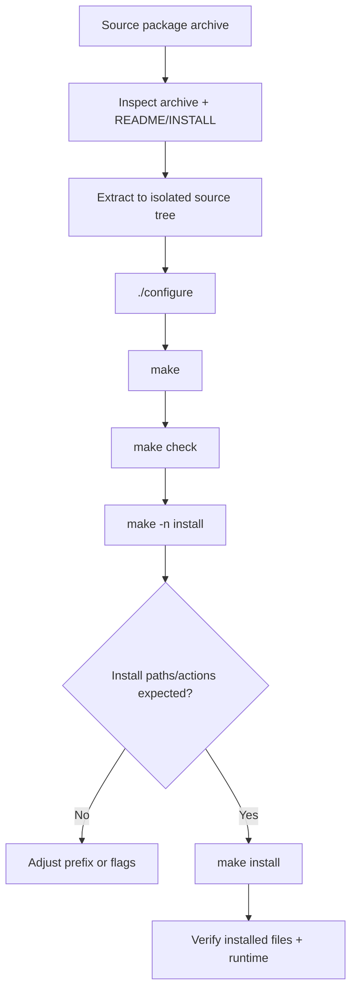

## 2. Archive inspection boundary

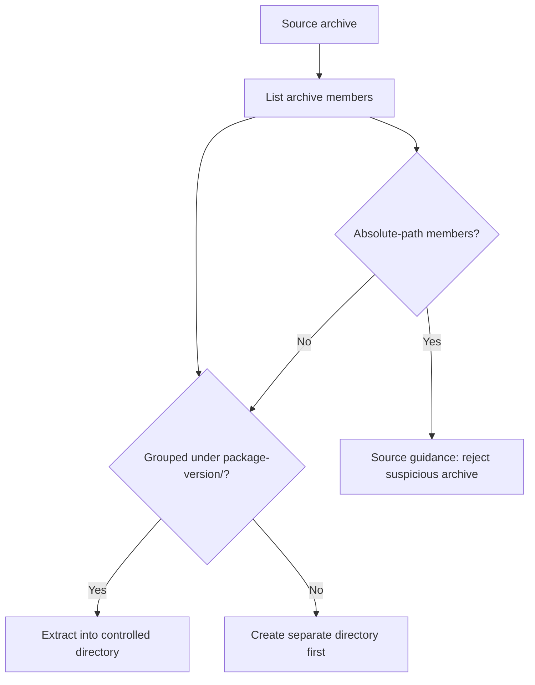

## 3. Autoconf generation flow

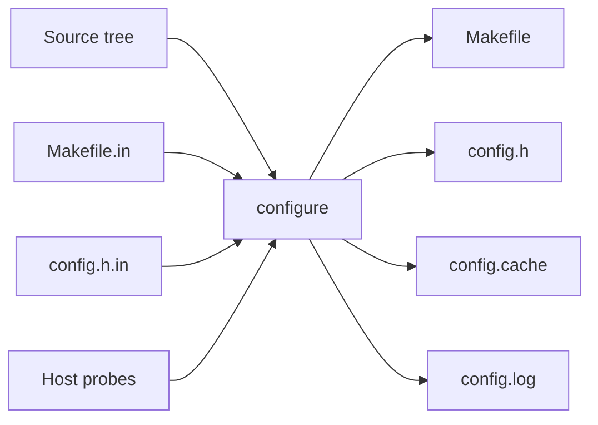

## 4. Configure flag routing

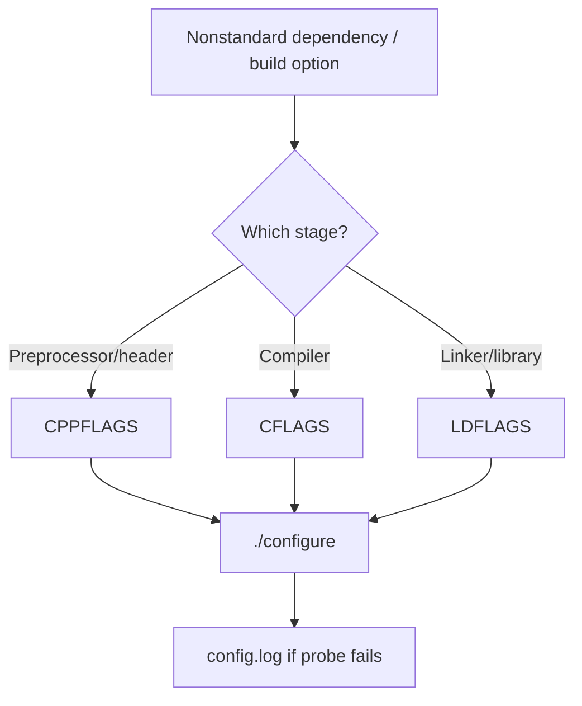

## 5. Isolated prefix strategy

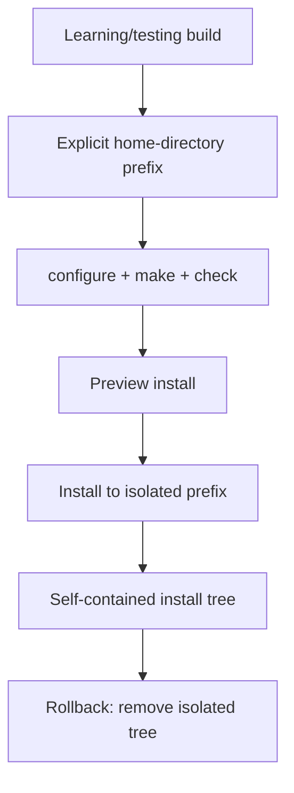

## 6. pkg-config dependency metadata

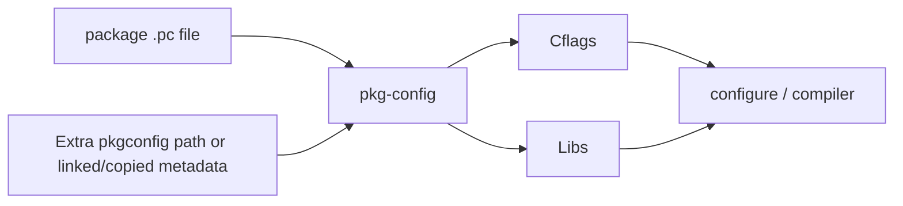

## 7. Patch path-level decision

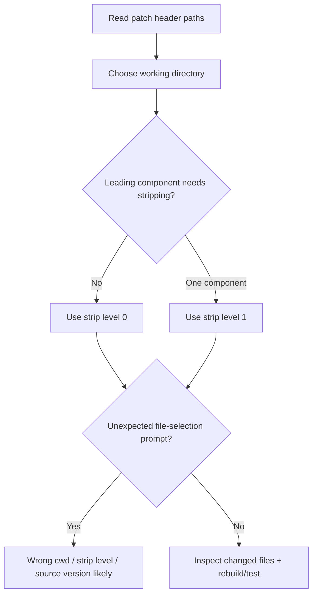

## 8. Configure failure workflow

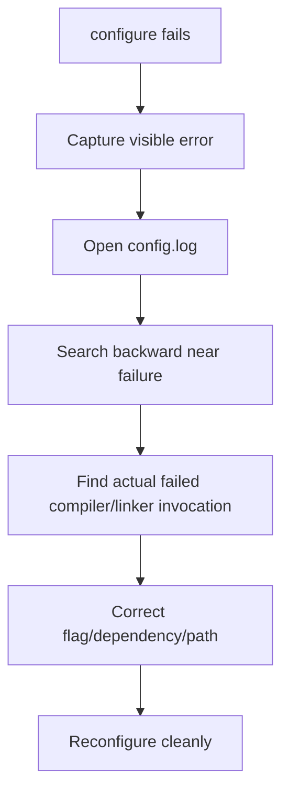

## 9. Recursive make error chain

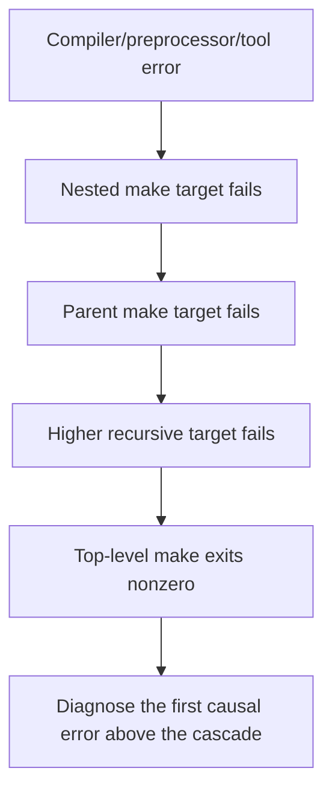

## 10. Install-location policy

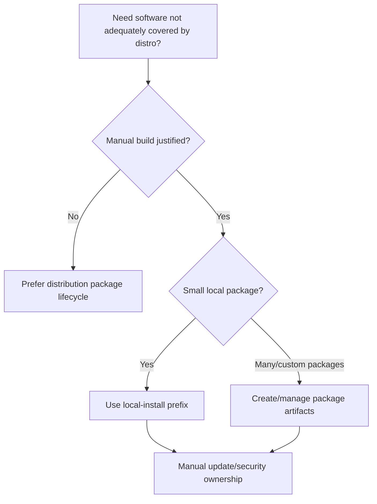

## 11. Chapter transition

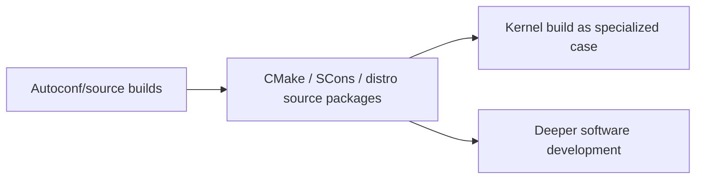

§16.7 explicitly points beyond basic Autoconf package builds.
