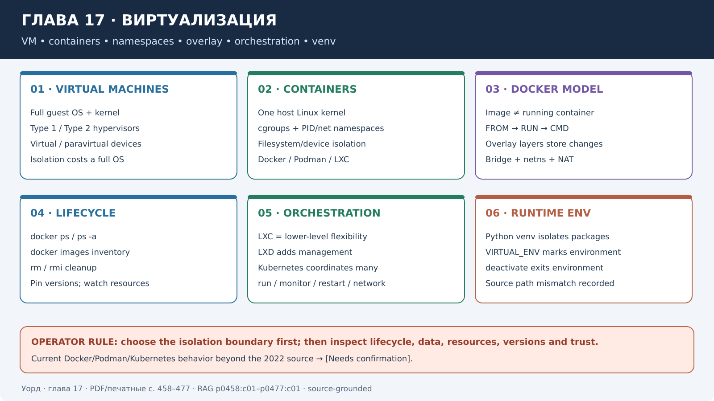
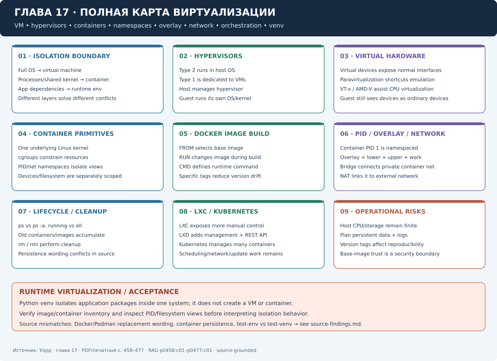

# Глава 17 — Виртуализация

Брайан Уорд — «Внутреннее устройство Linux», 3-е русское издание, 2022.





## Идентификация и readiness

- Book ID: `how-linux-works-brian-ward-3e-ru-2022`; inventory: `0034`.
- Chapter: **17. Виртуализация**; slug: `virtualization`.
- Source: `source/book.pdf`; SHA-256 `eee3833ea6ac0fe70268f66076c2ed2bd413b41484bd51d75af7b3ed3ae40ac3`.
- Book readiness for chapter analysis: **READY**.
- RAG acceptance: **ACCEPTED**, `failed_checks: []`.
- Extraction: `READY_WITH_KNOWN_LIMITATIONS`.
- Source policy: **rag_only**; external web, model-memory completion and direct canonical-PDF reading are not used.

## Chapter boundary

- PDF/printed pages: **458–477** inclusive.
- RAG chunks: **`p0458:c01`–`p0477:c01`**.
- Chunk path: `rag/chunks/p0401-p0500/p####-c01.md`.
- TOC evidence: `p0020:c01`.
- `p0458:c01` begins chapter 17 «Виртуализация».
- `p0477:c01` contains the end of §17.3.
- `p0478:c01` begins «Библиография».
- **Chapter boundary verified: YES.**

## Карта главы

| Раздел | PDF/печатные с. | Содержание |
|---|---:|---|
| Вступление, 17.1 | 458–459 | Goal of virtualization; system virtual machines; guest OS and virtual hardware. |
| 17.1.1 | 459–460 | Hypervisors type 1/type 2; host/guest terminology. |
| 17.1.2 | 460–461 | Virtual hardware, paravirtualization, processor modes, VT-x/AMD-V. |
| 17.1.3–17.1.4 | 461–463 | VM use cases and operational costs/limitations. |
| 17.2 | 463–464 | Containers as OS-level virtualization; shared kernel; cgroups/devices/filesystems/process/network isolation. |
| 17.2.1 | 464–465 | Docker, Podman and privilege/rootless model. |
| 17.2.2 | 465–473 | Docker image build, layers, image/container distinction, PID namespaces, overlay filesystem, network namespace/bridge/NAT, lifecycle and cleanup. |
| 17.2.3 | 473 | LXC/LXD model and trade-offs. |
| 17.2.4 | 473–474 | Kubernetes as orchestration for many containers. |
| 17.2.5 | 474–476 | Container infrastructure costs, storage/resources/data/logging/versioning/security pitfalls. |
| 17.3 | 476–477 | Runtime virtualization using Python virtual environments. |

## Основные идеи

**1. Виртуализация — это создание изолированных сред без конфликтов.** Глава использует это как общий принцип, но показывает три разных уровня: системные виртуальные машины, контейнеры и виртуализацию времени исполнения.

**2. Виртуальная машина виртуализирует целую машину.** В гостевой системе запускается полноценная ОС с ядром. Гипервизор типа 2 работает поверх обычной ОС; гипервизор типа 1 ориентирован на непосредственный запуск виртуальных машин.

**3. Виртуальное оборудование должно выглядеть для гостевой ОС как обычное устройство.** Глава связывает производительность с паравиртуализацией и аппаратной поддержкой виртуализации процессора, включая VT-x и AMD-V.

**4. Виртуальные машины дают сильную системную изоляцию, но несут стоимость полной ОС.** Источник перечисляет тестирование, совместимость приложений и серверные/облачные сценарии, а среди недостатков — время развертывания, обслуживание полной системы, конфликты зависимостей и стоимость большого количества отдельных VM.

**5. Контейнеры используют одно базовое ядро Linux.** Изоляция строится не одной функцией, а комбинацией механизмов ядра: групп управления, отдельных устройств/файловой системы, изоляции процессов и сетевых интерфейсов.

**6. Docker и Podman — инструменты управления контейнерной изоляцией, но модель привилегий различается.** В тексте Docker описан через демон и распространенную привилегированную модель, а Podman — через rootless-вариант. Точное современное поведение конкретной версии/дистрибутива — **[Needs confirmation]**.

**7. Образ и контейнер — разные сущности.** Образ задает основу файловой системы и конфигурацию; процессы выполняются в контейнере. Dockerfile-пример строит слои через `FROM`, `RUN` и `CMD`; `RUN` относится к сборке, `CMD` — к запуску контейнера.

**8. Контейнерная изоляция видна через пространства имен и overlay.** В примере PID внутри контейнера начинается с 1, хотя тот же процесс виден на хосте под другим PID. Файловая система собирается из lower/upper/work слоев. Сеть Docker описана через отдельный netns, виртуальную пару интерфейсов, мост и NAT.

**9. Жизненный цикл Docker требует явного контроля накопившегося состояния.** Глава показывает `docker ps`, `docker ps -a`, `docker images`, удаление завершенных контейнеров и старых образов. В источнике есть противоречие относительно сохранения изменений файловой системы после завершения процессов — см. `source-findings.md`.

**10. Контейнеры не отменяют эксплуатационные затраты.** Нужны ресурсы хоста, место хранения, стратегия данных и журналов, управление версиями образов, контроль безопасности и инфраструктура оркестрации.

**11. LXC и Kubernetes решают разные уровни задачи.** LXC дает более ручной и гибкий контейнерный механизм; LXD упрощает управление LXC. Kubernetes координирует запуск, мониторинг, перезапуск, сеть и обновления множества контейнеров.

**12. Runtime virtualization изолирует зависимости приложения, а не машину.** Python `venv` создает отдельное окружение пакетов и переменную `VIRTUAL_ENV`. В исходном примере есть несовпадение имени каталога при активации — см. `source-findings.md`.

## Главная операционная карта

```text
need isolation
   ↓
choose boundary
   ├─ full OS / kernel boundary → virtual machine
   ├─ process set on shared Linux kernel → container
   └─ application-language dependencies → runtime environment
            ↓
for containers:
image/config → build → run → inspect namespaces/filesystem/network
            ↓
observe lifecycle/resources/data/version/security
            ↓
controlled cleanup / update
            ↓
verify resulting state
```

## Source-confirmed operational checkpoints

- Distinguish image from running container.
- Inspect running container state with `ps`/`mount` and Docker inventory commands.
- Treat PID, filesystem and network views as namespaced views, not separate hardware.
- Track exited containers and untagged/old images so they do not accumulate.
- Use explicit image versions for stable environments; the source warns that `latest` can introduce unexpected changes.
- Treat container data, logs, resource ceilings and base-image trust as design inputs, not afterthoughts.
- Keep current-version Docker/Podman/Kubernetes behavior **[Needs confirmation]** rather than extending the 2022 source beyond its evidence.

## Артефакты

- [cheatsheet.md](cheatsheet.md) — operational/conceptual decision and verification map.
- [commands.md](commands.md) — only commands/interfaces explicitly supported by chapter RAG.
- [diagram.md](diagram.md) — Mermaid models of VM/container/runtime virtualization.
- [visual-cheatsheet.svg](visual-cheatsheet.svg) — compact visual summary.
- [visual-cheatsheet-detailed.svg](visual-cheatsheet-detailed.svg) — detailed visual summary.
- [source-findings.md](source-findings.md) — source contradictions/code mismatches and applicability boundaries.

Explicit chapter-end summary/review-question sections are not present: §17.3 ends on `p0477:c01`, and `p0478:c01` begins the bibliography. Therefore `summary.md`, `review-questions.md` and `review-answers.md` are not created.

## Ограничения

- This is a **RAG-only** chapter artifact set.
- No claims about current Docker, Podman, LXC/LXD, Kubernetes, VirtualBox, cloud-provider or Python behavior are added from external documentation.
- The book uses concrete version-era examples such as Alpine `latest`, Docker networking and rootless Podman details. Their applicability to a live system is **[Needs confirmation]**.
- The source contains material internal mismatches; they are recorded explicitly instead of silently corrected.
