# Mermaid — глава 17 «Виртуализация»

Источник: **RAG `p0458:c01`–`p0477:c01`**, PDF/печатные страницы 458–477. Диаграммы синтезированы только из связей, подтвержденных главой.

## 1. Isolation boundary

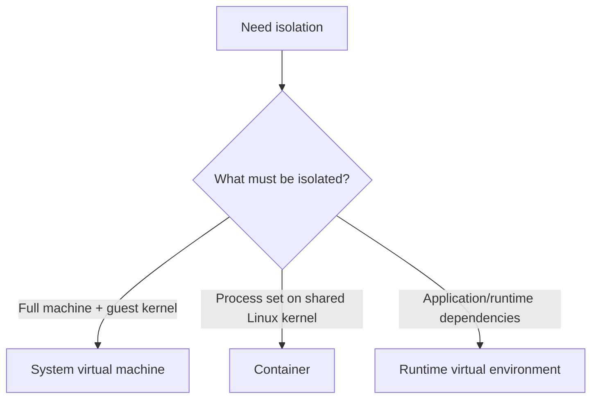

## 2. Hypervisor model

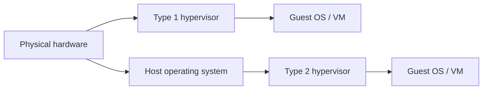

## 3. Virtual hardware path

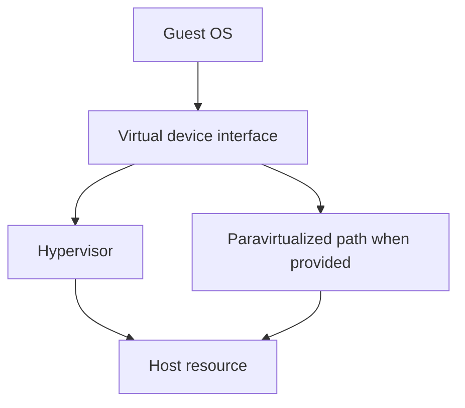

## 4. Container construction model

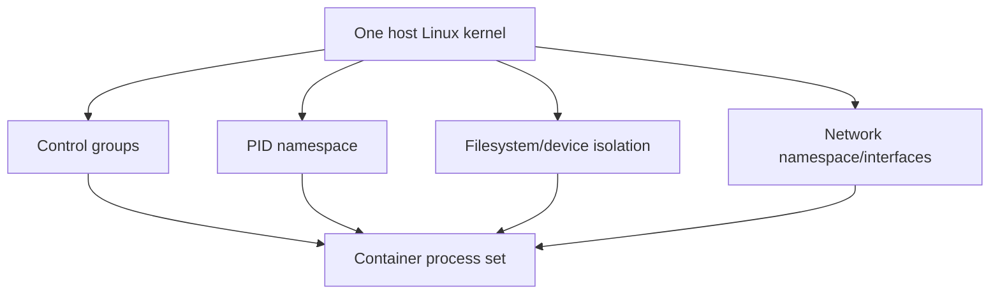

## 5. Docker image build

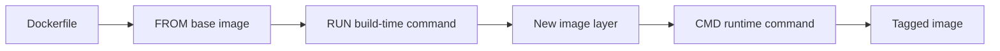

## 6. Image versus container lifecycle

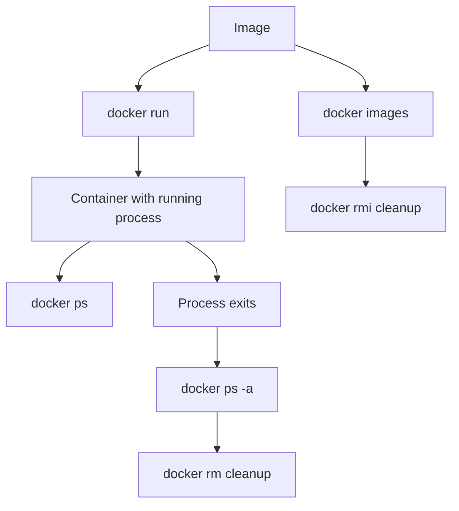

The source contains a contradiction about persistence of filesystem changes after process exit; this diagram therefore separates **exit** from explicit **container removal** and does not assert automatic filesystem deletion. See `source-findings.md`.

## 7. Docker network model

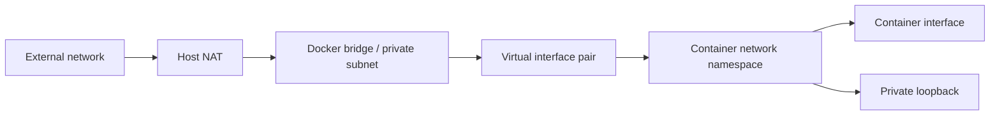

## 8. Overlay filesystem model

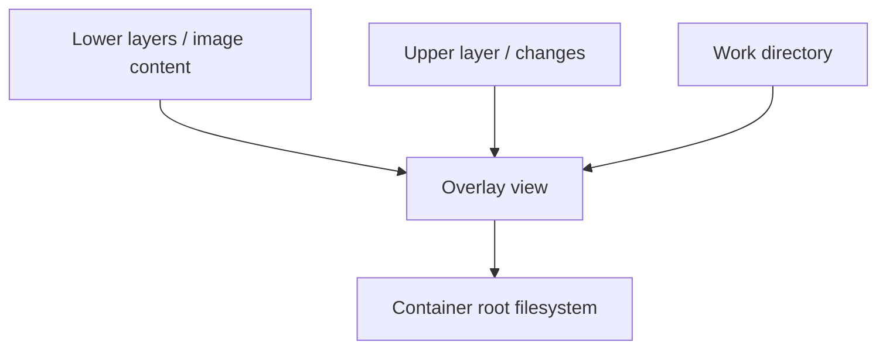

## 9. Container management levels

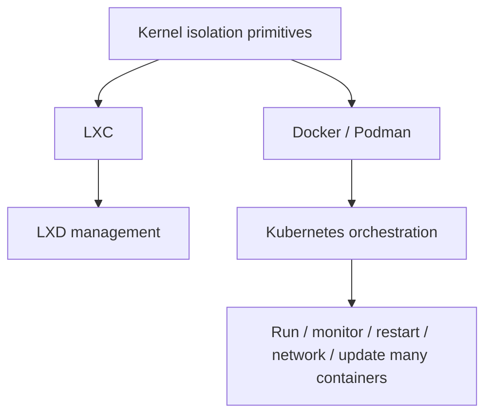

## 10. Container risk map

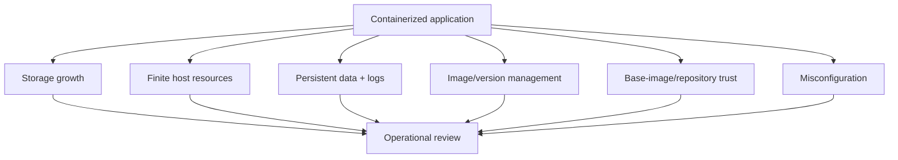

## 11. Python runtime virtualization

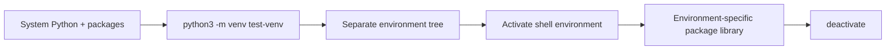

The literal activation path in the source uses `test-env` instead of the created `test-venv`; the diagram avoids silently choosing a corrected command and records the mismatch in `source-findings.md`.
