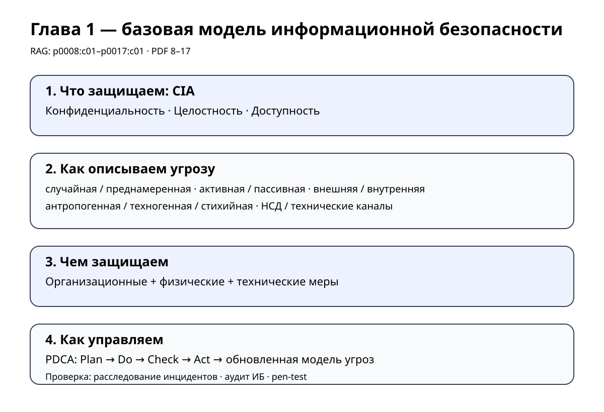
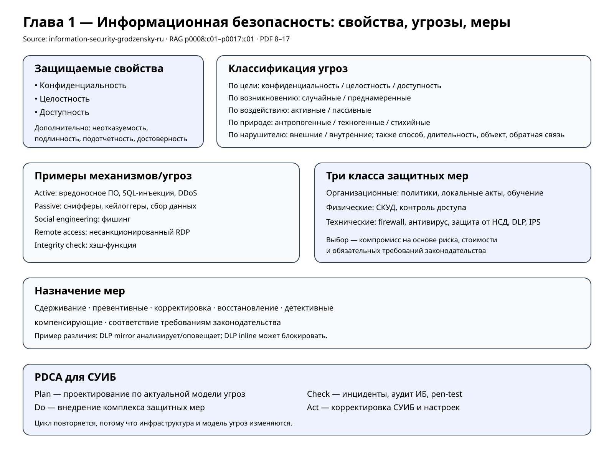

# Глава 1 — Понятие информационной безопасности (ИБ). Основные принципы ИБ. Виды угроз информационной безопасности. Классификация методов и мер обеспечения информационной безопасности

RAG-grounded разбор главы 1 книги «Информационная безопасность: учебное пособие» Я. С. Гродзенского.

## Идентификация

- Book ID: `information-security-grodzensky-ru`
- Глава: 1
- Slug: `information-security-basics`
- Source policy: `rag_only`
- External sources: запрещены
- Model memory: запрещена
- Прямой доступ к PDF: не использовался

## Provenance

- RAG chunks: `p0008:c01`–`p0017:c01`
- PDF pages: 8–17
- Source SHA-256: `4e4cf1d98c35c3d131d1aad21c5c7cd7da3c2548ef5e12dc75e27b4460a90c2f`
- `p0008:c01` начинается заголовком раздела 1.
- `p0017:c01` содержит итог раздела и вопросы для самопроверки.
- `p0018:c01` начинается разделом 2 «Стандартизация, сертификация и метрология как часть обеспечения информационной безопасности предприятия».
- Chapter boundary verified: yes
- Printed page range: [Needs confirmation]

## Содержимое

- [cheatsheet.md](cheatsheet.md) — рабочая модель главы.
- [commands.md](commands.md) — явно названные в главе средства, механизмы и проверки; shell-команд в главе нет.
- [diagram.md](diagram.md) — Mermaid-карта от свойств ИБ и угроз к мерам и циклу PDCA.
- [visual-cheatsheet.svg](visual-cheatsheet.svg) — компактный обзор.
- [visual-cheatsheet-detailed.svg](visual-cheatsheet-detailed.svg) — подробная схема.
- [summary.md](summary.md) — chapter-end summary по `p0017:c01`.
- [review-questions.md](review-questions.md) — 4 вопроса для самопроверки.
- [review-answers.md](review-answers.md) — ответы, основанные только на RAG главы.

## Карта главы

1. Информационная безопасность определяется через защиту конфиденциальности, целостности и доступности.
2. Дополнительно рассматриваются неотказуемость, подлинность, подотчетность и достоверность.
3. Информация разделяется на общедоступную и ограниченного доступа; среди конфиденциальной информации названы персональные данные, коммерческая, служебная и профессиональная тайна.
4. Угрозы классифицируются:
   - по цели воздействия;
   - по характеру возникновения;
   - по характеру воздействия;
   - по способу реализации;
   - по длительности;
   - по природе возникновения;
   - по принципу воздействия;
   - по типу злоумышленника;
   - по объекту атаки;
   - по наличию обратной связи с атакуемым объектом.
5. Преднамеренные угрозы разделяются на активные и пассивные.
6. Современные атаки могут сочетать социальную инженерию, эксплуатацию уязвимостей и технические каналы.
7. Источники угроз могут быть внешними и внутренними; последние особенно опасны из-за уже имеющегося доступа.
8. Защита строится как сочетание организационных, физических и технических мер.
9. Выбор мер должен учитывать риски и требования законодательства.
10. Меры дополнительно классифицируются как сдерживающие, превентивные, корректирующие, восстановительные, детективные, компенсирующие и меры соответствия.
11. Для корректировки СУИБ показан цикл PDCA: планирование → внедрение → проверка → корректировка.
12. Регулярные аудит ИБ и тесты на проникновение названы частью этапа проверки.

## Краткий анализ

Глава задаёт базовый понятийный каркас ИБ. Центральная модель — три свойства информации: конфиденциальность, целостность и доступность. Конфиденциальность означает доступ только авторизованным пользователям; целостность — отсутствие несанкционированного изменения; доступность — возможность уполномоченного субъекта реализовать права доступа в рамках предоставленных полномочий.

К этой триаде автор добавляет неотказуемость, подлинность, подотчетность и достоверность. Тем самым ИБ рассматривается не только как защита от чтения, изменения или недоступности, но и как способность подтвердить действия и субъекты, вести учет действий и обеспечивать соответствие результатов ожидаемому поведению.

Вторая опорная часть главы — классификация угроз. Рисунок 1 показывает многомерную модель: одна угроза может одновременно описываться по цели, происхождению, типу воздействия, способу реализации, длительности, источнику и объекту. Это важнее простой категории «вирус/хакер», потому что защитные меры выбираются относительно конкретной модели угроз.

Активные угрозы непосредственно воздействуют на функционирование информационной системы; пассивные в основном связаны с несанкционированным сбором информации без ее изменения и могут подготавливать активную атаку. Среди примеров упомянуты вредоносное ПО, SQL-инъекции, снифферы, кейлоггеры, несанкционированный RDP, фишинг и DDoS.

Глава отдельно подчеркивает внутренний источник риска: сотрудник или подрядчик уже может обладать доступом к данным и системам. Источником инцидента также может быть не злоумышленник, а ошибка, халатность, отказ техники или стихийное событие.

Защита не сводится к одному типу средств. Автор делит меры на технические, организационные и физические и прямо связывает их выбор с компромиссом между риском, стоимостью и требованиями законодательства. Приводится пример персональных данных, где набор мер определяется через последовательное обращение к нормативным требованиям.

Другая классификация описывает назначение мер: сдерживание, превентивные, корректирующие, восстановительные, детективные, компенсирующие и меры соответствия. На этой основе можно видеть защиту как жизненный цикл, а не как единичную закупку продукта.

Цикл PDCA применяется к СУИБ: спроектировать систему по актуальной модели угроз, внедрить меры, проверить ее через расследования, аудит и тесты на проникновение, затем скорректировать систему при изменении угроз или инфраструктуры.

## Основной принцип

ИБ — это не «одна защита от одной атаки», а управление рисками вокруг защищаемых свойств информации:

`свойства информации → модель угроз → сочетание мер → проверка → корректировка`.

При этом меры должны одновременно учитывать реальную угрозу, инфраструктуру, доступные ресурсы и обязательные требования законодательства.

## Ограничения

- Глава не содержит shell-команд и не задаёт готовую процедуру технической диагностики.
- Правовые ссылки и примеры приведены в состоянии источника; актуальность норм на текущую дату в рамках `rag_only` не проверялась.
- Рисунок 1 восстановлен в RAG как текстовая классификация; графический оригинал отдельно не кодируется.
- Подробные реализации криптографии, электронной подписи, сетевой безопасности и других направлений отнесены автором к последующим разделам.
