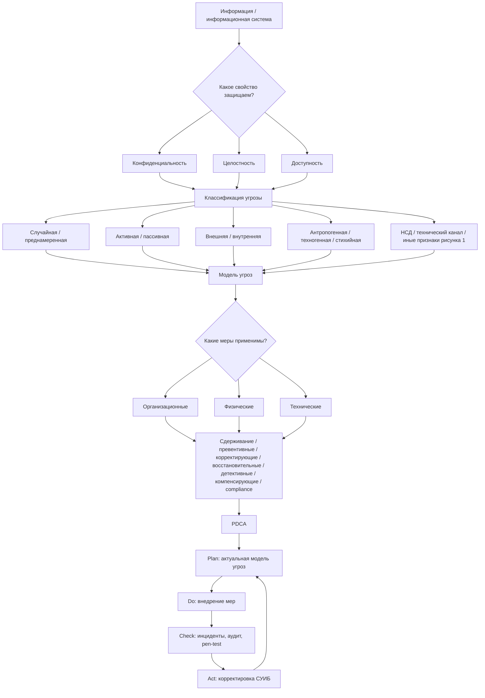
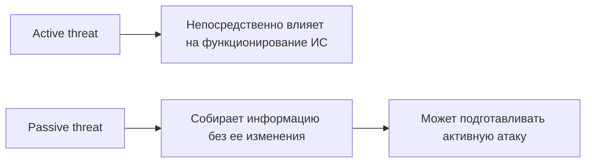
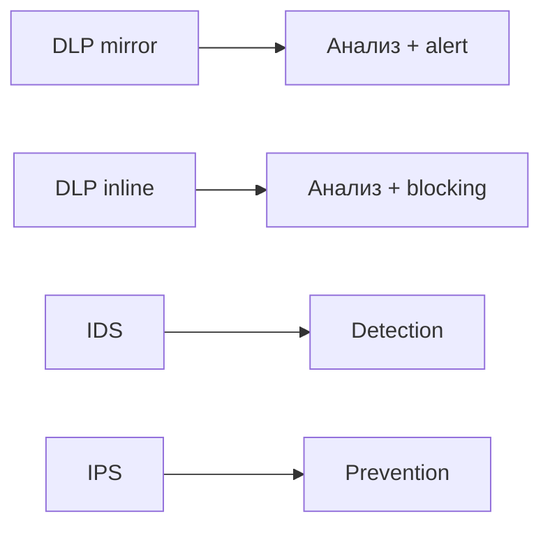

# Диаграмма: логика главы 1

## Смысл

Глава связывает три уровня решения:

1. определить защищаемое свойство;
2. классифицировать угрозу и сформировать актуальную модель угроз;
3. подобрать сочетание организационных, физических и технических мер и управлять ими циклически через PDCA.

Диаграмма не добавляет vendor-specific реализацию: в главе она отсутствует.
