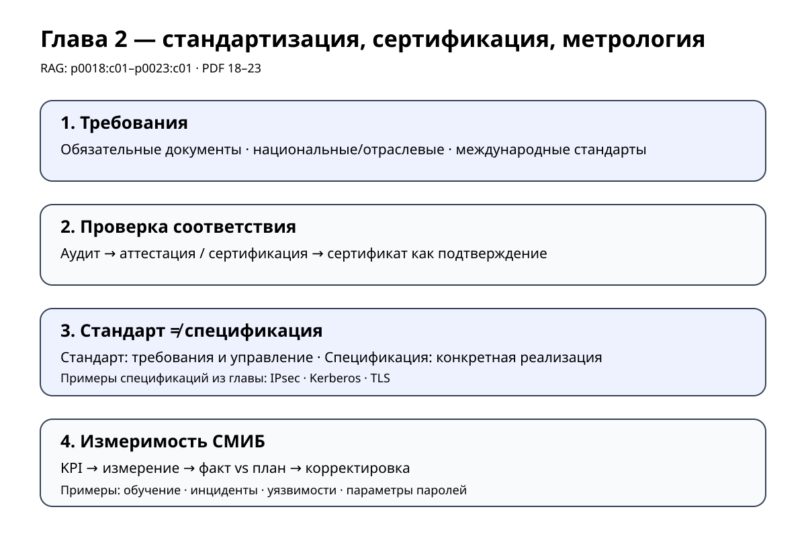
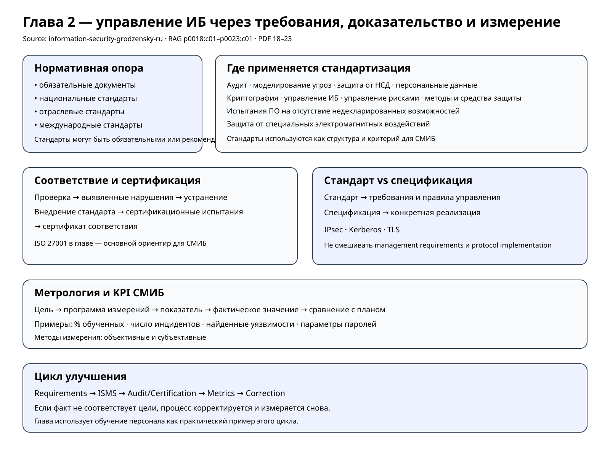

# Глава 2 — Стандартизация, сертификация и метрология как часть обеспечения информационной безопасности предприятия

RAG-grounded разбор главы 2 книги «Информационная безопасность: учебное пособие» Я. С. Гродзенского.

## Идентификация

- Book ID: `information-security-grodzensky-ru`
- Глава: 2
- Slug: `standardization-certification-metrology`
- Source policy: `rag_only`
- External sources: запрещены
- Model memory: запрещена
- Прямой доступ к PDF: не использовался

## Provenance

- RAG chunks: `p0018:c01`–`p0023:c01`
- PDF pages: 18–23
- Source SHA-256: `4e4cf1d98c35c3d131d1aad21c5c7cd7da3c2548ef5e12dc75e27b4460a90c2f`
- `p0018:c01` начинается заголовком раздела 2.
- `p0023:c01` содержит итог раздела и вопросы для самопроверки.
- `p0024:c01` начинается разделом 3 «Обеспечение безопасности персональных данных при их обработке в информационных системах».
- Chapter boundary verified: yes
- Printed page range: [Needs confirmation]

## Содержимое

- [cheatsheet.md](cheatsheet.md) — рабочая карта требований, стандартов, сертификации и измерений.
- [commands.md](commands.md) — стандарты, проверки, измерения и механизмы, явно названные в RAG главы; shell-команд нет.
- [diagram.md](diagram.md) — Mermaid-карта «требование → внедрение → аудит/сертификация → измерение → корректировка».
- [visual-cheatsheet.svg](visual-cheatsheet.svg) — компактный обзор.
- [visual-cheatsheet-detailed.svg](visual-cheatsheet-detailed.svg) — подробная схема.
- [summary.md](summary.md) — chapter-end summary по `p0023:c01`.
- [review-questions.md](review-questions.md) — 4 вопроса для самопроверки.
- [review-answers.md](review-answers.md) — ответы, основанные только на RAG главы.

## Карта главы

1. Регулирование ИБ описывается через три группы:
   - обязательные документы и нормативные акты;
   - национальные и отраслевые стандарты;
   - международные стандарты.
2. Стандарты могут быть обязательными или рекомендательными.
3. Стандартизация применяется к аудиту ИБ, моделированию угроз, испытаниям ПО, защите от НСД, персональным данным, криптографии, управлению ИБ и рисками.
4. Соответствие проверяется через аудиты, регуляторные проверки, аттестацию и сертификацию.
5. Сертификат используется как формальное подтверждение соответствия требованиям стандарта.
6. ISO 27000 рассматривается как семейство стандартов, а ISO 27001 — как основной стандарт для построения СМИБ.
7. Стандарты задают требования и правила управления, спецификации — конкретную реализацию механизмов, например IPsec, Kerberos, TLS.
8. Метрология в ИБ связана с измеримостью эффективности СМИБ.
9. ГОСТ Р ИСО/МЭК 27004 в источнике связан с построением программы измерений.
10. Примеры измеряемых показателей: обучение персонала, число инцидентов, найденные уязвимости, способы генерации паролей.
11. Измерения могут быть объективными и субъективными.
12. Полученные метрики должны использоваться для корректировки процессов.

## Краткий анализ

Глава показывает ИБ как управляемую и проверяемую систему, а не только как набор технических средств. Стандартизация задаёт общие правила, критерии и области применения; сертификация формализует подтверждение соответствия; метрология делает состояние и эффективность СМИБ измеримыми.

Автор разделяет нормативное поле на обязательные документы, национальные/отраслевые стандарты и международные стандарты. Это задаёт важную границу: не каждый стандарт является обязательным, но обязательность может следовать из отрасли, законодательства или конкретных условий деятельности.

Стандартизация применяется широко: от моделирования угроз и защиты от НСД до управления рисками и криптографии. То есть стандарт рассматривается не как «документ для аудита», а как структурирующий элемент всей системы управления безопасностью.

Сертификация идёт после внедрения требований стандарта. В главе сертификат соответствия рассматривается как доказательство соответствия конкретным требованиям. Для ISO 27001 он также описывается как способ подтвердить наличие выстроенной системы ИБ и повысить доверие партнёров.

Отдельно проводится различие между стандартом и спецификацией. Стандарт определяет требования и правила управления СМИБ, а спецификация описывает конкретную реализацию технических механизмов. В качестве примеров спецификаций названы IPsec, Kerberos и TLS.

Метрология переносится из классической области измерений в контекст СМИБ. Смысл — определить показатели, методику их измерения и контроль, чтобы состояние системы можно было оценивать не только во время внешнего аудита. Примеры: доля обученных сотрудников, число инцидентов, число найденных уязвимостей, параметры использования паролей.

Глава связывает измерение с циклом улучшения. Если фактический показатель отличается от планового, процесс корректируется. На примере обучения персонала прямо показано применение цикла Шухарта-Деминга.

## Основной принцип

Зрелая ИБ должна быть не только внедрена, но и:

`формализована требованиями → проверяема → сертифицируема → измерима → корректируема`.

Стандарт задаёт критерии, аудит/сертификация проверяют соответствие, метрики показывают фактическое состояние, а результаты измерений используются для улучшения системы.

## Ограничения

- Глава отражает нормативные акты и версии стандартов в состоянии источника; их актуальность на текущую дату в `rag_only` не проверялась.
- Shell-команд и vendor-specific конфигурации в главе нет.
- Сравнение российского и зарубежного подходов передаётся как позиция источника и не расширялось внешними данными.
- Ряд стандартов и законов упомянут обзорно; детальный разбор их требований в этой главе отсутствует.
