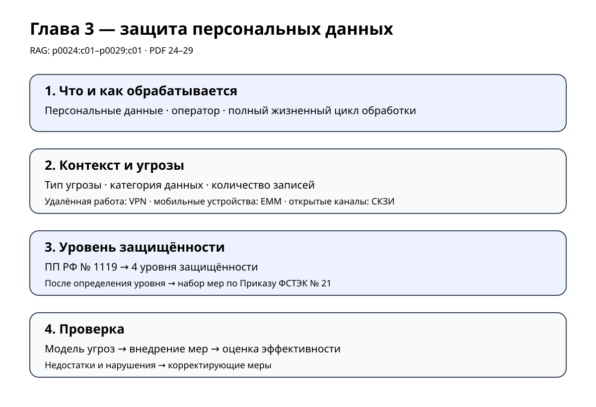
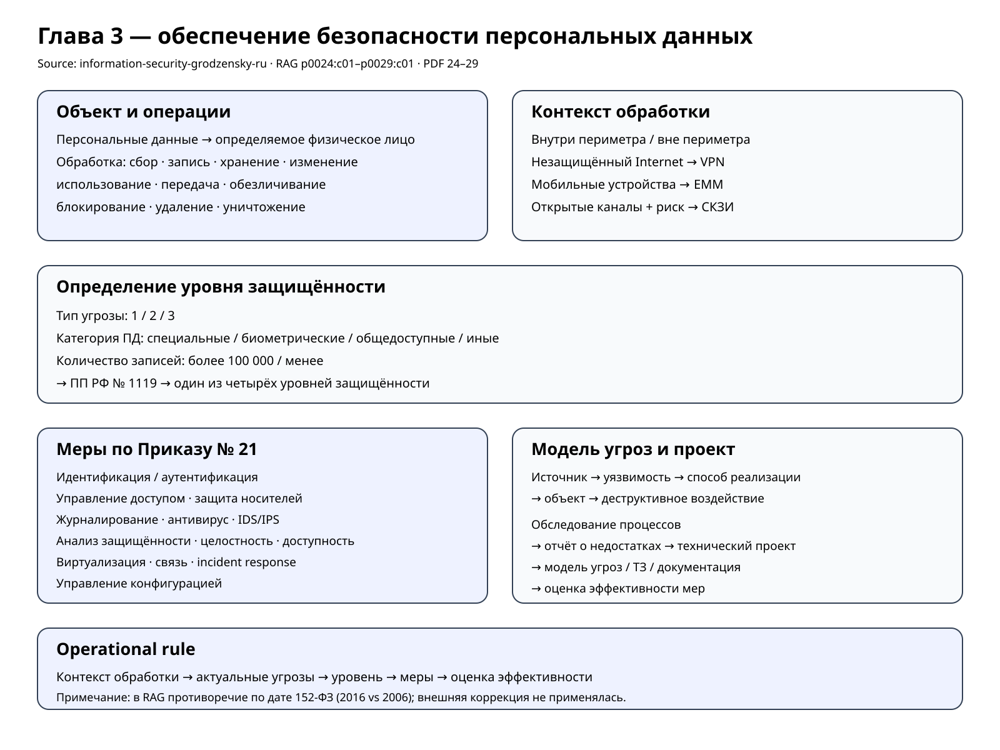

# Глава 3 — Обеспечение безопасности персональных данных при их обработке в информационных системах

RAG-grounded разбор главы 3 книги «Информационная безопасность: учебное пособие» Я. С. Гродзенского.

## Идентификация

- Book ID: `information-security-grodzensky-ru`
- Глава: 3
- Slug: `personal-data-security`
- Source policy: `rag_only`
- External sources: запрещены
- Model memory: запрещена
- Прямой доступ к PDF: не использовался

## Provenance

- RAG chunks: `p0024:c01`–`p0029:c01`
- PDF pages: 24–29
- Source SHA-256: `4e4cf1d98c35c3d131d1aad21c5c7cd7da3c2548ef5e12dc75e27b4460a90c2f`
- `p0024:c01` начинается заголовком раздела 3.
- `p0029:c01` содержит итог раздела и вопросы для самопроверки.
- `p0030:c01` начинается разделом 4 «Борьба с угрозами несанкционированного доступа к информации».
- Chapter boundary verified: yes
- Printed page range: [Needs confirmation]

## Source contradiction

В RAG главы есть внутренняя несогласованность по дате Федерального закона № 152-ФЗ:

- `p0024:c01`: «от 27.07.2016»;
- `p0025:c01` и `p0026:c01`: «от 27.07.2006».

В рамках `rag_only` это не исправляется внешним знанием; факт противоречия сохранён явно.

## Содержимое

- [cheatsheet.md](cheatsheet.md) — рабочая модель защиты персональных данных.
- [commands.md](commands.md) — механизмы, меры и средства, явно названные в главе; shell-команд нет.
- [diagram.md](diagram.md) — Mermaid-карта «данные → угрозы → уровень защищённости → меры → контроль».
- [visual-cheatsheet.svg](visual-cheatsheet.svg) — компактный обзор.
- [visual-cheatsheet-detailed.svg](visual-cheatsheet-detailed.svg) — подробная схема.
- [summary.md](summary.md) — chapter-end summary по `p0029:c01`.
- [review-questions.md](review-questions.md) — 4 вопроса для самопроверки.
- [review-answers.md](review-answers.md) — ответы только по RAG главы.

## Карта главы

1. Персональные данные рассматриваются как один из основных видов конфиденциальной информации.
2. Вводятся определения персональных данных, оператора и обработки персональных данных.
3. Защита должна охватывать конфиденциальность, целостность и доступность.
4. Обработка происходит как внутри периметра, так и вне его, включая мобильные устройства и незащищённые интернет-соединения.
5. Для защиты передачи данных упомянуты VPN и СКЗИ; для мобильных устройств — EMM.
6. Защита персональных данных описывается как сочетание организационных и технических мер.
7. Уровень защищённости определяется с учётом:
   - типа актуальных угроз;
   - категории персональных данных;
   - количества обрабатываемых записей.
8. Постановление Правительства РФ № 1119 в источнике задаёт четыре уровня защищённости.
9. После определения уровня меры защиты выбираются по Приказу ФСТЭК России № 21.
10. Приведён перечень мер: идентификация/аутентификация, управление доступом, защита носителей, журналирование, антивирус, обнаружение вторжений, анализ защищённости, целостность, доступность, защита виртуализации, связи, реагирование на инциденты, управление конфигурацией.
11. Рассматривается модель угроз персональным данным как инструмент сопоставления актуальных угроз с внедрёнными мерами.
12. Проект приведения обработки персональных данных в соответствие включает обследование, отчёт о недостатках, модель угроз, технический проект, ТЗ, комплект организационно-технической документации и оценку эффективности мер.

## Краткий анализ

Глава строит защиту персональных данных как последовательность от правового определения и инвентаризации обработки к выбору конкретных защитных мер.

Сначала задаётся объект защиты. Персональные данные определяются как информация о прямо или косвенно определённом или определяемом физическом лице. Обработка трактуется очень широко: от сбора и записи до хранения, изменения, передачи, обезличивания, блокирования, удаления и уничтожения.

Оператор — это субъект, который организует или осуществляет обработку и определяет её цели, состав данных и операции. Автор подчёркивает, что наличие сотрудников, клиентов, партнёров и поставщиков обычно означает наличие процессов обработки персональных данных.

Защита рассматривается не только как защита конфиденциальности. На примере медицинских данных глава показывает также риски изменения информации и недоступности информационной системы, то есть связывает персональные данные с полной CIA-моделью.

Поскольку обработка может происходить за пределами корпоративного периметра, источником отдельно названы VPN для защищённого подключения к корпоративным ресурсам и EMM для мобильных устройств. При риске компрометации данных по открытым каналам связи источник связывает защиту с применением СКЗИ.

Далее вводится регуляторная последовательность. Постановление № 1119 используется для определения уровня защищённости. В источнике указаны четыре уровня, зависящие от типа угроз, категории персональных данных и количества записей. После этого Приказ ФСТЭК № 21 используется для определения организационных и технических мер.

Важный инженерный переход главы — от формального списка требований к модели угроз. Она описывает источник угрозы, уязвимости ИСПДн, способ реализации, объект и деструктивное воздействие и должна показать, что внедрённые меры соответствуют актуальным угрозам.

Глава также описывает практический проект соответствия: обследование процессов → выявление нарушений → меры устранения → технический проект → модель угроз → ТЗ на внедрение СЗИ → организационно-техническая документация → оценка эффективности.

## Основной принцип

Защита персональных данных строится не от продукта, а от контекста обработки:

`какие персональные данные → какие операции → какие угрозы → какой уровень защищённости → какие меры → проверка эффективности`.

Организационные и технические меры должны соответствовать как нормативным требованиям, так и актуальной модели угроз.

## Ограничения

- Нормативные акты, даты и требования представлены в состоянии источника и не проверялись на актуальность.
- В источнике есть противоречие по дате 152-ФЗ; оно сохранено, а не исправлено.
- Shell-команды, vendor-specific конфигурации VPN/EMM/EDR/СКЗИ отсутствуют.
- Конкретная методика построения модели угроз раскрыта лишь обзорно.
