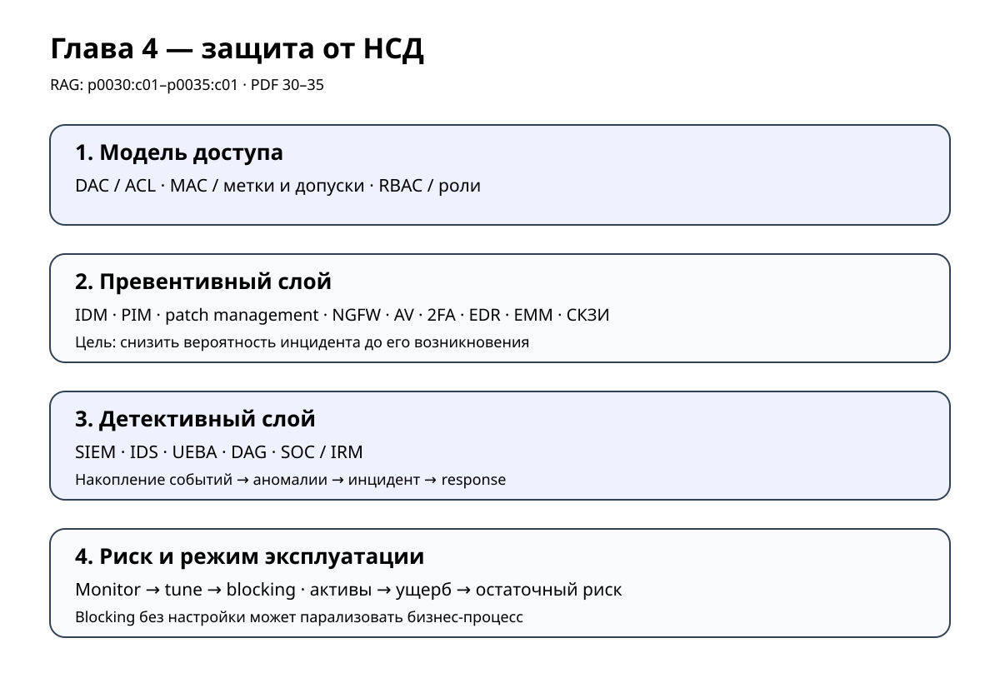

# Глава 4 — Борьба с угрозами несанкционированного доступа к информации

RAG-grounded разбор главы 4 книги «Информационная безопасность: учебное пособие» Я. С. Гродзенского.

## Идентификация

- Book ID: `information-security-grodzensky-ru`
- Глава: 4
- Slug: `unauthorized-access`
- Source policy: `rag_only`
- External sources: запрещены
- Model memory: запрещена
- Прямой доступ к PDF: не использовался

## Provenance

- RAG chunks: `p0030:c01`–`p0035:c01`
- PDF pages: 30–35
- Source SHA-256: `4e4cf1d98c35c3d131d1aad21c5c7cd7da3c2548ef5e12dc75e27b4460a90c2f`
- `p0030:c01` начинается заголовком раздела 4.
- `p0035:c01` содержит итог раздела и вопросы для самопроверки.
- `p0036:c01` начинается разделом 5 «Защита информации от утечки по техническим каналам».
- Chapter boundary verified: yes
- Printed page range: [Needs confirmation]

## Содержимое

- [cheatsheet.md](cheatsheet.md) — модель защиты от НСД.
- [commands.md](commands.md) — средства и механизмы, явно названные в главе; shell-команд нет.
- [diagram.md](diagram.md) — Mermaid-карта «модель нарушителя → управление доступом → превентивные меры → мониторинг → риск».
- [visual-cheatsheet.svg](visual-cheatsheet.svg) — компактный обзор.
- [visual-cheatsheet-detailed.svg](visual-cheatsheet-detailed.svg) — подробная схема.
- [summary.md](summary.md) — chapter-end summary по `p0035:c01`.
- [review-questions.md](review-questions.md) — 4 вопроса для самопроверки.
- [review-answers.md](review-answers.md) — ответы только по RAG главы.

## Карта главы

1. НСД определяется как доступ к информации с нарушением установленных правил разграничения доступа с использованием штатных средств СВТ или АС.
2. Защита СВТ и АС различается:
   - для СВТ — программно-технические меры;
   - для АС — программно-технические плюс организационные меры.
3. Вводится модель нарушителя и уровни его возможностей.
4. Рассматриваются три модели управления доступом:
   - DAC — дискреционная;
   - MAC — мандатная;
   - RBAC — ролевая.
5. Автор рекомендует смешанную модель:
   - RBAC для прав сотрудников;
   - MAC для информации ограниченного доступа;
   - DAC для иной информации.
6. Превентивные меры включают сегментацию, IDM, PIM, NGFW, контроль целостности, patch management, антивирус, парольную политику, 2FA, СКЗИ, DAG, EDR, EMM и Security Awareness.
7. Защитные системы могут использоваться в режиме мониторинга или блокировки.
8. Блокирующие режимы требуют предварительной тонкой настройки, иначе возможны ложные срабатывания и остановка бизнес-процессов.
9. Детективные меры включают SIEM, Data Governance, IDS, UEBA и системы контроля сотрудников.
10. SIEM + IRM используются как технологическая основа SOC.
11. Выбор мер должен учитывать модель угроз, активы, возможный ущерб и приемлемый остаточный риск.
12. Для оценки рисков упомянуты GRC, CMDB и сканеры безопасности.

## Краткий анализ

Глава 4 рассматривает НСД как одновременно техническую, организационную и управленческую задачу. Центральная идея — одной системы контроля доступа недостаточно: необходимо связать модель нарушителя, правила доступа, превентивные меры, мониторинг и оценку риска.

Сначала вводится нормативное определение НСД. Источник различает СВТ и автоматизированную систему: защита СВТ строится прежде всего на программно-технических средствах, тогда как защита АС дополняется организационными мерами, поскольку в АС появляются пользователи, полномочия и модель нарушителя.

Далее рассматриваются принципы управления доступом. DAC основывается на ACL или матрице доступа, где владелец объекта управляет доступом. MAC использует метки конфиденциальности и уровни допуска. RBAC выдаёт права по роли сотрудника в компании. Автор считает практичным смешанное применение этих моделей.

Важная часть главы посвящена профилактике. Превентивные меры перечислены широко: от сегментации сети и управления привилегированными учётными записями до patch management, двухфакторной аутентификации, EDR и EMM. Общий принцип — снизить вероятность инцидента до его возникновения.

Источник отдельно показывает границу между мониторингом и блокированием. Межсетевой экран или DLP могут работать на копии трафика без блокировки либо «в разрыв», блокируя трафик по политике. Блокирующий режим требует настройки под конкретную организацию; применение правил «из коробки» может привести либо к массовым ложным срабатываниям, либо к пропуску нежелательного трафика.

После превентивного слоя следует детективный: SIEM, IDS, UEBA, Data Governance и контроль сотрудников. В крупных организациях SIEM и IRM связываются с SOC, который постоянно выявляет инциденты и реагирует на них.

В финале глава возвращается к риск-ориентированному выбору защитных мер. Конкретный набор СЗИ определяется законодательством, частной моделью угроз, уже внедрёнными средствами и стоимостью риска. GRC-системы используются для отображения связи «бизнес-процесс → информационная система → аппаратное обеспечение» и могут получать сведения из CMDB или сканеров безопасности.

## Основной принцип

Защита от НСД строится как многослойная система:

`модель нарушителя → модель доступа → превентивные меры → мониторинг → расследование → риск-ориентированная корректировка`.

Особенно важен принцип: блокирование без предварительной настройки может само стать источником отказа бизнес-процесса.

## Ограничения

- Глава не содержит shell-команд или конкретных конфигураций продуктов.
- Названия нормативных документов и классификаций отражены в состоянии источника и не проверялись на актуальность.
- Детальные методики расчёта риска отнесены автором к разделу 15.
- Vendor-specific настройка IDM/PIM/DLP/SIEM/EDR/EMM/GRC отсутствует.
