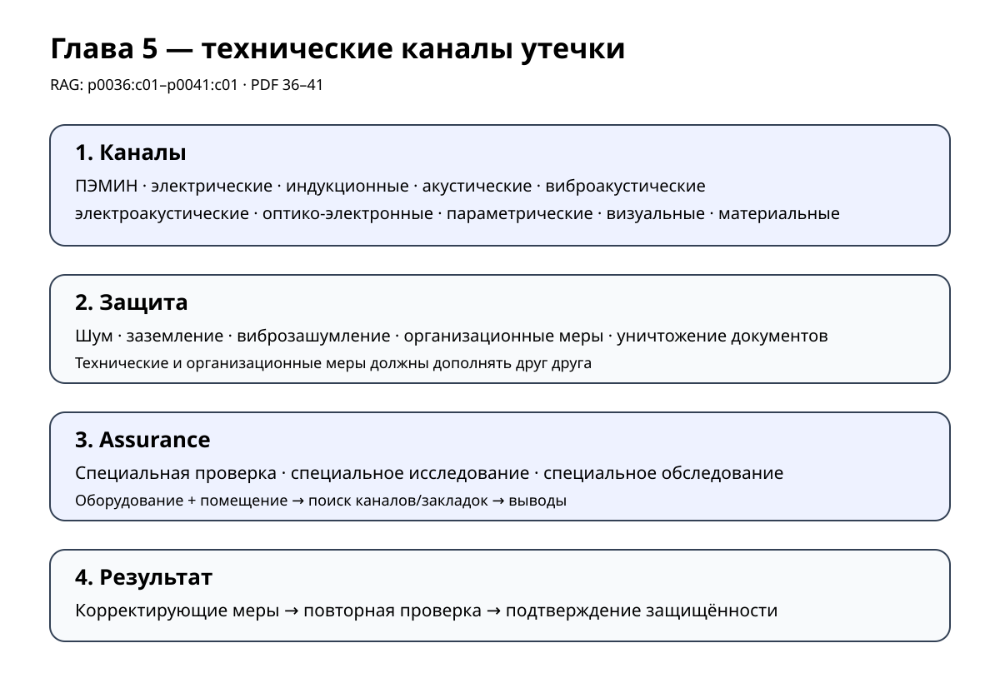
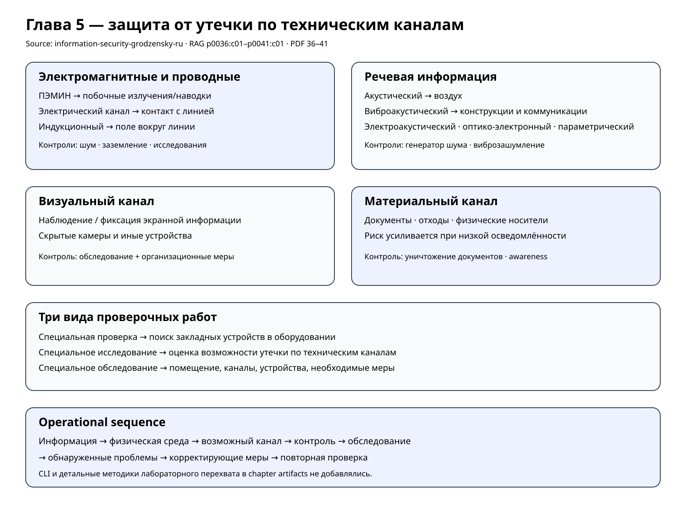

# Глава 5 — Защита информации от утечки по техническим каналам

RAG-grounded разбор главы 5 книги «Информационная безопасность: учебное пособие» Я. С. Гродзенского.

## Идентификация

- Book ID: `information-security-grodzensky-ru`
- Глава: 5
- Slug: `technical-leakage-channels`
- Source policy: `rag_only`
- External sources: запрещены
- Model memory: запрещена
- Прямой доступ к PDF: не использовался

## Provenance

- RAG chunks: `p0036:c01`–`p0041:c01`
- PDF pages: 36–41
- Source SHA-256: `4e4cf1d98c35c3d131d1aad21c5c7cd7da3c2548ef5e12dc75e27b4460a90c2f`
- `p0036:c01` начинается заголовком раздела 5.
- `p0041:c01` содержит итог раздела и вопросы для самопроверки.
- `p0042:c01` начинается разделом 6 «Криптографическая защита информации».
- Chapter boundary verified: yes
- Printed page range: [Needs confirmation]

## Содержимое

- [cheatsheet.md](cheatsheet.md) — классификация технических каналов и защитных мер.
- [commands.md](commands.md) — средства контроля и защитные механизмы, явно названные в главе; shell-команд нет.
- [diagram.md](diagram.md) — Mermaid-карта «канал → способ утечки → контроль → обследование/аттестация».
- [visual-cheatsheet.svg](visual-cheatsheet.svg) — компактный обзор.
- [visual-cheatsheet-detailed.svg](visual-cheatsheet-detailed.svg) — подробная схема.
- [summary.md](summary.md) — итог главы по `p0041:c01`.
- [review-questions.md](review-questions.md) — 4 вопроса для самопроверки.
- [review-answers.md](review-answers.md) — ответы только по RAG главы.

## Карта главы

1. Утечка информации возможна не только через вредоносное ПО и сетевые атаки.
2. Основные технические каналы:
   - электромагнитные;
   - электрические;
   - индукционные;
   - акустические;
   - электроакустические;
   - виброакустические;
   - оптико-электронные;
   - параметрические;
   - визуальные;
   - материальные.
3. ПЭМИН возникают при работе вычислительной техники и могут сопровождать ввод, вывод, запись и передачу данных.
4. Электрические каналы предполагают подключение к линиям, индукционные — съём без непосредственного контакта с линией.
5. Речевая информация может утекать через акустические, виброакустические, электроакустические, оптико-электронные и параметрические каналы.
6. Для защиты от части таких каналов в источнике названы генераторы электромагнитного шума, заземление, виртуальная клавиатура, генераторы шума и виброзашумление.
7. Визуальные каналы включают наблюдение/фиксацию отображаемой информации; материальный канал — документы и производственные отходы.
8. Организационные меры и повышение осведомлённости особенно важны против визуальных, материальных и инсайдерских рисков.
9. Для технической защиты применяются специальные проверки, специальные исследования и специальные обследования.
10. Специальные проверки направлены на поиск скрытых закладных устройств в оборудовании.
11. Специальные исследования оценивают возможность утечки по техническим каналам, включая ПЭМИН.
12. Специальные обследования помещений выявляют технические каналы и закладные устройства; результатом может быть аттестация помещения или оборудования.

## Краткий анализ

Глава расширяет модель ИБ за пределы сетевой и программной безопасности. Даже если периметр, endpoints и пользователи защищены привычными средствами, информация может покидать систему через физические явления, оборудование, помещение или материальные носители.

Первая группа — электромагнитные, электрические и индукционные каналы. ПЭМИН сопутствуют работе техники при вводе, обработке, выводе и передаче данных. Электрический канал предполагает непосредственное подключение к проводным линиям, тогда как индукционный использует электромагнитное поле вокруг линии без прямого контакта.

Вторая группа связана с речевой информацией. Акустический канал использует распространение звука по воздуху, виброакустический — колебания строительных конструкций и коммуникаций. Электроакустический связан с преобразованием акустических воздействий в электрические сигналы компонентов оборудования. Оптико-электронный основан на регистрации колебаний отражённого светового сигнала, а параметрический — на изменениях параметров электронных устройств под внешним высокочастотным воздействием.

Третья группа — визуальные и материальные каналы. Визуальная утечка может происходить через наблюдение или фиксацию информации, а материальная — через выброшенные документы и иные физические носители. Здесь технические средства должны дополняться организационными мерами и обучением персонала.

Защитная часть главы строится вокруг инженерного контроля среды. Для ПЭМИН упомянуты генерация электромагнитного шума и заземление; для виброакустических рисков — генераторы шума и виброзашумление. Для материального канала источник прямо приводит уничтожение документов шредером.

На уровне assurance глава различает несколько видов работ. Специальная проверка оборудования ищет закладные устройства. Специальное исследование оценивает возможность утечки через технические каналы. Специальное обследование помещения моделирует возможные каналы, выполняет поиск и заканчивается выводами о необходимых защитных мерах.

## Основной принцип

Защита от технических каналов начинается не с сетевой топологии, а с анализа физической среды обработки информации:

`какая информация → где и чем обрабатывается → какие физические каналы возможны → какие защитные меры применены → что показали специальные проверки/исследования/обследования`.

## Ограничения

- Глава не содержит shell-команд или vendor-specific конфигураций.
- Нормативные документы и требования отражены в состоянии источника и не проверялись на текущую актуальность.
- Рисунки и схемы исходного PDF в RAG представлены только текстовым окружением и подписями.
- Детальные методики измерения ПЭМИН, расчёта зон и проведения лабораторных работ в главе описаны обзорно и не воспроизводятся как пошаговые инструкции.
