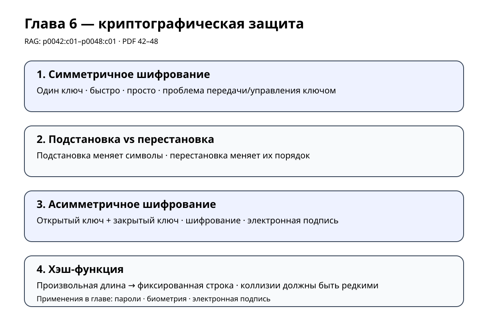
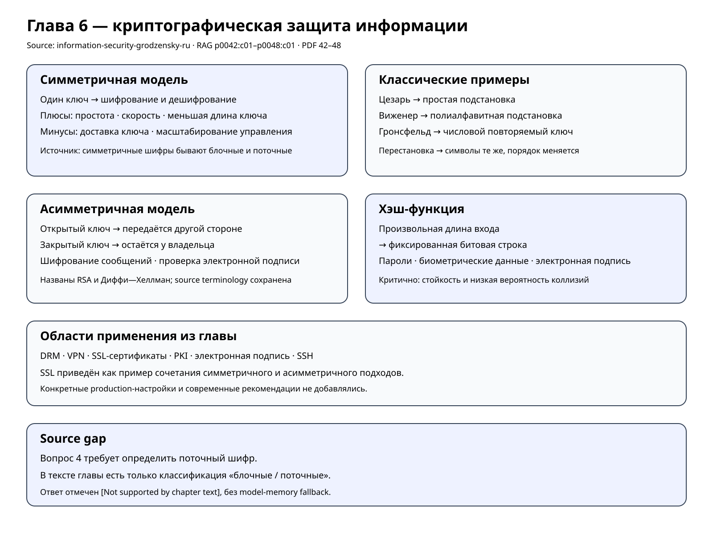

# Глава 6 — Криптографическая защита информации

RAG-grounded разбор главы 6 книги «Информационная безопасность: учебное пособие» Я. С. Гродзенского.

## Идентификация

- Book ID: `information-security-grodzensky-ru`
- Глава: 6
- Slug: `cryptographic-protection`
- Source policy: `rag_only`
- External sources: запрещены
- Model memory: запрещена
- Прямой доступ к PDF: не использовался

## Provenance

- RAG chunks: `p0042:c01`–`p0048:c01`
- PDF pages: 42–48
- Source SHA-256: `4e4cf1d98c35c3d131d1aad21c5c7cd7da3c2548ef5e12dc75e27b4460a90c2f`
- `p0042:c01` начинается заголовком раздела 6.
- `p0048:c01` содержит итог раздела и вопросы для самопроверки.
- `p0049:c01` начинается разделом 7 «Организационно-технические и правовые основы использования в информационных системах электронного документооборота и электронной подписи».
- Chapter boundary verified: yes
- Printed page range: [Needs confirmation]

## Содержимое

- [cheatsheet.md](cheatsheet.md) — концептуальная карта криптографической защиты главы.
- [commands.md](commands.md) — алгоритмы, механизмы и области применения, явно названные в RAG; shell-команд нет.
- [diagram.md](diagram.md) — Mermaid-карта симметричного/асимметричного шифрования и хэширования.
- [visual-cheatsheet.svg](visual-cheatsheet.svg) — компактный обзор.
- [visual-cheatsheet-detailed.svg](visual-cheatsheet-detailed.svg) — подробная схема.
- [summary.md](summary.md) — chapter-end summary по `p0048:c01`.
- [review-questions.md](review-questions.md) — 4 вопроса для самопроверки.
- [review-answers.md](review-answers.md) — ответы только по RAG главы.

## Карта главы

1. Криптография связывается с конфиденциальностью, целостностью, аутентификацией и неотказуемостью.
2. Области применения, названные в источнике:
   - DRM;
   - VPN;
   - SSL-сертификаты;
   - электронная подпись;
   - SSH.
3. Исторические шифры используются для объяснения базовых принципов:
   - шифр Цезаря;
   - шифр Виженера;
   - шифр Гронсфельда.
4. Различаются шифры подстановки и перестановки.
5. Симметричное шифрование использует один и тот же ключ для шифрования и дешифрования.
6. Симметричные шифры в источнике делятся на блочные и поточные.
7. Преимущества симметричной схемы по главе:
   - простота;
   - скорость;
   - меньшая длина ключа относительно асимметричной схемы.
8. Недостатки симметричной схемы:
   - риск компрометации ключа при передаче;
   - сложность управления ключами в больших сетях;
   - невозможность использовать общий секретный ключ как основу электронной подписи в описанной модели.
9. Асимметричная схема использует открытый и закрытый ключи.
10. Открытый ключ применяется для шифрования и проверки электронной подписи; закрытый — для расшифрования.
11. Источник называет RSA и Диффи—Хеллмана среди известных алгоритмов асимметричной криптографии.
12. Хэш-функция описывается как разновидность односторонней функции, преобразующая данные произвольной длины в битовую строку фиксированной длины.
13. Для хэш-функции важны стойкость и минимальная вероятность коллизий.
14. Хэширование связывается с хранением паролей/биометрических данных и электронной подписью.

## Краткий анализ

Глава выполняет роль вводного слоя в криптографию. Она не строит формальную математическую теорию, а объясняет основные классы преобразований, ключевую модель и области применения.

Автор начинает с цели криптографии: обеспечить конфиденциальность, целостность, аутентификацию и неотказуемость. Криптографические механизмы рассматриваются как дополнительный рубеж защиты: даже если злоумышленник получает файл или перехватывает данные, содержимое должно оставаться непонятным без требуемого ключа.

Для объяснения эволюции шифрования используются исторические примеры. Шифр Цезаря показан как простой шифр подстановки. Шифр Виженера — как полиалфавитная замена с повторяющимся ключевым словом. Шифр Гронсфельда использует числовой ключ. Источник подчёркивает, что эти методы имеют историческое значение и не являются стойкими в современных условиях.

Шифры подстановки меняют символы на другие символы или группы символов. Шифры перестановки сохраняют сами символы, но изменяют их расположение по правилу, определяемому ключом.

Следующий уровень — различие симметричной и асимметричной криптографии. Симметричная схема использует один общий ключ для шифрования и расшифрования. Её преимущества — простота и скорость; основные ограничения — доставка секрета и управление большим количеством ключей.

Асимметричная модель использует пару взаимосвязанных ключей. В изложении главы открытый ключ доступен другой стороне и используется для шифрования, а закрытый остаётся у владельца и используется для расшифрования. Открытый ключ также связывается с проверкой электронной подписи.

Финальный блок главы посвящён односторонним и хэш-функциям. Хэш-функция преобразует данные произвольной длины в результат фиксированной длины. Автор связывает её с безопасным хранением паролей и биометрических данных, а также с электронной подписью, где подписывается хэш сообщения.

## Основной принцип

Криптографическая модель главы может быть сведена к цепочке:

`данные → криптографическое преобразование + ключ/функция → защищённое представление → проверка/расшифрование уполномоченной стороной`.

При выборе схемы важно различать:
- один общий ключ;
- пару открытого/закрытого ключей;
- необратимое хэширование.

## Source limitations

- Вопрос 4 спрашивает: «Что такое поточный шифр?».
- В проверенных chunks главы `p0042:c01–p0048:c01` есть только утверждение, что симметричные шифры делятся на блочные и поточные.
- Явного определения поточного шифра в доступном тексте главы нет.
- Поэтому ответ не дополнялся модельной памятью: `[Not supported by chapter text]`.

Также источник сам называет RSA и алгоритм Диффи—Хеллмана «наиболее известными алгоритмами асимметричного шифрования». Внешняя терминологическая нормализация не выполнялась.

## Ограничения

- Shell-команд и практических CLI-упражнений в главе нет.
- Современная стойкость конкретных алгоритмов, параметры ключей и рекомендации по выбору алгоритмов не проверялись внешними источниками.
- Таблицы Виженера/Гронсфельда и рисунки исходного PDF представлены в RAG как извлечённый текст; визуальная структура частично потеряна.
- Следующая глава отдельно развивает PKI и электронную подпись.
