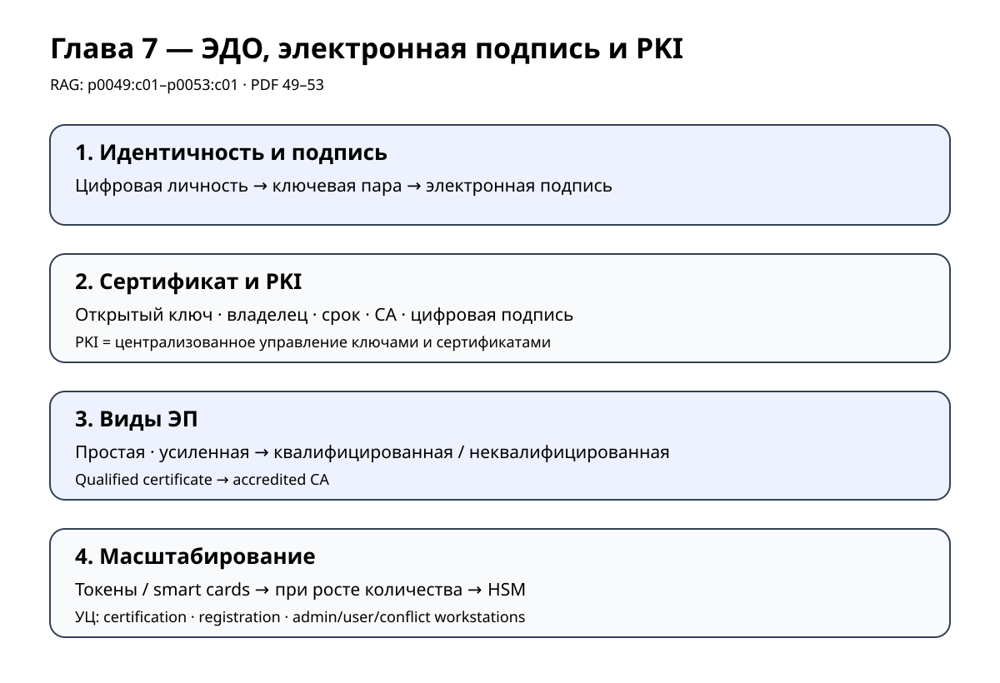

# Глава 7 — Организационно-технические и правовые основы использования в информационных системах электронного документооборота и электронной подписи

RAG-grounded разбор главы 7 книги «Информационная безопасность: учебное пособие» Я. С. Гродзенского.

## Идентификация

- Book ID: `information-security-grodzensky-ru`
- Глава: 7
- Slug: `electronic-document-signature-pki`
- Source policy: `rag_only`
- External sources: запрещены
- Model memory: запрещена
- Прямой доступ к PDF: не использовался

## Provenance

- RAG chunks: `p0049:c01`–`p0053:c01`
- PDF pages: 49–53
- Source SHA-256: `4e4cf1d98c35c3d131d1aad21c5c7cd7da3c2548ef5e12dc75e27b4460a90c2f`
- `p0049:c01` начинается заголовком раздела 7.
- `p0053:c01` содержит итог раздела и вопросы для самопроверки.
- `p0054:c01` начинается разделом 8 «Управление уязвимостями ИБ».
- Chapter boundary verified: yes
- Printed page range: [Needs confirmation]

## Содержимое

- [cheatsheet.md](cheatsheet.md) — рабочая модель ЭДО, ЭП и PKI.
- [commands.md](commands.md) — компоненты, носители и механизмы, явно названные в главе; shell-команд нет.
- [diagram.md](diagram.md) — Mermaid-карта PKI/УЦ/сертификата/подписи.
- [visual-cheatsheet.svg](visual-cheatsheet.svg) — компактный обзор.
- [visual-cheatsheet-detailed.svg](visual-cheatsheet-detailed.svg) — подробная схема.
- [summary.md](summary.md) — итог главы по `p0053:c01`.
- [review-questions.md](review-questions.md) — 4 вопроса для самопроверки.
- [review-answers.md](review-answers.md) — ответы только по RAG главы.

## Карта главы

1. Вводится понятие цифровой личности как идентификационной информации, позволяющей однозначно определить человека в цифровом пространстве.
2. Юридическая значимость электронного документа связывается с электронной подписью и удостоверяющим центром.
3. Основным законом в источнике назван ФЗ от 06.04.2011 № 63 «Об электронной подписи».
4. Электронная подпись определяется как электронная информация, связанная с подписываемой информацией и используемая для определения подписавшего лица.
5. Сертификат ключа проверки электронной подписи подтверждает принадлежность открытого ключа владельцу.
6. Механизм ЭП строится на асимметричной криптографии.
7. PKI описывается как централизованная модель управления ключами и сертификатами; PGP приводится как пример децентрализованной модели.
8. Сертификат открытого ключа содержит:
   - открытый ключ;
   - срок действия;
   - имя центра сертификации;
   - имя владельца;
   - цифровую подпись.
9. Виды ЭП по источнику:
   - простая;
   - усиленная;
     - усиленная квалифицированная;
     - усиленная неквалифицированная.
10. Квалифицированный сертификат выдаётся аккредитованным удостоверяющим центром.
11. При небольшом числе ЭП источник предлагает приобретение сертификатов; при больших масштабах — собственный УЦ.
12. Носители ЭП: токены и смарт-карты; при большом количестве ключей источник рассматривает HSM как централизованную альтернативу.
13. В состав УЦ включены:
   - центр сертификации;
   - центр регистрации;
   - АРМ пользователя;
   - АРМ администратора;
   - АРМ разбора конфликтных ситуаций.
14. Криптопровайдер выполняет криптографические операции и обеспечивает функциональность авторизации/юридической значимости электронных документов.

## Краткий анализ

Глава соединяет три слоя: правовой, криптографический и инфраструктурный.

Правовой слой задаёт условия признания электронной подписи и сертификатов. Источник связывает этот слой прежде всего с ФЗ № 63. Электронная подпись нужна не просто для технической аутентификации, а для подтверждения личности и юридической значимости электронного документа.

Криптографический слой опирается на асимметричную схему из предыдущей главы. Закрытый ключ остаётся у владельца, открытый ключ включается в сертификат. Проверка подписи и подлинности сертификата связывается с хэш-функциями и открытым ключом удостоверяющего центра.

Инфраструктурный слой — PKI и удостоверяющий центр. УЦ выпускает сертификаты, управляет ими и списками отозванных сертификатов; центр регистрации ведёт данные пользователей и обрабатывает запросы; различные АРМ обеспечивают регистрацию, генерацию ключей/запросов и разбор конфликтных ситуаций.

Глава отдельно рассматривает масштабирование хранения ключей. Токены и смарт-карты удобны как персональные носители, но при большом количестве ключей становятся операционным риском из-за отказов и необходимости управления множеством физических устройств. HSM в источнике показан как централизованная платформа для создания, хранения ключей, подписания и хэширования.

## Основной принцип

Рабочая модель главы:

`цифровая личность → ключевая пара → сертификат → удостоверяющий центр / PKI → электронная подпись → юридически значимый ЭДО`.

При масштабировании добавляется operational layer:

`tokens / smart cards → централизованное управление → HSM`.

## Source nuance

Контрольный вопрос 2 сформулирован как «Чем отличается квалифицированная ЭП от усиленной?».

По тексту главы квалифицированная ЭП не противопоставлена усиленной: она является одним из видов усиленной ЭП. Источник делит усиленную ЭП на квалифицированную и неквалифицированную. Поэтому ответ формулируется через это дерево классификации, без внешней нормализации.

## Ограничения

- Нормативная актуальность ФЗ, требований к аккредитации и упомянутых органов не проверялась внешними источниками.
- Shell-команд, OpenSSL/PKI CLI и vendor-specific инструкций в главе нет.
- Конкретные процедуры выпуска, отзыва и ротации сертификатов описаны обзорно.
- Схема УЦ из рисунка 6 в RAG представлена текстовым окружением, а не исходной графикой.
