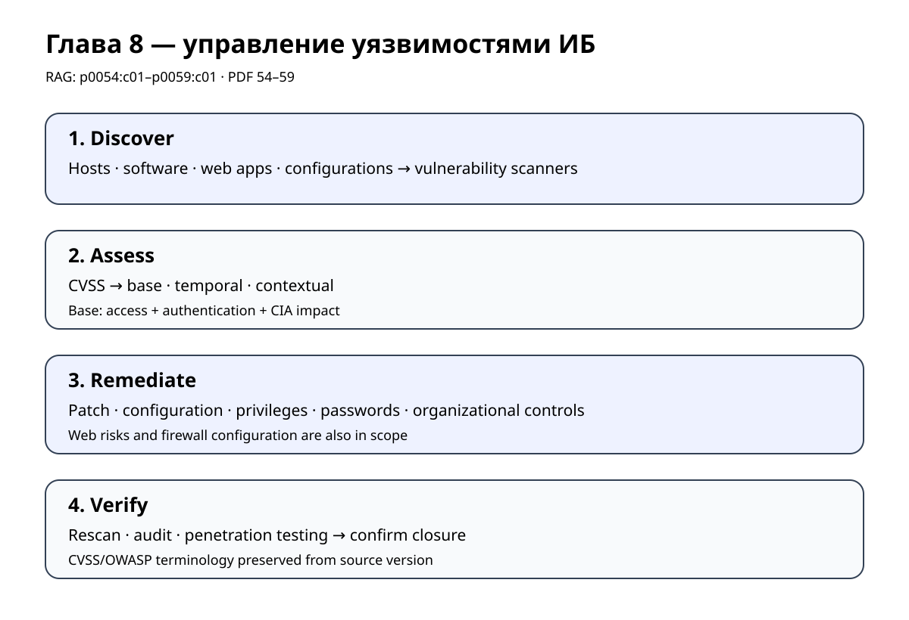

# Глава 8 — Управление уязвимостями ИБ

RAG-grounded разбор главы 8 книги «Информационная безопасность: учебное пособие» Я. С. Гродзенского.

## Идентификация

- Book ID: `information-security-grodzensky-ru`
- Глава: 8
- Slug: `vulnerability-management`
- Source policy: `rag_only`
- External sources: запрещены
- Model memory: запрещена
- Прямой доступ к PDF: не использовался

## Provenance

- RAG chunks: `p0054:c01`–`p0059:c01`
- PDF pages: 54–59
- Source SHA-256: `4e4cf1d98c35c3d131d1aad21c5c7cd7da3c2548ef5e12dc75e27b4460a90c2f`
- `p0054:c01` начинается заголовком раздела 8.
- `p0059:c01` содержит итог раздела и вопросы для самопроверки.
- `p0060:c01` начинается разделом 9 «Безопасность компьютерных сетей».
- Chapter boundary verified: yes
- Printed page range: [Needs confirmation]

## Содержимое

- [cheatsheet.md](cheatsheet.md) — рабочая модель vulnerability management.
- [commands.md](commands.md) — классы инструментов и проверок, явно названные в главе; shell-команд нет.
- [diagram.md](diagram.md) — Mermaid-карта «обнаружить → оценить → приоритизировать → устранить → перепроверить».
- [visual-cheatsheet.svg](visual-cheatsheet.svg) — компактный обзор.
- [visual-cheatsheet-detailed.svg](visual-cheatsheet-detailed.svg) — подробная схема.
- [summary.md](summary.md) — итог главы по `p0059:c01`.
- [review-questions.md](review-questions.md) — 4 вопроса для самопроверки.
- [review-answers.md](review-answers.md) — ответы только по RAG главы.

## Карта главы

1. Уязвимость рассматривается как слабость программного/программно-технического средства или ИС, которая может быть использована для реализации угрозы.
2. Источник отдельно различает:
   - уязвимость кода;
   - организационную уязвимость.
3. Примеры уязвимостей:
   - ошибки ПО;
   - слабые пароли;
   - избыточные привилегии;
   - большое число открытых портов;
   - ошибки конфигурации.
4. Уязвимости различаются по степени опасности.
5. CVSS в источнике используется как система численной оценки опасности.
6. Группы метрик CVSS по главе:
   - базовые;
   - временные;
   - контекстные.
7. Базовые метрики в изложении главы:
   - вектор доступа;
   - сложность атаки;
   - аутентификация;
   - влияние на конфиденциальность;
   - влияние на целостность;
   - влияние на доступность.
8. Временные метрики связываются с наличием исправления, возможностью эксплуатации и достоверностью источника информации.
9. Контекстные метрики, явно названные в главе:
   - вероятность косвенного ущерба (CDP);
   - плотность целей (Target Distribution).
10. Для выявления уязвимостей применяются сканеры безопасности/системы анализа защищённости.
11. Отдельно рассматриваются:
   - сетевые сканеры;
   - сканеры веб-приложений;
   - сканеры исходного кода — упомянуты, но отложены на последующее рассмотрение.
12. Веб-риски иллюстрируются списком OWASP Top-10 в состоянии источника.
13. Среди примеров названы SQL-инъекция, Broken Authentication, Sensitive Data Exposure, XXE, Broken Access Control, Security Misconfiguration, XSS, Insecure Deserialization.
14. Конфигурации межсетевых экранов также рассматриваются как источник уязвимостей при отсутствии централизованного аудита и управления.
15. Финальная рекомендация главы: использовать специализированные сканеры, повышать осведомлённость персонала и проводить тестирование на проникновение.

## Краткий анализ

Глава формирует базовую vulnerability-management модель: недостаточно просто знать о наличии слабых мест — их нужно обнаруживать, оценивать по опасности, устранять и контролировать повторно.

Автор начинает с определения уязвимости и подчёркивает, что слабость может быть не только программной. Организационная уязвимость возникает из-за отсутствия организационных мер или несоблюдения правил эксплуатации системы защиты. Таким образом, vulnerability management охватывает и технику, и процессы.

CVSS используется как механизм приоритизации. В источнике оценка строится на базовых, временных и контекстных метриках. Базовый слой характеризует способ и сложность эксплуатации, необходимость аутентификации и влияние на CIA. Временный слой учитывает наличие исправлений, практическую эксплуатируемость и подтверждённость сведений. Контекстный — потенциальный косвенный ущерб и распространённость целей.

Следующий слой — discovery. Сканеры безопасности обходят сеть, идентифицируют хосты, находят уязвимости и сортируют их по степени опасности. Источник подчёркивает необходимость такой проверки для гетерогенной инфраструктуры: Windows, Linux и сетевого оборудования.

Отдельный блок посвящён веб-приложениям. OWASP Top-10 используется как набор типовых опасных векторов в версии, отражённой в книге. Это не современная внешняя сверка, а источник-ориентированное представление.

Наконец, автор расширяет понятие уязвимости на конфигурацию сетевых устройств. При отсутствии централизованного аудита firewall-конфигураций несогласованные изменения разных администраторов могут открыть нежелательный доступ. Поэтому управление конфигурацией и автоматизированная проверка политик включаются в vulnerability-management контур.

## Основной принцип

`обнаружить → оценить опасность → приоритизировать → устранить → перепроверить`

При этом источник подразумевает несколько классов слабостей:

`код + конфигурация + права + пароли + организационные процессы`.

## Source-version boundary

CVSS и OWASP Top-10 описаны в терминологии и составе, содержащихся в книге. Они не обновлялись и не сверялись с текущими версиями.

В частности:
- названия CVSS-метрик сохранены как в источнике;
- диапазоны severity сохранены как в источнике;
- список OWASP приведён только в той мере, в какой он описан в RAG главы.

## Ограничения

- Shell-команд и vendor-specific scanner syntax в главе нет.
- Современные версии CVSS/OWASP не подмешивались.
- Конкретные remediation SLA и процессы patch deployment не стандартизованы в этой главе.
- Pen-test упомянут как мера проверки, но методика его проведения не раскрывается.
