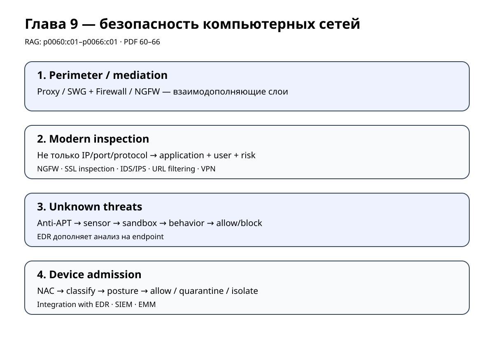
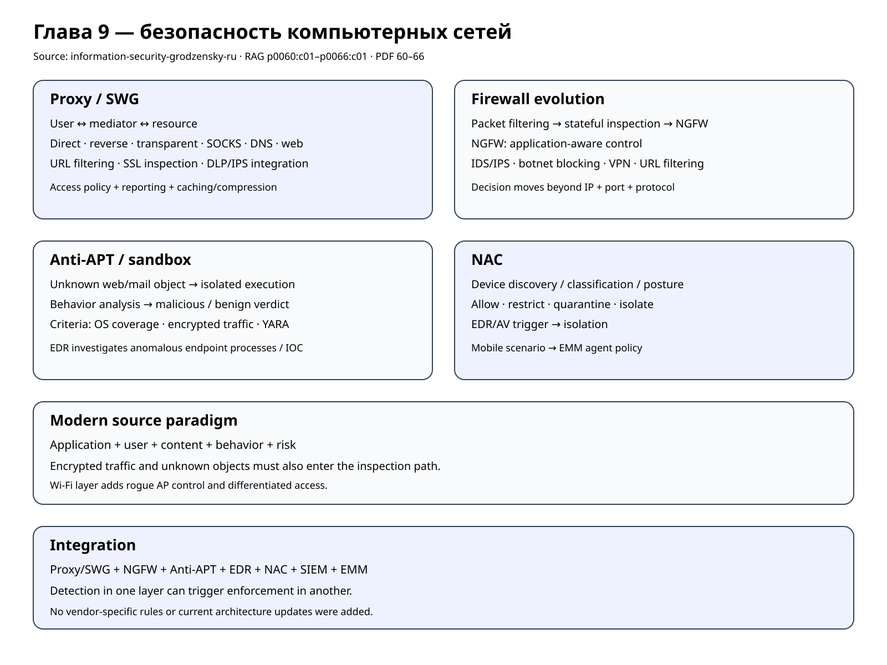

# Глава 9 — Безопасность компьютерных сетей

RAG-grounded разбор главы 9 книги «Информационная безопасность: учебное пособие» Я. С. Гродзенского.

## Идентификация

- Book ID: `information-security-grodzensky-ru`
- Глава: 9
- Slug: `network-security`
- Source policy: `rag_only`
- External sources: запрещены
- Model memory: запрещена
- Прямой доступ к PDF: не использовался

## Provenance

- RAG chunks: `p0060:c01`–`p0066:c01`
- PDF pages: 60–66
- Source SHA-256: `4e4cf1d98c35c3d131d1aad21c5c7cd7da3c2548ef5e12dc75e27b4460a90c2f`
- `p0060:c01` начинается заголовком раздела 9.
- `p0066:c01` содержит итог раздела и вопросы для самопроверки.
- `p0067:c01` начинается разделом 10 «Безопасная разработка приложений в эпоху Agile».
- Chapter boundary verified: yes
- Printed page range: [Needs confirmation]

## Содержимое

- [cheatsheet.md](cheatsheet.md) — рабочая карта сетевой защиты.
- [commands.md](commands.md) — классы сетевых средств и механизмов из главы; shell-команд нет.
- [diagram.md](diagram.md) — Mermaid-карта perimeter / NGFW / Anti-APT / NAC.
- [visual-cheatsheet.svg](visual-cheatsheet.svg) — компактный обзор.
- [visual-cheatsheet-detailed.svg](visual-cheatsheet-detailed.svg) — подробная схема.
- [summary.md](summary.md) — итог главы по `p0066:c01`.
- [review-questions.md](review-questions.md) — 4 вопроса для самопроверки.
- [review-answers.md](review-answers.md) — ответы только по RAG главы.

## Карта главы

1. Сетевая безопасность рассматривается как защита от внешних атак и вредоносного трафика.
2. Два базовых взаимодополняющих класса:
   - межсетевые экраны;
   - шлюзы ИБ / proxy-серверы.
3. UTM в источнике представлен как комбинация функций этих подходов.
4. Proxy используется как посредник между пользователем и ресурсом; рассмотрены direct, reverse, transparent, SOCKS, DNS и web proxy.
5. SWG расширяет proxy-функции: URL filtering, SSL inspection, IPS/DLP integration, policy enforcement, reporting и др.
6. Межсетевые экраны классифицируются через уровни OSI и эволюцию:
   - управляемые коммутаторы;
   - пакетные фильтры;
   - специализированные шлюзы;
   - stateful inspection;
   - NGFW.
7. Современная парадигма по книге: недостаточно фильтровать только по порту, протоколу и IP; нужен анализ приложений, пользователей, рисков и содержимого трафика.
8. NGFW в источнике связывается с:
   - application-aware traffic control;
   - SSL traffic inspection;
   - IDS/IPS;
   - botnet blocking;
   - VPN;
   - URL filtering;
   - directory integration;
   - DLP-related capabilities.
9. Для целевых атак рассматриваются Anti-APT, network sensors, sandboxes и EDR.
10. Sandbox анализирует неизвестные файлы/ссылки в эмулируемой среде и блокирует доставку при вредоносном поведении.
11. NAC контролирует подключение устройств и соответствие политике безопасности.
12. Примеры NAC:
   - изоляция узла по сигналу EDR/антивируса;
   - карантин неизвестного хоста до vulnerability scan;
   - проверка наличия EMM-agent на мобильном устройстве.
13. Wi-Fi security в главе связывается с защитой от rogue access points, разграничением доступа и captive portal.
14. Финальный принцип — интеграция сетевых СЗИ между собой.

## Краткий анализ

Глава 9 описывает сетевую безопасность как многоуровневую систему контроля доступа и анализа трафика. Автор явно показывает эволюцию от простого packet filtering к application-aware защите.

Proxy и firewall решают разные задачи. Proxy выступает посредником между пользователем и ресурсом, позволяет контролировать доступ и содержимое взаимодействия. Firewall прежде всего фильтрует проходящий через него трафик по правилам. В книге эти подходы считаются взаимодополняющими.

Отдельный блок посвящён SWG. Это развитие proxy-класса с функциями URL filtering, SSL inspection, подключения IPS и DLP, контроля мобильных пользователей и построения централизованных политик.

Эволюция firewall связывается с OSI. Пакетный фильтр анализирует заголовки и работает быстро, но ограничен при анализе высокоуровневого трафика. Stateful inspection добавляет контроль состояния сессий. NGFW переносит фокус на приложения, пользователей и содержимое трафика.

Ключевая идея главы сформулирована как отказ от достаточности модели «порт + протокол + IP». Современная защита должна анализировать, какое приложение и какой пользователь генерирует трафик, учитывать риск и уметь работать с зашифрованным трафиком.

Для неизвестного вредоносного кода и целевых атак источник рассматривает Anti-APT и sandbox-подход. Sandbox запускает объект в изолированной/эмулируемой среде и анализирует поведение. EDR дополняет этот контур на конечных станциях.

NAC рассматривается как policy enforcement layer на этапе подключения устройства к сети. Он может классифицировать узел, проверять соответствие требованиям, помещать устройство в карантин или изолировать его по сигналу других СЗИ.

Финал главы подчёркивает интеграцию: proxy, NGFW, Anti-APT, NAC, EDR, SIEM, EMM и другие элементы должны работать как связанный набор защитных эшелонов.

## Основной принцип

`traffic / device → classify context → inspect → enforce policy → detect unknown behavior → isolate/respond → integrate telemetry`

Современная сетевая защита в логике главы должна учитывать не только сетевые адреса и порты, но также приложение, пользователя, поведение и риск.

## Source-version boundary

Терминология и функции NGFW, SWG, Anti-APT, NAC, SSL, VPN и Wi-Fi controls сохранены в состоянии книги.

Современные архитектуры SASE/ZTNA, актуальные версии TLS и текущие product capabilities внешне не добавлялись.

## Ограничения

- Shell-команд и vendor-specific configuration syntax в главе нет.
- Топология и ACL/firewall rules не представлены в виде готовых конфигураций.
- Конкретные критерии производительности NGFW/SWG описаны обзорно.
- Sandbox/YARA упоминаются без практических правил и сигнатур.
