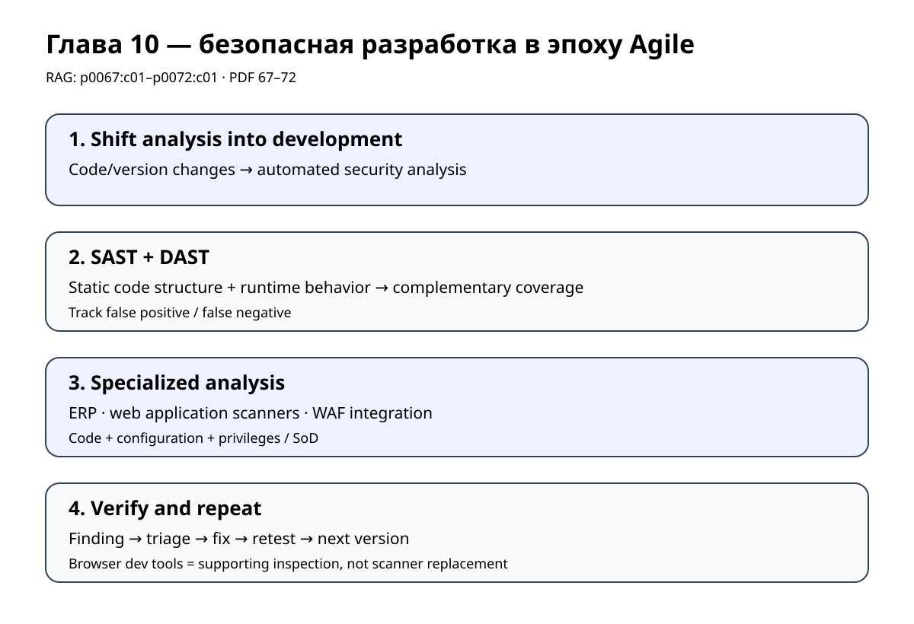
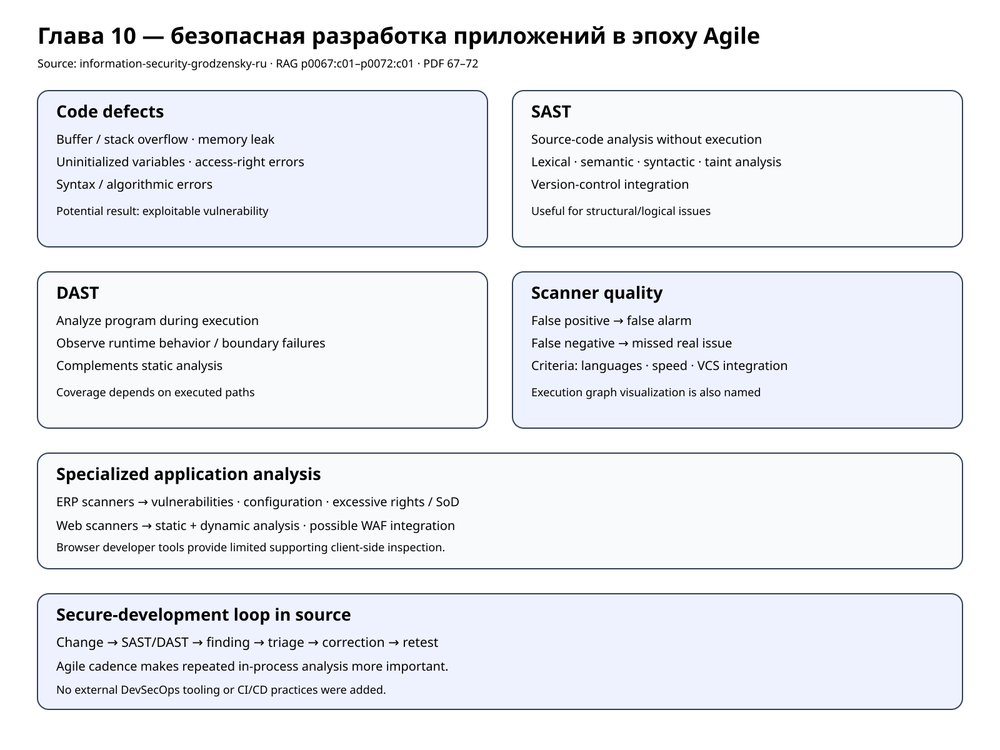

# Глава 10 — Безопасная разработка приложений в эпоху Agile

RAG-grounded разбор главы 10 книги «Информационная безопасность: учебное пособие» Я. С. Гродзенского.

## Идентификация

- Book ID: `information-security-grodzensky-ru`
- Глава: 10
- Slug: `secure-development-agile`
- Source policy: `rag_only`
- External sources: запрещены
- Model memory: запрещена
- Прямой доступ к PDF: не использовался

## Provenance

- RAG chunks: `p0067:c01`–`p0072:c01`
- PDF pages: 67–72
- Source SHA-256: `4e4cf1d98c35c3d131d1aad21c5c7cd7da3c2548ef5e12dc75e27b4460a90c2f`
- `p0067:c01` начинается заголовком раздела 10.
- `p0072:c01` содержит итог раздела и вопросы для самопроверки.
- `p0073:c01` начинается разделом 11 «Безопасность информации на мобильных устройствах».
- Chapter boundary verified: yes
- Printed page range: [Needs confirmation]

## Содержимое

- [cheatsheet.md](cheatsheet.md) — рабочая модель анализа безопасности кода.
- [commands.md](commands.md) — классы инструментов и проверки, явно названные в главе.
- [diagram.md](diagram.md) — Mermaid-карта SAST/DAST и интеграции анализа в разработку.
- [visual-cheatsheet.svg](visual-cheatsheet.svg) — компактный обзор.
- [visual-cheatsheet-detailed.svg](visual-cheatsheet-detailed.svg) — подробная схема.
- [summary.md](summary.md) — итог главы по `p0072:c01`.
- [review-questions.md](review-questions.md) — 4 вопроса для самопроверки.
- [review-answers.md](review-answers.md) — ответы только по RAG главы.

## Карта главы

1. Ошибки в исходном коде рассматриваются как существенный источник уязвимостей и инцидентов ИБ.
2. Agile и частая смена версий усиливают необходимость встроить анализ безопасности непосредственно в процесс разработки и управления версиями.
3. Примеры ошибок кода из источника:
   - переполнение буфера;
   - утечки памяти;
   - переполнение стека;
   - использование неинициализированной переменной;
   - нарушение прав доступа;
   - синтаксические ошибки;
   - базовые ошибки алгоритма.
4. Сканеры кода используют лексический, семантический, синтаксический, taint-анализ и другие методы.
5. Анализ может выполняться для изменившегося кода или между версиями продукта.
6. Важная проблема анализаторов — false positive и false negative.
7. Рассматриваются два основных вида анализа:
   - SAST — статический анализ исходного кода;
   - DAST — динамический анализ программы во время выполнения.
8. Источник рекомендует сочетать оба вида, поскольку классы обнаруживаемых ошибок различаются.
9. Для выбора статического анализатора предлагается учитывать:
   - число поддерживаемых языков;
   - скорость работы;
   - интеграцию с системами управления версиями;
   - визуализацию графов выполнения.
10. Отдельно рассматриваются сканеры ERP/учётных систем, включая SAP и 1С.
11. Web application scanners могут сочетать статический и динамический анализ и интегрироваться с WAF.
12. Браузерные developer tools рассматриваются как ограниченный, но полезный инструмент анализа клиентской части:
   - просмотр исходного кода;
   - анализ загруженных ресурсов;
   - Elements;
   - Source;
   - Application/client-side storage.
13. Финальный вывод: анализ кода — важная часть ИБ, потому что ПО может содержать как непреднамеренные ошибки, так и закладки.

## Краткий анализ

Глава связывает безопасность приложений с темпом современной разработки. Если версии меняются часто, а требования могут изменяться поздно, отдельная проверка «в конце проекта» становится недостаточной. Поэтому автор подводит к необходимости встроить анализ кода в сам процесс разработки и управления версиями.

На уровне дефектов глава не ограничивается синтаксическими ошибками. В перечень входят проблемы памяти, выходы за границы, ошибки управления доступом и ошибки алгоритма — то есть дефекты, которые потенциально могут стать эксплуатационно значимыми уязвимостями.

SAST и DAST представлены как взаимодополняющие подходы. Статический анализ работает с исходным кодом без запуска приложения и способен находить классы проблем, видимые из структуры программы. Динамический анализ наблюдает реально выполняющуюся программу и может обнаруживать ошибки, зависящие от конкретных значений и пути выполнения.

Источник специально показывает два противоположных примера: ситуацию, где динамический анализ проще фиксирует выход за границы массива, и ситуацию, где статический анализ замечает ошибку выражения, которая при конкретном выполнении может не проявиться. Из этого делается вывод о целесообразности совместного применения SAST и DAST.

Отдельный operational аспект — качество самих анализаторов. False positive создаёт ложное срабатывание, false negative — пропуск реальной ошибки. Поэтому результат scanner-а не следует интерпретировать как абсолютную истину: требуется управление качеством детектирования и верификация находок.

Для крупных бизнес-приложений область анализа расширяется с кода до конфигураций, полномочий и требований Segregation of Duties. Web application scanners, в свою очередь, могут объединять статический и динамический подходы и взаимодействовать с WAF.

Браузерные developer tools в главе используются как дополнительный способ посмотреть клиентскую часть: исходный HTML/JavaScript, iframe/script resources и client-side state. Это вспомогательный инструмент, а не замена специализированного code scanner.

## Основной принцип

`изменение кода → автоматизированный анализ → triage findings → исправление → повторный анализ`

При этом:

`SAST + DAST > один из подходов в изоляции`

в рамках логики главы, потому что они находят разные классы проблем.

## Source-version boundary

Термины Agile, SAST, DAST, WAF, SaaS, ERP, SAP, 1С и developer-tools scenarios сохранены в версии и формулировках книги.

Современные DevSecOps/CI/CD практики, SCA, SBOM, secret scanning и IaC scanning внешне не добавлялись.

## Ограничения

- Shell-команд и CI pipeline examples в главе нет.
- Примеры C/C++ кода из источника не превращались в эксплуатационные инструкции.
- В RAG есть указание на возможность scanner-а генерировать exploit для проверки опасности web-уязвимости; operational exploit steps в chapter artifacts не добавлялись.
- Актуальность нормативных требований и конкретных scanner products не проверялась внешне.
