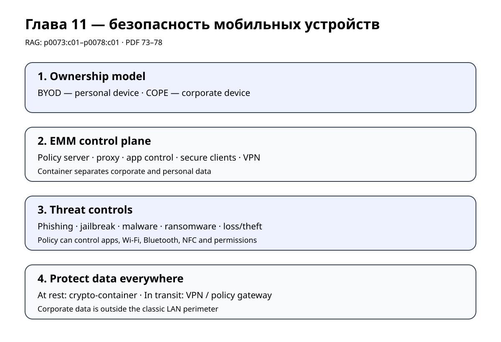

# Глава 11 — Безопасность информации на мобильных устройствах

RAG-grounded разбор главы 11 книги «Информационная безопасность: учебное пособие» Я. С. Гродзенского.

## Идентификация

- Book ID: `information-security-grodzensky-ru`
- Глава: 11
- Slug: `mobile-device-security`
- Source policy: `rag_only`
- External sources: запрещены
- Model memory: запрещена
- Прямой доступ к PDF: не использовался

## Provenance

- RAG chunks: `p0073:c01`–`p0078:c01`
- PDF pages: 73–78
- Source SHA-256: `4e4cf1d98c35c3d131d1aad21c5c7cd7da3c2548ef5e12dc75e27b4460a90c2f`
- `p0073:c01` начинается заголовком раздела 11.
- `p0078:c01` содержит итог раздела и вопросы для самопроверки.
- `p0079:c01` начинается разделом 12 «Защита информации ограниченного доступа и предотвращение утечек информации».
- Chapter boundary verified: yes
- Printed page range: [Needs confirmation]

## Содержимое

- [cheatsheet.md](cheatsheet.md) — рабочая модель защиты мобильных устройств.
- [commands.md](commands.md) — классы мобильных средств и контролей, явно названные в главе; shell-команд нет.
- [diagram.md](diagram.md) — Mermaid-карта BYOD/COPE → EMM → container/policy/VPN.
- [visual-cheatsheet.svg](visual-cheatsheet.svg) — компактный обзор.
- [visual-cheatsheet-detailed.svg](visual-cheatsheet-detailed.svg) — подробная схема.
- [summary.md](summary.md) — итог главы по `p0078:c01`.
- [review-questions.md](review-questions.md) — 4 вопроса для самопроверки.
- [review-answers.md](review-answers.md) — ответы только по RAG главы.

## Карта главы

1. Мобильные устройства создают специфические риски из-за постоянного перемещения и нахождения вне классического сетевого периметра.
2. Основные нарушители в источнике:
   - внешний злоумышленник;
   - нелояльный сотрудник.
3. Базовые организационные модели:
   - BYOD — личное устройство сотрудника под корпоративной политикой безопасности;
   - COPE — корпоративное устройство, выданное сотруднику.
4. Основной класс технической защиты — EMM.
5. EMM в главе решает три группы задач:
   - отделение корпоративной информации от личной;
   - управление полномочиями;
   - защита данных при передаче.
6. Для разделения данных используется криптоконтейнер.
7. Для передачи данных используются VPN-модули и proxy/policy-интеграция.
8. EMM-модули, явно перечисленные в источнике:
   - proxy/gateway;
   - application store;
   - secure mail client;
   - secure file manager;
   - secure browser;
   - VPN client.
9. Рассматривается wrapping/containerization сторонних приложений.
10. Среди дополнительных функций EMM:
   - phishing protection;
   - jailbreak detection;
   - anti-theft;
   - контроль Wi-Fi/Bluetooth/NFC;
   - certificate-based authentication;
   - SSO.
11. Политики могут зависеть от Wi-Fi-сети, геолокации и состояния устройства.
12. Угрозы, явно названные в главе:
   - потеря/кража устройства;
   - malware;
   - ransomware;
   - botnet;
   - phishing;
   - jailbreak;
   - NFC-related attacks;
   - утечки корпоративных данных.
13. Для предотвращения утечек на мобильных устройствах источник связывает контроль с EMM и ограничениями DLP в мобильной среде.
14. Итоговая идея главы: корпоративная информация уже находится за пределами классического периметра, поэтому защита должна сопровождать данные на самом устройстве и в канале связи.

## Краткий анализ

Глава рассматривает mobile security как расширение корпоративной ИБ за пределы локальной сети. Ключевая проблема — смешение личного и корпоративного контекста на одном устройстве.

Организационная развилка начинается с модели владения. При BYOD устройство принадлежит сотруднику, но на него распространяется корпоративная политика безопасности. При COPE устройство выдаёт организация, что упрощает применение централизованных политик, хотя источник отдельно подчёркивает необходимость учитывать обработку личных данных сотрудника.

Технический центр главы — EMM. Оно описывается как клиент-серверная система с агентом на устройстве, сервером политик и proxy-компонентом. Такое решение должно одновременно защищать stored data, контролировать доступ к функциям устройства и защищать сетевую передачу.

Криптоконтейнер используется для отделения корпоративной информации от личной. Доступ к контейнеру связывается с паролем, PIN или биометрией; данные внутри контейнера шифруются штатными средствами ОС.

Для сетевого доступа источник связывает EMM с VPN и proxy. Для регулируемой информации отдельно рекомендуется оценивать применимость нормативных требований и при необходимости использовать соответствующие VPN-клиенты.

Дополнительные возможности EMM в главе образуют policy-enforcement слой: ограничение приложений и функций, контроль магазинов приложений, phishing protection, jailbreak detection, anti-theft, certificate authentication и SSO.

В финале глава показывает EMM как единый orchestration-layer для мобильной среды: хранение данных, права, сетевой доступ, application control и response на потерю или компрометацию устройства.

## Основной принцип

`ownership model → corporate policy → EMM enrollment → container/policy/VPN → monitoring → response`

Для мобильной среды защита должна сопровождать данные как на устройстве, так и при передаче.

## Source-version boundary

- Правовые утверждения о BYOD/COPE и контроле личных устройств сохранены как позиция источника.
- Сравнение Android/iOS и threat terminology не обновлялись внешними источниками.
- Современные UEM/MDM/MAM product distinctions внешне не добавлялись.

## Ограничения

- Shell-команд и vendor-specific EMM configuration в главе нет.
- Конкретные mobile OS hardening baselines отсутствуют.
- Remote wipe/anti-theft описаны концептуально; operational procedures не добавлялись.
- Актуальность правовых и сертификационных требований не проверялась.
