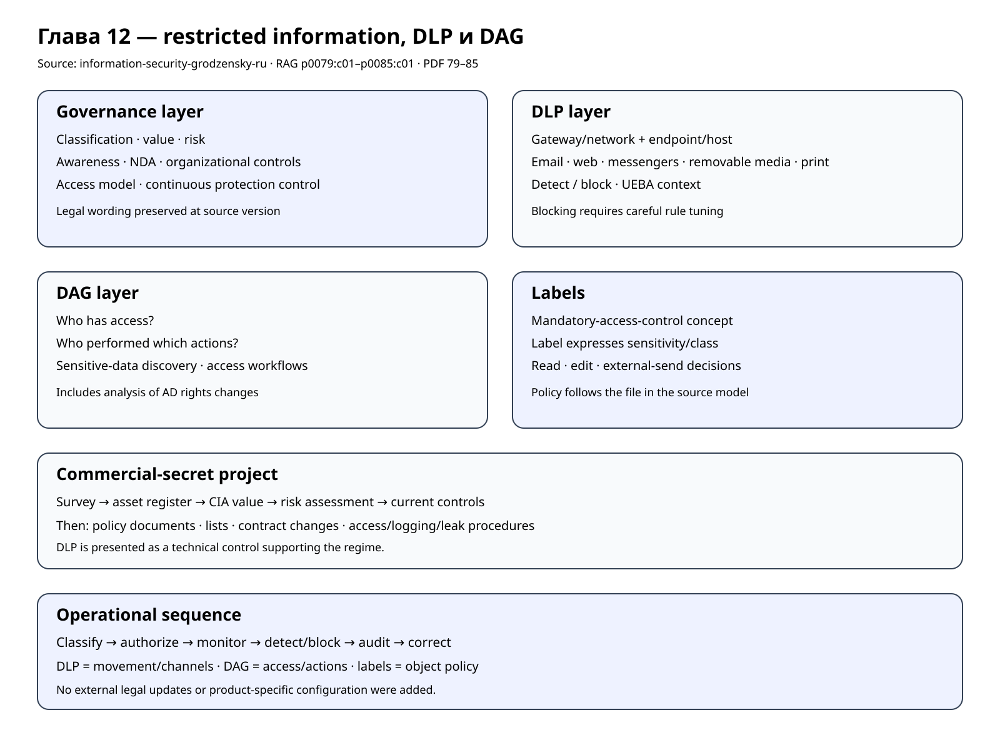

# Глава 12 — Защита информации ограниченного доступа и предотвращение утечек информации

RAG-grounded разбор главы 12 книги «Информационная безопасность: учебное пособие» Я. С. Гродзенского.

## Идентификация

- Book ID: `information-security-grodzensky-ru`
- Глава: 12
- Slug: `restricted-information-dlp-dag`
- Source policy: `rag_only`
- External sources: запрещены
- Model memory: запрещена
- Прямой доступ к PDF: не использовался

## Provenance

- RAG chunks: `p0079:c01`–`p0085:c01`
- PDF pages: 79–85
- Source SHA-256: `4e4cf1d98c35c3d131d1aad21c5c7cd7da3c2548ef5e12dc75e27b4460a90c2f`
- `p0079:c01` начинается заголовком раздела 12.
- `p0085:c01` содержит вопросы для самопроверки.
- `p0086:c01` начинается разделом 13 «Информационная безопасность на производстве и в управлении качеством».
- Chapter boundary verified: yes
- Printed page range: [Needs confirmation]

## Содержимое

- [cheatsheet.md](cheatsheet.md) — рабочая модель защиты информации ограниченного доступа.
- [commands.md](commands.md) — классы средств и контрольных механизмов, явно названные в главе.
- [diagram.md](diagram.md) — Mermaid-карта DLP + DAG + labels + commercial secret.
- [visual-cheatsheet.svg](visual-cheatsheet.svg) — компактный обзор.
- [visual-cheatsheet-detailed.svg](visual-cheatsheet-detailed.svg) — подробная схема.
- [summary.md](summary.md) — итоговый смысл главы по `p0084:c01`.
- [review-questions.md](review-questions.md) — 4 вопроса для самопроверки.
- [review-answers.md](review-answers.md) — ответы только по RAG главы.

## Карта главы

1. Информация ограниченного доступа требует обязательного соблюдения конфиденциальности в случаях, определённых законодательством.
2. По 149-ФЗ в изложении источника оператор/обладатель должен:
   - предотвращать НСД и передачу неуполномоченным лицам;
   - своевременно обнаруживать НСД;
   - предупреждать неблагоприятные последствия;
   - предотвращать воздействие, нарушающее работу технических средств;
   - обеспечивать быстрое восстановление изменённой/уничтоженной информации;
   - постоянно контролировать уровень защищённости.
3. Утечки делятся на умышленные и случайные.
4. Организационные меры:
   - обучение сотрудников;
   - NDA/соглашения о неразглашении;
   - awareness;
   - классификация информации;
   - оценка ценности и риска компрометации.
5. Технический контур строится прежде всего вокруг:
   - DLP;
   - Data Access Governance (DAG);
   - ИТ-аудита;
   - классификаторов;
   - security labels.
6. DLP может работать:
   - на endpoint через агент;
   - на сетевом периметре/gateway;
   - в режиме detection;
   - в режиме blocking.
7. Агент нужен для контроля каналов, которые периметр не видит полностью: печать, removable media, local messengers, encrypted traffic.
8. Blocking mode требует аккуратной настройки из-за false positives.
9. UEBA используется как контекстный/поведенческий слой для DLP.
10. DAG управляет неструктурированными данными:
   - согласование доступа;
   - continuous audit;
   - анализ прав;
   - обнаружение sensitive data;
   - автоматизация access requests;
   - анализ изменений прав в Active Directory.
11. Security labels относятся к мандатной модели доступа и могут ограничивать чтение, редактирование или передачу файла.
12. Коммерческая тайна рассматривается как отдельный режим конфиденциальности.
13. Проект внедрения режима коммерческой тайны включает:
   - обследование организации и активов;
   - оценку ценности и рисков;
   - реестр информационных активов;
   - разработку организационно-распорядительной документации;
   - регламенты доступа, регистрации событий и действий при утечке.

## Краткий анализ

Глава строит защиту информации ограниченного доступа как сочетание правового режима, классификации информации, технических средств и организационных процедур.

Первый слой — обязательства оператора/обладателя. В изложении главы защита не сводится к предотвращению утечки: также требуется обнаружение НСД, восстановление информации и постоянный контроль уровня защищённости.

Второй слой — классификация и awareness. Автор отдельно показывает случайную утечку: сотрудник может передать чувствительный документ без злого умысла. Следовательно, технические средства должны сопровождаться обучением, соглашениями о неразглашении и понятной классификацией информации.

DLP в главе отвечает за контроль каналов передачи чувствительной информации. Сетевой вариант видит периметровый трафик, endpoint-agent расширяет покрытие на локальные каналы. Режим blocking рассматривается как рискованный без качественной настройки правил, поскольку false positives способны нарушить бизнес-процессы.

DAG решает другую задачу: кто имеет доступ к неструктурированным данным и что с ними делает. Это дополняет DLP: DLP контролирует перемещение/утечку, DAG — права и действия с файлами внутри инфраструктуры.

Security labels добавляют policy-driven контроль самих файлов, связывая класс секретности с разрешёнными действиями.

Финальный блок переносит эту модель на коммерческую тайну. Источник описывает проект как последовательность от обследования, оценки активов и рисков к разработке организационно-распорядительной документации и регламентов.

## Основной принцип

`classify information → define access → monitor use/movement → detect/block leakage → audit rights → enforce legal/organizational regime`

DLP и DAG в логике главы взаимодополняют друг друга:

`DLP = движение/каналы`
`DAG = доступ/действия с неструктурированными данными`

## Source-version boundary

Правовые формулировки 149-ФЗ, 98-ФЗ, указа №188 и ГОСТ Р 53114-2008 сохранены в состоянии источника и не проверялись на актуальность.

Терминология DLP, DAG, UEBA, iCap и Active Directory также не обновлялась внешним знанием.

## Ограничения

- Shell-команд и vendor-specific DLP/DAG configuration в главе нет.
- Подробная настройка classification rules и blocking policies не приводится.
- Нормативная актуальность не проверялась.
- Прямые процедуры расследования инсайдеров не описаны.
