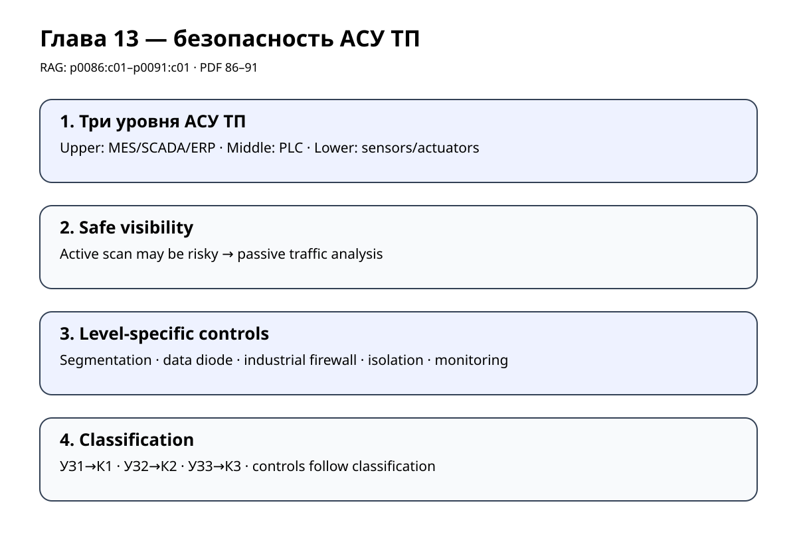
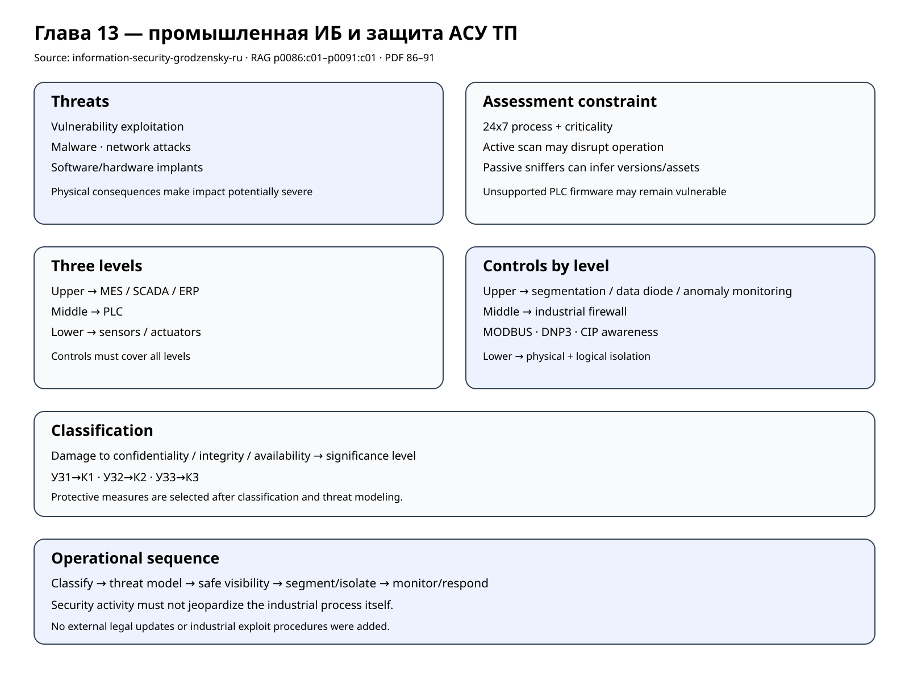

# Глава 13 — Информационная безопасность на производстве и в управлении качеством

RAG-grounded разбор главы 13 книги «Информационная безопасность: учебное пособие» Я. С. Гродзенского.

## Идентификация

- Book ID: `information-security-grodzensky-ru`
- Глава: 13
- Slug: `industrial-control-security`
- Source policy: `rag_only`
- External sources: запрещены
- Model memory: запрещена
- Прямой доступ к PDF: не использовался

## Provenance

- RAG chunks: `p0086:c01`–`p0091:c01`
- PDF pages: 86–91
- Source SHA-256: `4e4cf1d98c35c3d131d1aad21c5c7cd7da3c2548ef5e12dc75e27b4460a90c2f`
- `p0086:c01` — начало раздела 13.
- `p0091:c01` — итог и вопросы для самопроверки.
- `p0092:c01` — начало раздела 14.
- Chapter boundary verified: yes

## Карта главы

1. Защита АСУ ТП рассматривается как особенно критичная из-за возможного физического, финансового и репутационного ущерба.
2. Нормативная опора в источнике:
   - Приказ ФСТЭК России № 31;
   - Федеральный закон № 187-ФЗ;
   - ГОСТ Р 56498-2015 (IEC/PAS 62443-3:2008);
   - ISA/IEC 62443.
3. Основные угрозы:
   - эксплуатация уязвимостей;
   - вредоносное ПО;
   - сетевые атаки;
   - возможные закладки в ПО и оборудовании.
4. Vulnerability management в АСУ ТП отличается от корпоративной среды:
   - системы могут работать круглосуточно;
   - активное сканирование может нарушить нормальную работу;
   - исправления могут отсутствовать из-за снятия оборудования с поддержки.
5. Для более щадящего анализа источник приводит passive sniffers/traffic analyzers.
6. АСУ ТП делится на три уровня:
   - верхний: MES, SCADA, ERP, визуализация и диспетчеризация;
   - средний: PLC;
   - нижний: датчики и исполнительные механизмы.
7. Защита требуется на всех трёх уровнях.
8. Верхний уровень:
   - сегментация;
   - датадиоды для одностороннего взаимодействия;
   - мониторинг сетевых аномалий.
9. Средний уровень:
   - специализированные industrial firewalls;
   - понимание MODBUS, DNP3, CIP;
   - специализированные сигнатуры.
10. Нижний уровень:
   - физическая и логическая изоляция;
   - в некоторых архитектурах — специализированная защита от вторжений.
11. Monitoring/incident-management решения используются для:
   - inventory сетевых активов;
   - выявления неавторизованного управления;
   - обнаружения атак;
   - расследования инцидентов.
12. Общий набор мер в источнике включает firewall/IDS, DLP, antivirus, vulnerability analysis, code scanners, crypto protection, authentication, trusted boot и removable-media control.
13. Проект по Приказу № 31:
   - классифицировать АСУ;
   - определить угрозы и построить threat model;
   - определить требования к системе защиты;
   - внедрить организационные и технические меры.
14. Классы защищённости:
   - К1 — самый высокий;
   - К2;
   - К3 — самый низкий.
15. Класс связан с уровнем значимости информации:
   - УЗ1 → К1;
   - УЗ2 → К2;
   - УЗ3 → К3.
16. УЗ определяется через возможный ущерб при нарушении конфиденциальности, целостности и доступности.

## Краткий анализ

Глава показывает, что industrial security нельзя просто копировать из офисной инфраструктуры. Ключевое различие — приоритет непрерывности технологического процесса и физические последствия ошибки.

Самый важный operational вывод источника связан с vulnerability management. Даже обычное активное сканирование в АСУ ТП может считаться недопустимым, если существует риск нарушения технологической работы. Поэтому источник выделяет passive traffic analysis как способ получить данные о версиях ПО и потенциальных уязвимостях без активного воздействия на узлы.

Архитектурно глава строится вокруг трёх уровней АСУ ТП. На верхнем уровне важны сегментация и разрыв доверия между корпоративной и технологической сетью; датадиод используется как пример одностороннего канала. На среднем уровне применяются специализированные firewalls, понимающие промышленные протоколы. Нижний уровень защищается прежде всего изоляцией.

Нормативная последовательность источника начинается не с выбора конкретного СЗИ, а с классификации АСУ, модели угроз и определения требований. Только после этого выбираются организационные и технические меры.

Классификация К1–К3 связывается с уровнем значимости УЗ1–УЗ3, который определяется возможным ущербом от нарушения CIA. То есть защита должна быть пропорциональна потенциальным последствиям для производственного процесса.

## Основной принцип

`industrial context → classify ASU → threat model → safe visibility → segment/isolate → deploy level-specific controls → monitor incidents`

Главное operational отличие от обычной корпоративной среды:

`не допустить, чтобы сама проверка безопасности нарушила технологический процесс`.

## Source-version boundary

Нормативные акты, классы защищённости, ISA/IEC 62443 и промышленная терминология сохранены в состоянии книги и внешне не проверялись.

## Ограничения

- Shell-команд и vendor-specific configuration в главе нет.
- MODBUS/DNP3/CIP приведены как примеры поддерживаемых промышленных протоколов, без packet-level инструкций.
- Методика расчёта УЗ и выбора мер передана только в объёме главы.
- Актуальность Приказа №31 и связанных требований не проверялась.
