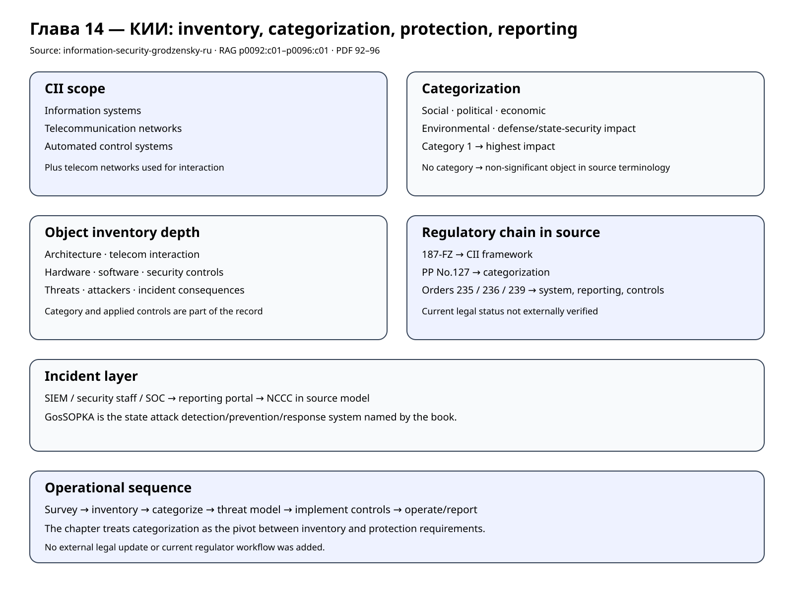

# Глава 14 — Защита критической информационной инфраструктуры

RAG-grounded разбор главы 14 книги «Информационная безопасность: учебное пособие» Я. С. Гродзенского.

## Идентификация

- Book ID: `information-security-grodzensky-ru`
- Глава: 14
- Slug: `critical-information-infrastructure`
- Source policy: `rag_only`
- External sources: запрещены
- Model memory: запрещена
- Прямой доступ к PDF: не использовался

## Provenance

- RAG chunks: `p0092:c01`–`p0096:c01`
- PDF pages: 92–96
- Source SHA-256: `4e4cf1d98c35c3d131d1aad21c5c7cd7da3c2548ef5e12dc75e27b4460a90c2f`
- `p0092:c01` — начало раздела 14.
- `p0096:c01` — итог и вопросы для самопроверки.
- `p0097:c01` — начало раздела 15.
- Chapter boundary verified: yes

## Карта главы

1. КИИ по источнику включает объекты КИИ и сети электросвязи, используемые для взаимодействия таких объектов.
2. Объекты КИИ:
   - информационные системы;
   - информационно-телекоммуникационные сети;
   - автоматизированные системы управления субъектов КИИ.
3. Субъектами КИИ в книге называются организации и ИП из перечисленных законом отраслей, владеющие или законно использующие соответствующие ИС/сети/АСУ.
4. ГОССОПКА в источнике описана как государственная система обнаружения, предупреждения и ликвидации последствий компьютерных атак.
5. Источник связывает субъектов КИИ с передачей сведений об инцидентах в НКЦКИ.
6. Объекты КИИ делятся на значимые и незначимые.
7. Значимые объекты получают одну из трёх категорий значимости.
8. Категорирование учитывает:
   - социальную;
   - политическую;
   - экономическую;
   - экологическую значимость;
   - значимость для обороны, безопасности государства и правопорядка.
9. Постановление Правительства РФ №127 в источнике задаёт правила категорирования и критерии значимости.
10. Приказ ФСТЭК №235 относится к созданию и функционированию систем безопасности значимых объектов КИИ.
11. Приказ ФСТЭК №236 определяет форму направления сведений о категорировании.
12. Приказ ФСТЭК №239 задаёт требования к мерам защиты значимых объектов КИИ.
13. В сведениях об объекте КИИ источник перечисляет:
   - данные об объекте и субъекте;
   - архитектуру и назначение;
   - взаимодействие с сетями связи;
   - эксплуатирующее лицо;
   - аппаратные и программные средства;
   - применяемые СЗИ;
   - угрозы и нарушителей;
   - возможные последствия инцидентов;
   - категорию значимости;
   - организационные и технические меры.
14. Проект приведения в соответствие строится как:
   - обследование объектов;
   - моделирование угроз;
   - категорирование;
   - внедрение мер защиты.

## Краткий анализ

Глава переводит тему критической инфраструктуры из общего обсуждения угроз в формальную модель: сначала необходимо определить, является ли организация субъектом КИИ, затем составить перечень объектов, провести категорирование и только после этого выбирать меры защиты.

Центральная сущность главы — категория значимости. Она зависит не только от технической роли системы, но и от потенциальных социальных, политических, экономических, экологических и оборонных последствий нарушения её работы.

Отдельный слой — взаимодействие с государственными механизмами реагирования. В изложении книги ГОССОПКА и НКЦКИ формируют контур передачи сведений об инцидентах; SIEM/SOC могут быть источником информации для такого процесса.

Глава также подчёркивает инвентаризационную глубину проекта: требуется знать не только название системы, но и архитектуру, сети связи, оборудование, ПО, встроенные функции безопасности, применяемые СЗИ, нарушителей и последствия возможных атак.

## Основной принцип

`identify subject → inventory CII objects → categorize → model threats → define controls → report/maintain compliance`

Для значимых объектов логика источника дополнительно связывает категорию значимости с набором требований к системе безопасности и защитным мерам.

## Source-version boundary

Правовые утверждения, обязанности субъектов КИИ, формулировки ГОССОПКА/НКЦКИ и нормативные ссылки сохранены строго в состоянии книги.

Актуальность 187-ФЗ, Постановления №127 и приказов ФСТЭК №235/236/239 внешне не проверялась.

## Ограничения

- Shell-команд и vendor-specific configuration в главе нет.
- Практические формы отчётности и текущие требования регуляторов не добавлялись.
- Современные изменения законодательства о КИИ не подмешивались.
