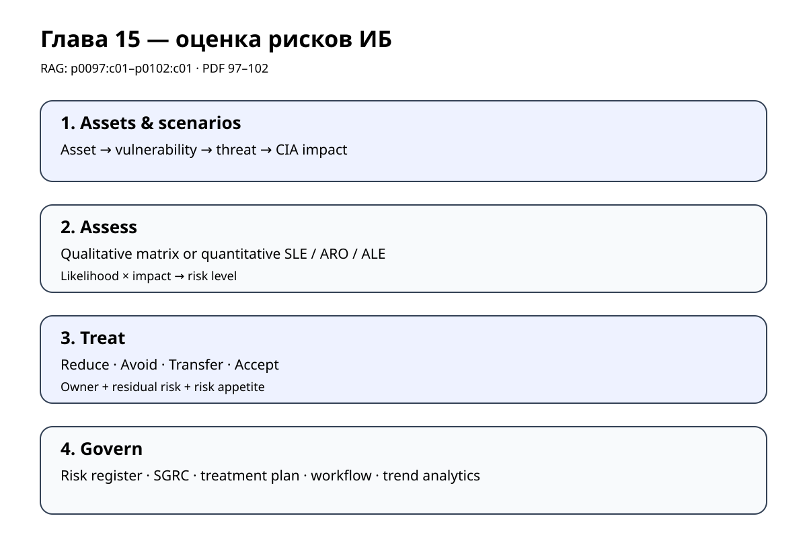
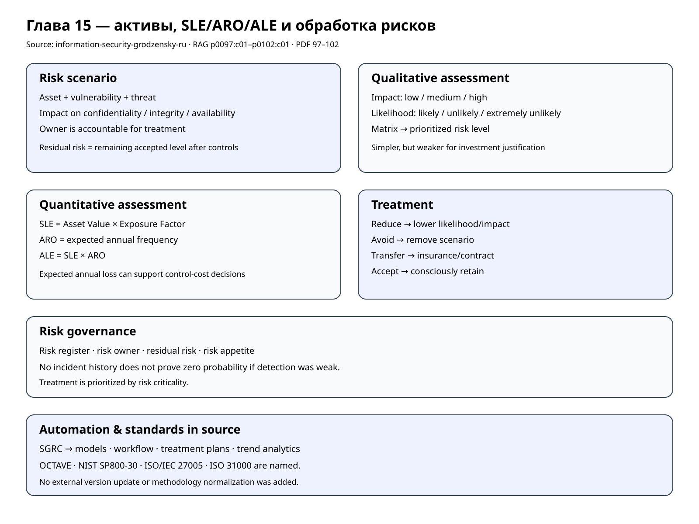

# Глава 15 — Оценка рисков информационной безопасности

RAG-grounded разбор главы 15 книги «Информационная безопасность: учебное пособие» Я. С. Гродзенского.

## Идентификация

- Book ID: `information-security-grodzensky-ru`
- Глава: 15
- Slug: `information-security-risk-assessment`
- Source policy: `rag_only`
- External sources: запрещены
- Model memory: запрещена
- Прямой доступ к PDF: не использовался

## Provenance

- RAG chunks: `p0097:c01`–`p0102:c01`
- PDF pages: 97–102
- Source SHA-256: `4e4cf1d98c35c3d131d1aad21c5c7cd7da3c2548ef5e12dc75e27b4460a90c2f`
- `p0097:c01` — начало раздела 15.
- `p0102:c01` — итог и вопросы для самопроверки.
- `p0103:c01` — начало раздела 16.
- Chapter boundary verified: yes

## Карта главы

1. Риск ИБ связывается с вероятностью реализации угрозы через уязвимость и последующим ущербом для конфиденциальности, целостности или доступности.
2. Анализ начинается с информационных активов:
   - определить ценность;
   - понять жизненный цикл;
   - зафиксировать связанные ИТ-активы, ПО, оборудование, каналы связи и облачные сервисы.
3. Классическая модель сценария:
   - актив;
   - уязвимость;
   - угроза.
4. Для каждого риска определяется владелец.
5. Отдельно выделяется остаточный риск — приемлемый для организации уровень после применения мер.
6. Два основных подхода:
   - качественный;
   - количественный.
7. Качественная оценка использует категории ущерба и вероятности.
8. Количественная оценка использует:
   - SLE — ущерб от одного инцидента;
   - ARO — среднегодовую частоту;
   - ALE — ожидаемый среднегодовой ущерб.
9. Формулы из главы:
   - `SLE = стоимость актива × фактор воздействия`;
   - `ALE = SLE × ARO`.
10. Источник связывает стоимость защитных мер с ожидаемым ущербом и считает нецелесообразным превышение ALE в приведённом примере.
11. После анализа формируется реестр рисков.
12. Четыре способа обработки:
   - снижение;
   - исключение;
   - передача;
   - принятие.
13. Названные методики:
   - OCTAVE;
   - NIST SP800-30;
   - ГОСТ Р ИСО/МЭК 27005-2010;
   - ALE-подход и другие.
14. Для автоматизации управления рисками используется класс SGRC.
15. В SGRC важны:
   - поддерживаемые модели оценки;
   - качественная/количественная оценка;
   - собственная методика;
   - остаточный риск;
   - risk appetite;
   - план обработки;
   - аналитика динамики;
   - workflow.
16. В финале главы ISO 31000 назван основным стандартом оценки рисков для организаций в изложении источника.

## Краткий анализ

Глава делает риск центральным механизмом приоритизации ИБ. Защита должна начинаться не с покупки СЗИ, а с ответа на вопросы: какие активы критичны, какие угрозы и уязвимости к ним относятся, насколько вероятна реализация и какой ущерб она принесёт.

Важный operational слой — ownership. У каждого риска должен быть владелец, отвечающий за его обработку и остаточный уровень. Владелец информационного риска часто связан с бизнес-подразделением, а для ИТ-активов — с ИТ-функцией.

Качественный анализ проще и быстрее, но хуже обосновывает инвестиции. Количественный анализ сложнее, зато позволяет связать риск с деньгами. Для этого используются SLE, ARO и ALE.

Глава отдельно предупреждает о проблеме отсутствующей статистики. Если инциденты не зафиксированы, это не означает, что их не было: организация могла не иметь средств обнаружения. Поэтому отсутствие истории не должно автоматически превращаться в нулевую вероятность.

Обработка риска рассматривается как комбинация четырёх стратегий: снизить, исключить, передать или принять. После выбора мер необходимо контролировать остаточный риск относительно risk appetite.

## Основной принцип

`assets → threats + vulnerabilities → likelihood × impact → risk register → treatment → residual risk`

Для количественного варианта:

`SLE → ARO → ALE → сравнение ожидаемого ущерба и стоимости мер`.

## Source-version boundary

- Примеры финансовых порогов в рублях сохранены как примеры книги.
- GDPR, ISO 27001, ISO 31000, OCTAVE, NIST SP800-30 и ГОСТ Р ИСО/МЭК 27005-2010 не проверялись внешне.
- Терминология SGRC и risk appetite сохранена в состоянии источника.

## Ограничения

- Глава не задаёт единую универсальную методику расчёта.
- Конкретные SGRC products и automation workflows не разбираются.
- Формулы даны на вводном уровне.
- Современные версии стандартов/методик не подмешивались.
