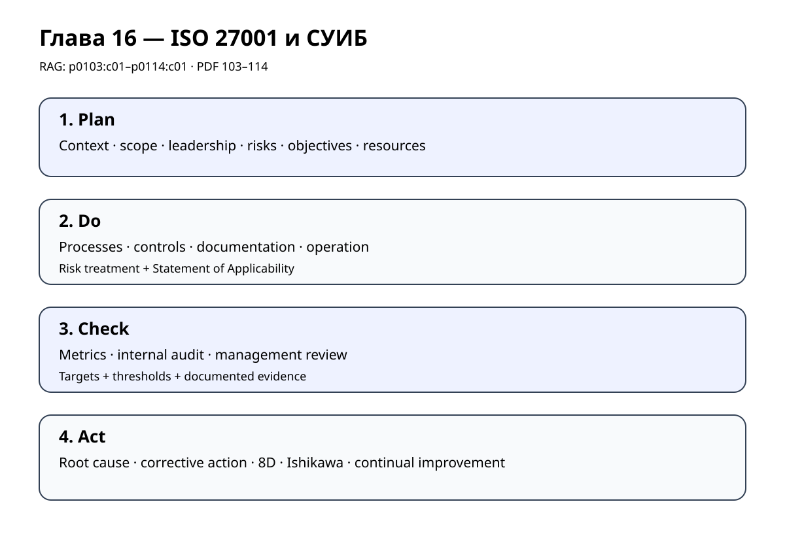
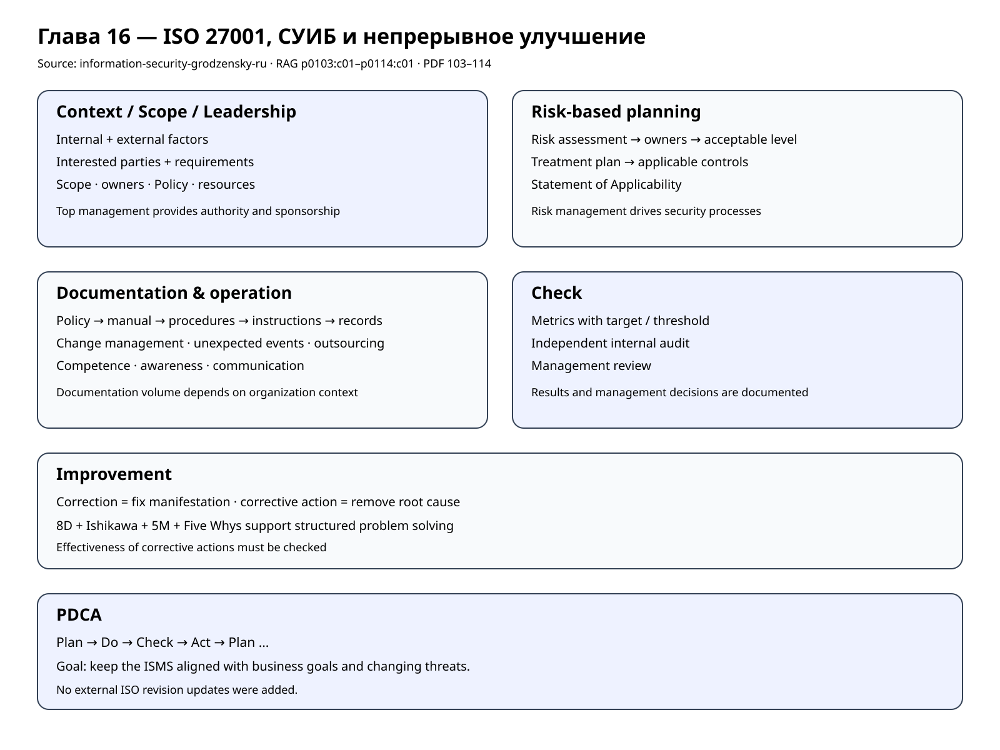

# Глава 16 — Стандарт ISO 27001 и способы его внедрения

RAG-grounded разбор главы 16 книги «Информационная безопасность: учебное пособие» Я. С. Гродзенского.

## Идентификация

- Book ID: `information-security-grodzensky-ru`
- Глава: 16
- Slug: `iso-27001-isms`
- Source policy: `rag_only`
- External sources: запрещены
- Model memory: запрещена
- Прямой доступ к PDF: не использовался

## Provenance

- RAG chunks: `p0103:c01`–`p0114:c01`
- PDF pages: 103–114
- Source SHA-256: `4e4cf1d98c35c3d131d1aad21c5c7cd7da3c2548ef5e12dc75e27b4460a90c2f`
- `p0103:c01` — начало раздела 16.
- `p0114:c01` — итог и вопросы для самопроверки.
- `p0115:c01` — «Заключение».
- Chapter boundary verified: yes
- Printed page range: [Needs confirmation]

## Содержимое

- [cheatsheet.md](cheatsheet.md) — рабочая модель ISO 27001/СУИБ/PDCA.
- [commands.md](commands.md) — процессы, документы и механизмы из главы; shell-команд нет.
- [diagram.md](diagram.md) — Mermaid-карты PDCA, GAP-analysis и corrective-action loop.
- [visual-cheatsheet.svg](visual-cheatsheet.svg) — компактный обзор.
- [visual-cheatsheet-detailed.svg](visual-cheatsheet-detailed.svg) — подробная схема.
- [summary.md](summary.md) — итог главы по `p0114:c01`.
- [review-questions.md](review-questions.md) — 4 вопроса для самопроверки.
- [review-answers.md](review-answers.md) — ответы только по RAG главы.

## Карта главы

1. ISO 27001 в источнике представлен как основной стандарт серии, задающий требования к созданию, сопровождению и непрерывному совершенствованию СУИБ.
2. Дополнительно названы:
   - ISO 27002 — лучшие практики;
   - ISO 27004 — мониторинг эффективности;
   - ISO 27005 — управление рисками;
   - ISO 27035 — основы управления инцидентами.
3. Жизненный цикл СУИБ связывается с PDCA:
   - Plan — контекст, руководство, планирование, поддержка;
   - Do — операционная деятельность;
   - Check — оценка состояния;
   - Act — улучшение.
4. На Plan определяются:
   - область и границы СУИБ;
   - заинтересованные стороны;
   - требования;
   - процессы;
   - ресурсы;
   - цели;
   - риски и меры их обработки.
5. Роль руководства:
   - демонстрировать commitment;
   - назначать полномочия;
   - утверждать Политику ИБ;
   - назначать куратора/создавать Комитет по ИБ;
   - обеспечивать ресурсы.
6. Для каждого процесса СУИБ должны быть назначены владельцы/ответственные.
7. Risk management — основа управления ИБ в главе:
   - каждый риск имеет owner;
   - определяется acceptable/residual risk;
   - для превышающих допустимый уровень рисков создаётся treatment plan.
8. Поддержка СУИБ требует:
   - ресурсов;
   - компетенций;
   - awareness;
   - коммуникаций;
   - documented information.
9. Документированная информация делится на:
   - документы;
   - записи.
10. В hierarchy документов источник выделяет:
    - Политику ИБ;
    - Руководство СУИБ;
    - процедуры/регламенты/стандарты;
    - инструкции/методические материалы;
    - записи/акты/протоколы.
11. После оценки рисков создаётся «Положение о применимости механизмов контроля» — таблица мер с указанием применимости.
12. Check включает три ключевых процесса:
    - мониторинг/метрики эффективности;
    - внутренний аудит;
    - management review.
13. Для метрик важны:
    - измеримость;
    - значимость;
    - возможность владельца процесса влиять на показатель;
    - target и threshold values.
14. Несоответствия требуют различать:
    - коррекцию — устранение конкретного проявления;
    - корректирующее действие — устранение коренной причины.
15. Для оценки текущего состояния относительно требований используется GAP-анализ.
16. Проект внедрения СУИБ включает:
    - GAP-analysis;
    - план-график;
    - ответственных;
    - сроки;
    - ресурсы;
    - project manager;
    - коммуникацию заинтересованным сторонам.
17. Политика ИБ должна:
    - соответствовать целям организации;
    - содержать измеримые цели ИБ;
    - включать commitment к применимым требованиям;
    - включать commitment к постоянному улучшению СУИБ;
    - быть доступна сотрудникам;
    - распространяться заинтересованным сторонам;
    - быть утверждена высшим руководством;
    - пересматриваться.
18. Для problem solving источник вводит метод 8D.
19. Для root-cause analysis рассматриваются:
    - диаграмма Исикавы;
    - 5M;
    - «Пять почему?».
20. Финальный вывод: ISO 27001 + PDCA используются для системного и непрерывного улучшения СУИБ.

## Краткий анализ

Глава 16 переводит ИБ из набора отдельных защитных мер в управленческую систему. СУИБ должна быть встроена в бизнес, иметь область действия, владельцев процессов, ресурсы, измеримые цели, документацию, контроль эффективности и цикл улучшения.

PDCA используется как каркас жизненного цикла. На Plan формируется контекст, scope, risk model, цели и ресурсы. На Do внедряются процессы и меры. На Check выполняются мониторинг, аудит и review руководства. На Act устраняются коренные причины несоответствий и совершенствуется система.

Особенно важна роль руководства: СУИБ затрагивает стратегический, тактический и операционный уровни, поэтому без полномочий, ресурсов и sponsorship её нельзя свести к работе только отдела ИБ.

Risk management остаётся центральным механизмом выбора мер. Глава связывает область действия, риски, treatment и Statement of Applicability: меры должны быть не просто перечислены, а обоснованы применимостью.

Operational maturity проверяется через метрики, внутренний аудит и management review. При выявлении отклонения недостаточно устранить единичный симптом — требуется определить root cause и применить corrective action.

8D, Ishikawa и «Пять почему?» рассматриваются как инструменты системного решения проблем и поиска причин.

## Основной принцип

`context → scope → leadership → risk assessment → controls/processes → operate → measure/audit → corrective action → continual improvement`

## Source nuance

В `p0104:c01` PDCA задан как:
- Plan — проектирование;
- Do — внедрение/эксплуатация;
- Check — мониторинг;
- Act — улучшение.

В `p0106:c01` при описании risk treatment источник отдельно говорит о внедрении плана обработки на Act, повторной оценке на Check и дальнейшем улучшении на Do. Эта формулировка сохранена как есть и не нормализовалась внешними источниками.

## Source-version boundary

- ISO 27001/27002/27004/27005/27035, ISO 27000 и terminology сохранены в версии книги.
- Утверждения о сертификации и международной репутации не проверялись внешне.
- 8D, Ishikawa, 5M и «Пять почему?» приведены в формулировках источника.
- Современные редакции ISO/IEC 27001 и Annex A внешне не добавлялись.

## Ограничения

- Shell-команд и tool-specific implementation нет.
- Полный mandatory-document set текущей ISO 27001 не реконструировался.
- Аудит и метрики описаны на process level, без KPI formulas.
- Certification audit lifecycle дан обзорно.
