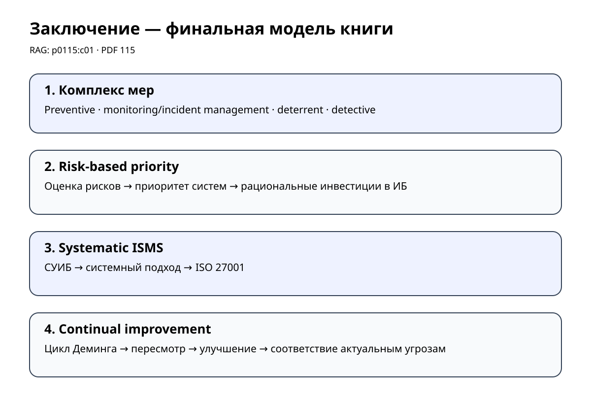

# Заключение — финальный артефакт книги

RAG-grounded обработка заключения книги «Информационная безопасность: учебное пособие» Я. С. Гродзенского.

## Идентификация

- Book ID: `information-security-grodzensky-ru`
- Artifact type: `book_conclusion`
- Source policy: `rag_only`
- External sources: запрещены
- Model memory: запрещена
- Прямой доступ к PDF: не использовался

## Provenance

- RAG chunk: `p0115:c01`
- PDF page: 115
- Source SHA-256: `4e4cf1d98c35c3d131d1aad21c5c7cd7da3c2548ef5e12dc75e27b4460a90c2f`
- `p0115:c01` начинается заголовком «ЗАКЛЮЧЕНИЕ».
- `p0116:c01` начинается «БИБЛИОГРАФИЧЕСКИЙ СПИСОК».
- Conclusion boundary verified: yes

## Содержимое

- [summary.md](summary.md) — нормализованный итог книги строго по заключению.
- [diagram.md](diagram.md) — Mermaid-карта финальной модели автора.
- [visual-summary.svg](visual-summary.svg) — компактная визуальная шпаргалка.

## Финальная модель книги по заключению

Заключение сводит материал к пяти опорным положениям:

1. Информационная безопасность охватывает множество классов угроз и регулируется рядом законодательных актов.
2. Защита информации требует сочетания различных типов мер:
   - превентивных;
   - средств мониторинга и управления инцидентами;
   - сдерживающих;
   - детективных.
3. Системное построение СУИБ автор связывает с ISO 27001.
4. Выбор и внедрение СЗИ должны опираться на оценку рисков, чтобы определить приоритеты защиты и рационально использовать инвестиции.
5. СУИБ должна постоянно пересматриваться и улучшаться; для этого источник рекомендует цикл Деминга.

## Основной принцип

`угрозы + требования → комплекс защитных мер → риск-ориентированный выбор СЗИ → СУИБ по ISO 27001 → постоянное улучшение`

## Book closeout

Заключение не вводит новых классов средств защиты или новых нормативных механизмов. Его функция — связать материал книги в одну управленческую модель:

- не отдельные СЗИ сами по себе;
- а системная СУИБ;
- основанная на рисках;
- поддерживаемая разными типами защитных мер;
- регулярно пересматриваемая по циклу улучшения.

## Source-version boundary

- Правовые утверждения сохранены в состоянии книги.
- ISO 27001 и цикл Деминга не актуализировались внешними источниками.
- Утверждение о влиянии сертификата ISO 27001 на международную репутацию сохранено как позиция автора.
- После заключения начинается библиографический список; приложения не входят в этот артефакт.
