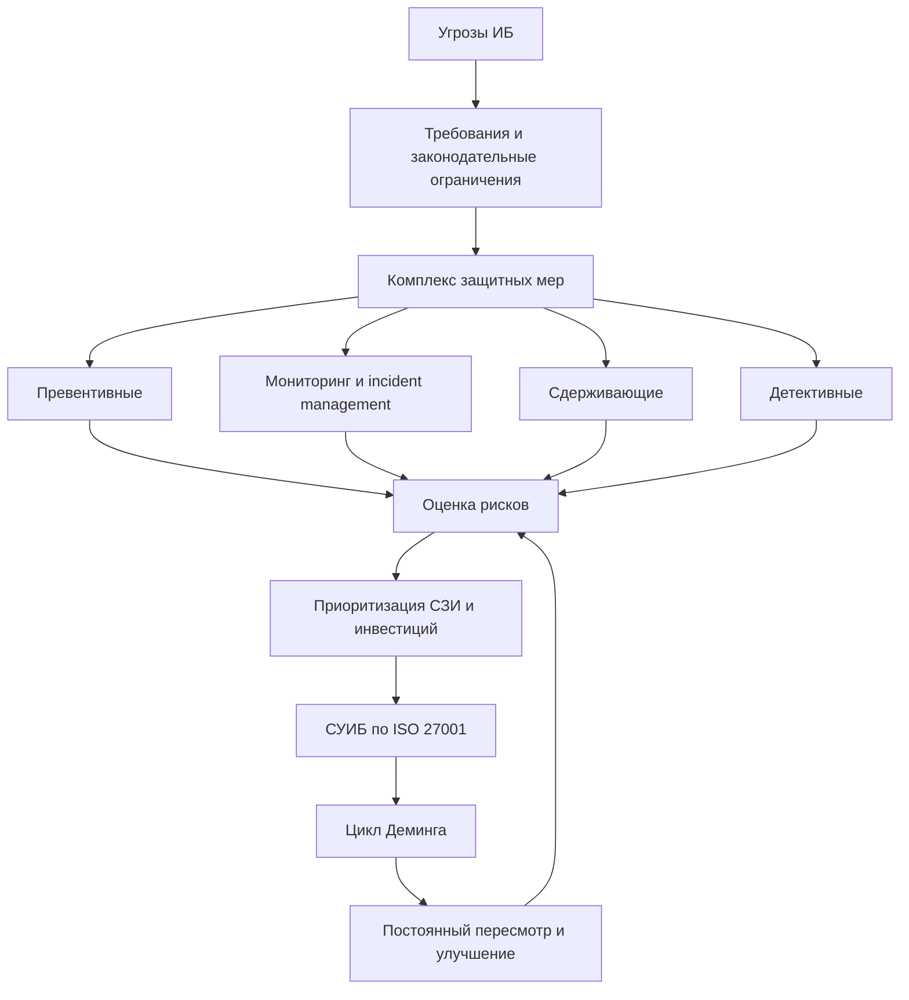

# Диаграмма: финальная модель книги

Источник: `information-security-grodzensky-ru:p0115:c01`, PDF page 115.

## Смысл связи

Диаграмма отражает только содержание заключения:

- защитные меры образуют не отдельный набор, а систему;
- риск определяет приоритеты;
- ISO 27001 задаёт системный подход к СУИБ;
- цикл Деминга обеспечивает непрерывное улучшение.
