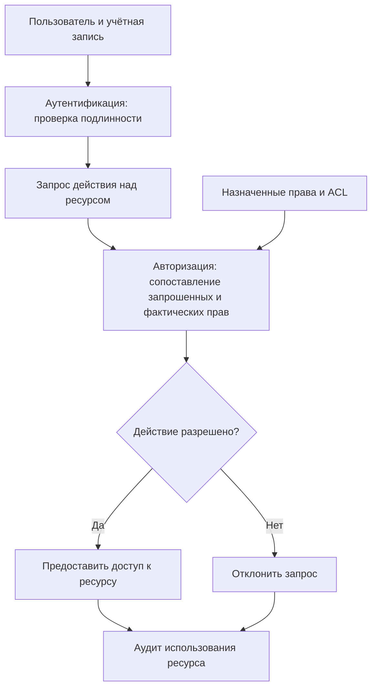
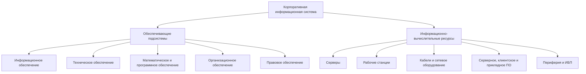
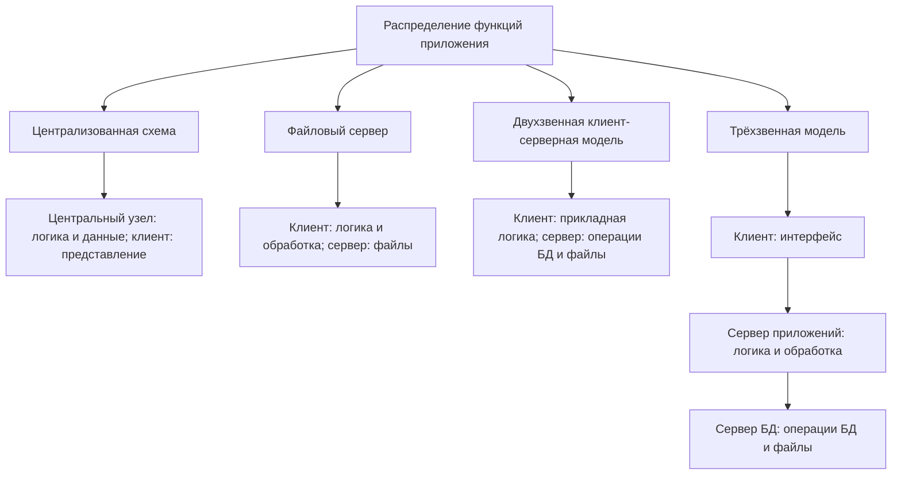
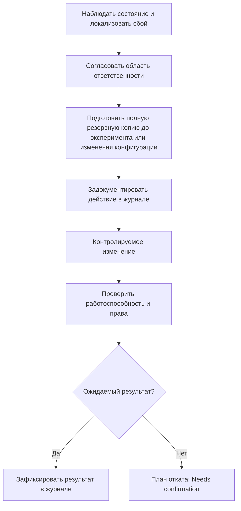

# Схемы — глава 1

Реконструкция **логики текста**, не визуальное восстановление повреждённых рисунков. Источник: RAG p0024-c01–p0050-c01.

## 1. Управление доступом к ресурсу (§1.1, p0029-c01–p0030-c01)

## 2. Составные части ИВС/КИС (§1.2–1.3, p0031-c01–p0039-c01)

## 3. Схемы вычислений (§1.4, p0045-c01–p0048-c01)

## 4. Логика безопасных административных изменений (§1.1, p0025-c01–p0030-c01)

**Ограничения:** последнее дерево — учебная сводка из обязанностей администратора и его «золотых правил», а не формальный, полностью описанный источником runbook. Источник не даёт универсальных команд, проверок восстановления или сценария rollback. Извлечение исходной схемы на p0046-c01 нарушает расположение элементов; данная диаграмма основана на поясняющем тексте p0045-c01–p0048-c01. См. source-findings.md.