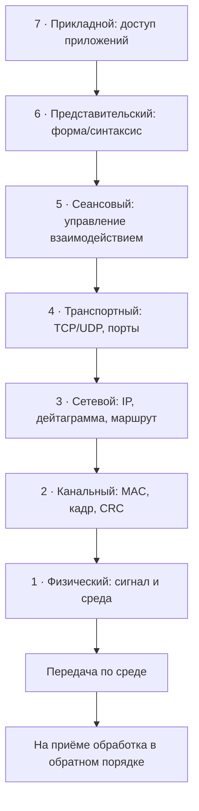
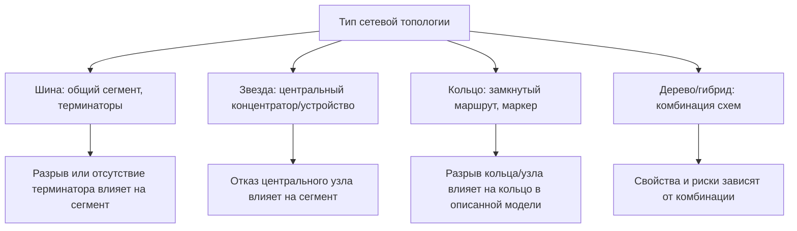
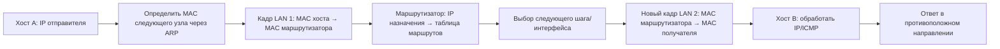
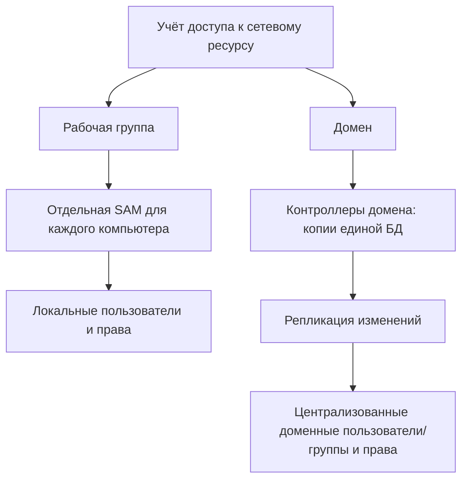
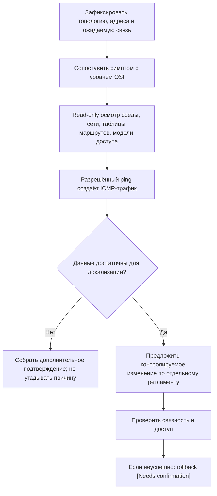

# Диаграммы — глава 2. Администрирование вычислительных сетей

Источник: RAG PDF p. 51–85; `p0051-c01`–`p0085-c01`. Схемы — текстово обоснованные учебные реконструкции, **не** точные копии иллюстраций PDF.

## 1. Уровни OSI и инкапсуляция (§2.2–2.9, PDF 58–68)

Пояснение: на передающей стороне нижестоящие протоколы добавляют служебные заголовки/трейлеры; при получении последовательность обратная. Реальные протоколы не обязаны совпадать с границами эталонной модели (`p0059-c01`).

## 2. Топология и точки отказа (§2.1, PDF 51–58)

## 3. Передача через маршрутизатор (§2.10, PDF 70–75)

Это отражает именно описанный пример `ping 172.16.20.2` и два сегмента из p0071–p0074. Не показывает firewall, NAT, VLAN и дополнительные маршрутизаторы: в этом фрагменте они не заданы.

## 4. Модели безопасности (§2.12, PDF 81–84)

## 5. Диагностический контур с границей изменений

Последняя схема организует **аналитические границы**, а не выдаёт разработанную книгой готовую процедуру: точные параметры проверок, согласование изменения и rollback отсутствуют в RAG главы.

## Source limitations

Топологические рисунки и схемы рабочих групп/домена в RAG представлены только окружающим текстом; мультимодальная точность не проверялась. Спорные утверждения FTP, anycast, ICMP и изолированные ошибки текстового слоя вынесены в [source-findings.md](source-findings.md).