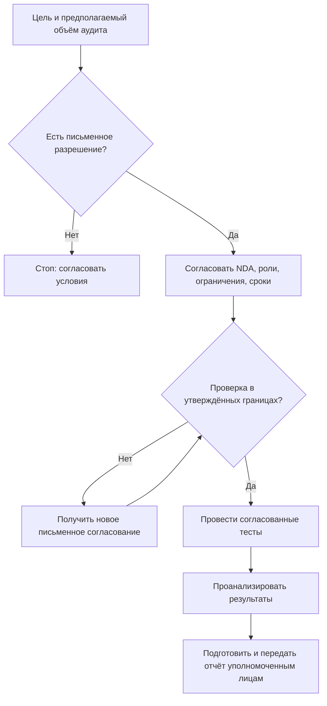

# Схема главы 01 — логика разрешённого аудита

Источники: RAG `p0010:c01`–`p0018:c01`, в особенности [p0014](../../../rag/chunks/p0001-p0100/p0014-c01.md)–[p0018](../../../rag/chunks/p0001-p0100/p0018-c01.md).

Это концептуальный workflow по главе, а не инструкция по эксплуатации уязвимостей. Варианты реакции на технический сбой и конкретный rollback главой не определены: **[Needs confirmation]**.
