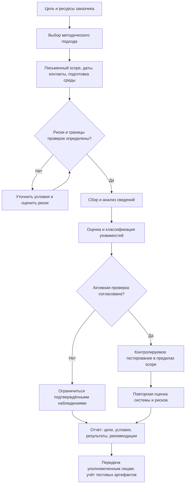

# Diagram — глава 02 «Методология»

**Provenance:** RAG `p0019:c01`–`p0028:c01`. Схема объединяет описанные в главе концептуальные стадии ISSAF/OSSTMM, не объявляя их одинаковыми стандартами.

## Как читать

- В модели **ISSAF** источник особо выделяет три фазы — планирование, аудит, отчётность/очистка ([p0020:c01](../../../rag/chunks/p0001-p0100/p0020-c01.md), [p0023:c01](../../../rag/chunks/p0001-p0100/p0023-c01.md)).
- Для **OSSTMM** источник перечисляет семь каналов и модули: подготовка, сбор сведений, анализ, проверка эксплуатации и расширения доступа, снижение рисков ([p0024:c01](../../../rag/chunks/p0001-p0100/p0024-c01.md)–[p0028:c01](../../../rag/chunks/p0001-p0100/p0028-c01.md)).
- Стрелки решения о scope и риске — визуальная интерпретация требований подготовки/оценки риска, а не дословная официальная диаграмма стандарта.
- Откат воздействия на инфраструктуру — **[Needs confirmation]**; в главе нет конкретного recovery runbook.
