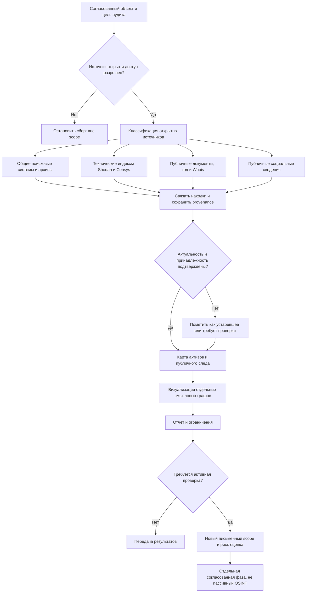

# Диаграмма главы 03: OSINT-процесс и границы доступа

**RAG:** chunks `p0029:c01`–`p0110:c01`. Форма ниже — концептуальное сведение положений книги; это не цитата конкретного рисунка издателя.

## Опорные понятия

- **Пассивный / полупассивный / активный** сбор различаются характером трафика и вероятностью обнаружения; [p0032:c01](../../../rag/chunks/p0001-p0100/p0032-c01.md)–[p0033:c01](../../../rag/chunks/p0001-p0100/p0033-c01.md).
- **Индекс и живой актив не эквивалентны**: Shodan/Censys индексируют ранее собранные данные; [p0050:c01](../../../rag/chunks/p0001-p0100/p0050-c01.md), [p0064:c01](../../../rag/chunks/p0001-p0100/p0064-c01.md).
- **Maltego** связывает сущности и поддерживает выборочные трансформеры; не нужно применять все трансформеры без контроля информационного шума; [p0073:c01](../../../rag/chunks/p0001-p0100/p0073-c01.md)–[p0078:c01](../../../rag/chunks/p0001-p0100/p0078-c01.md).
- **Публичная доступность не снимает ограничений обработки персональных данных**; [p0031:c01](../../../rag/chunks/p0001-p0100/p0031-c01.md), [p0090:c01](../../../rag/chunks/p0001-p0100/p0090-c01.md), [p0093:c01](../../../rag/chunks/p0001-p0100/p0093-c01.md).
- **Deep Web отличается от DarkNet**: неиндексируемая общедоступная информация и анонимные сети — разные понятия; [p0100:c01](../../../rag/chunks/p0001-p0100/p0100-c01.md)–[p0103:c01](../../../rag/chunks/p0101-p0200/p0103-c01.md).
- **Rollback технического сканирования:** [Needs confirmation].
