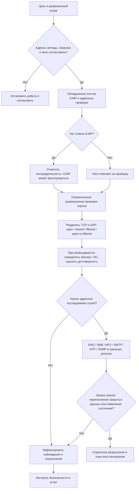

# Diagram — глава 04 «Активный сбор данных»

**Provenance:** canonical RAG `p0111:c01`–`p0154:c01`, PDF pp. 111–154. Концептуальная редакционная схема, не пересоздание изображения из книги.

## Смысл связей

**ICMP** обнаружение может давать ложные отрицательные результаты ([p0112:c01](../../../rag/chunks/p0101-p0200/p0112-c01.md)). **TCP/UDP** отличаются по логике ответа ([p0117:c01](../../../rag/chunks/p0101-p0200/p0117-c01.md)), **SYN и TCP Connect** — по установлению соединения ([p0120:c01](../../../rag/chunks/p0101-p0200/p0120-c01.md)), UDP `open|filtered` не означает гарантированный открытый порт ([p0121:c01](../../../rag/chunks/p0101-p0200/p0121-c01.md)). **Баннер** бывает намеренно изменён ([p0126:c01](../../../rag/chunks/p0101-p0200/p0126-c01.md)). **NSE** охватывает как инвентаризацию, так и агрессивные проверки ([p0128:c01](../../../rag/chunks/p0101-p0200/p0128-c01.md)). **DNS/SMB/NFS/SMTP/NTP/SNMP** дают разные классы сведений и разные риски раскрытия ([p0129:c01](../../../rag/chunks/p0101-p0200/p0129-c01.md)–[p0154:c01](../../../rag/chunks/p0101-p0200/p0154-c01.md)).

**Проверка/rollback при воздействии на сервисы:** [Needs confirmation] — источник не формулирует универсальную безопасную процедуру восстановления.
