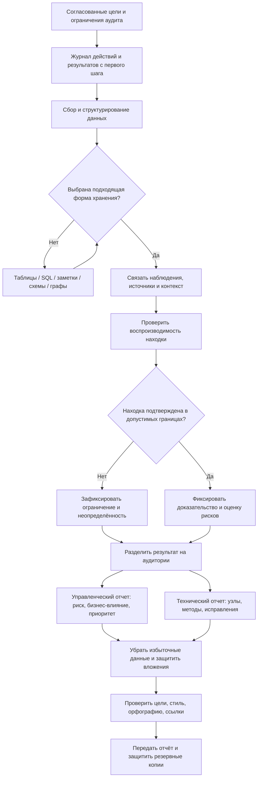

# Диаграмма главы 05: от сырого наблюдения до полезного отчёта

**Основание:** RAG `p0155:c01`–`p0184:c01`, особенно [p0155:c01](../../../rag/chunks/p0101-p0200/p0155-c01.md), [p0157:c01](../../../rag/chunks/p0101-p0200/p0157-c01.md)–[p0165:c01](../../../rag/chunks/p0101-p0200/p0165-c01.md), [p0167:c01](../../../rag/chunks/p0101-p0200/p0167-c01.md)–[p0177:c01](../../../rag/chunks/p0101-p0200/p0177-c01.md), [p0184:c01](../../../rag/chunks/p0101-p0200/p0184-c01.md).

Это **концептуальная схема на основе последовательности главы**, не официальный шаблон отчёта и не схема, непосредственно воспроизведённая из рисунка автора.

Важные разграничения:
- Данные ≠ интерпретация ≠ проверенная находка ([p0157:c01](../../../rag/chunks/p0101-p0200/p0157-c01.md), [p0177:c01](../../../rag/chunks/p0101-p0200/p0177-c01.md)).
- CVSS/оценка инструмента ≠ готовый приоритет исправления в конкретной организации ([p0177:c01](../../../rag/chunks/p0101-p0200/p0177-c01.md)–[p0181:c01](../../../rag/chunks/p0101-p0200/p0181-c01.md)).
- Руководитель и техническая команда требуют **разных уровней подробности** ([p0174:c01](../../../rag/chunks/p0101-p0200/p0174-c01.md)–[p0176:c01](../../../rag/chunks/p0101-p0200/p0176-c01.md)).
- Backup означает меры предосторожности с данными; универсальный rollback **[Needs confirmation]** ([p0184:c01](../../../rag/chunks/p0101-p0200/p0184-c01.md)).
